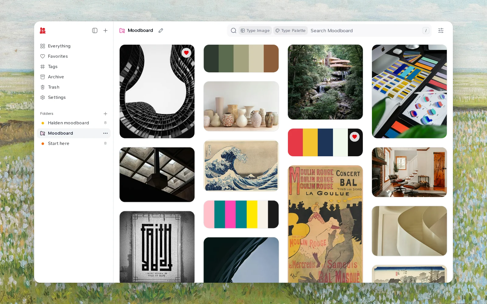
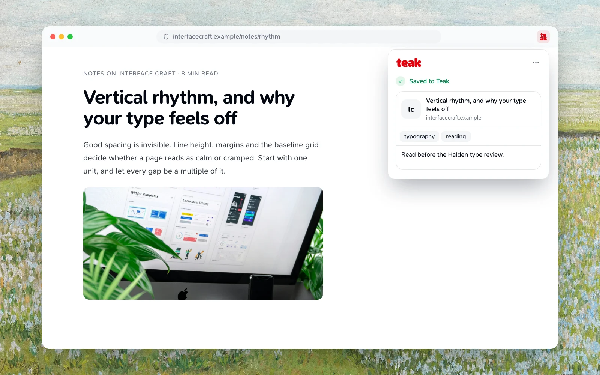

A moodboard is a set of references that agree on a feeling before anything is designed: the light, the materials, the type, the colors. Most of the work is collecting. The rest is noticing which pieces belong together.

Here's how I'd build one in Teak, from the first save to a board you can share with a client.

## 1. Collect without sorting

When you're gathering references, don't stop to file them. Save the thing and keep going.

- **From the browser:** click the Teak button, press `Alt+Shift+S`, or right-click and choose **Save Asset to Teak** to save just the image you're pointing at. On Instagram, Pinterest, X and a few other sites, Teak adds its own save button to each post.
- **From your computer:** drag images, videos, PDFs, even Figma files and design tokens into the library. Files up to 100 MB are fine.
- **From your phone:** use the share sheet, from Photos, Safari or any app.
- **Colors on their own:** paste a list of hex codes as a note and Teak saves it as a palette card.

Every new account already has a smart folder called **Moodboard**. It's a saved search for `type:image type:palette`, so every image and palette you save appears there on its own. For a quick board, that might be all you need.

## 2. Let Teak describe what you saved

You'll notice each card fill in a few seconds after you save it. For images, Teak:

- Pulls out up to five colors, keeping a small bright accent even when it covers only a sliver of the image.
- Writes a short summary and tags, in the language of what you saved.
- Judges its visual style: `minimal`, `dark`, `cinematic`, `typographic`, `3d`, `hand-drawn`, and others.
- Reads any words in it, so a screenshot of a poster is searchable by its headline.

You didn't have to tag anything, but now everything has tags.

## 3. Pull the board together by feel

This is where a board actually forms. A few searches I use all the time:

- **By color:** `teal`, or an exact `#2F3A2F`. Useful when a brand color is fixed and everything else has to sit beside it.
- **By style:** `minimal dark` or `hand-drawn`.
- **By mood:** `mood:"warm minimal interiors"` matches images by their look and description, so it finds the feeling even when no tag says it.
- **Leave things out:** `minimal -type:link` drops the links and keeps the rest.
- **More like this:** open the reference that's closest to what you want and choose **More like this** from its **⋯** menu. Teak lists the cards nearest to it in meaning, and the best ones are often references you'd forgotten about.

Combine them freely. `mood:"moody brutalist" -is:archived` is a perfectly good starting point for a board.

## 4. Keep the board

When you've found the set, give it a home:

- **A folder** holds the exact cards you picked. Select them, choose **More › Add to folder…**, and type a new name. Give the folder a color from its **…** menu so it's easy to spot. A card can live in several folders, so the same photo can sit on two boards.
- **A smart folder** keeps a search. Open **View** and choose **Save as smart folder…**, and the board fills itself as you save more references that match.

I usually do both: a smart folder while I'm exploring, then a regular folder for the final selection.

## 5. Review it with fresh eyes

Before a review, open the folder and choose **Shuffle** from the **View** menu. The same references in a new order show you which ones really carry the mood and which ones are just filling space. **Revisit** goes one card at a time if you want to trim: `→` keeps a card, `←` archives it.

Add a note to the folder's lead image explaining the direction, and type `[[` to link the two or three references that define it. When you come back to the project in six months, the reasoning is still there next to the pictures.

That's the whole workflow: save freely, let Teak describe, search by feel, then keep what agrees. The [features guide](/docs/features) has every search operator if you want to go further.
