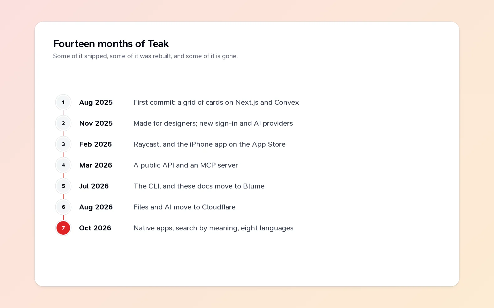
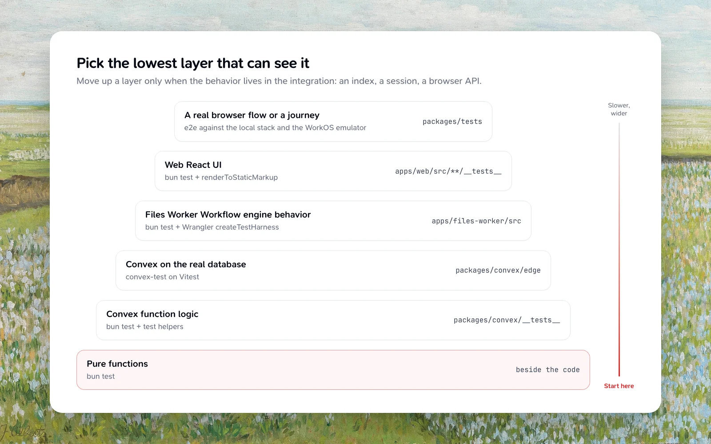

Teak's first commit was on August 10, 2025. Fourteen months later it runs on the web, iPhone, iPad, Mac, two browsers, Raycast, the command line and AI assistants, with Android on its way. All of it is built in the open, so every decision, including the ones I undid, is in the history.

Looking back through that history, the most useful lessons aren't in the features. They're in the reversals.

## I rebuilt more than I expected to

Some parts of Teak have been built three or four times:

- **Sign-in** went from Clerk to Better Auth in November 2025, then to WorkOS in October 2026. Three providers in fourteen months. The last move had a cost I couldn't avoid: password hashes couldn't be carried over safely, so everyone who signed in with a password had to reset it once.
- **Desktop** went from Tauri to Electron, and then the Electron app was deleted before it ever shipped. The Mac app that exists today is part of the native Apple app, written in SwiftUI.
- **Mobile** started as an Expo app and became native SwiftUI and Kotlin apps in October 2026.
- **AI** moved from OpenAI to Groq to Cloudflare Workers AI. **Page rendering** went from Cloudflare to another service and back to Cloudflare.
- **These docs** started on Fumadocs, moved to Starlight in May 2026, and to Blume in July.

It's tempting to read that list as a series of mistakes. I don't think it is. Each first choice got Teak to the next stage faster than the "right" choice would have. Expo got Teak onto the App Store in February 2026, long before I could have written two native apps. What I'd do differently is decide earlier which parts are foundations. Sign-in is a foundation. Moving it costs your users something, every time. A docs framework isn't; moving it costs only me.

## Native was worth it

The biggest single change this year was rewriting the mobile and desktop apps as native ones. It took a lot of work, and the result shows. Share sheets, Shortcuts, Spotlight, Quick Capture, the Services menu, Control Center: the things that make an app feel at home on a device are easy natively and a fight otherwise.

For a tool you open dozens of times a day, feeling at home matters more than I'd assumed.

## Quiet months happen

There's a month in Teak's history with no commits at all: April 2026. I won't pretend it was planned. The project was fine, and work picked up again in May.

If you're building something on your own, the gaps are part of it. What matters is that the project is easy to pick back up, which is mostly about writing things down. That's what the next lesson is about.

## Working with AI agents changed how I work

A lot of Teak this year was written with AI coding agents alongside me: Claude, Codex, Cursor and others, working in the same repository I do. They draft features, fix bugs, write tests, and open pull requests. A scheduled agent reads Teak's error reports every day, fixes what it can, and checks whether yesterday's fixes worked. It's never allowed to merge changes to sign-in, billing, the database schema or anything that deletes data on its own.

Working this way taught me one lesson above the others: a passing build is not proof.

An agent will tell you, confidently, that something works. Usually it does. Sometimes the tests pass and the feature is broken, because the tests checked the wrong thing. So Teak's rules now say every change ends with proof from the running app: launch it, use the feature the way a person would, look at the stored value, keep a screenshot. A bug fix starts by reproducing the bug. This applies to me as much as to any agent, and I'm a better engineer for it.

The other half is writing things down. Agents don't remember last week. So how Teak is built, run and tested lives in its [public docs](/docs/architecture), and each part of the repository has a short guide for whoever works on it next. That turned out to help people as much as agents.

## Roadmaps in phases

In October I planned three roadmaps as dozens of small phases: each one a single pull request, with its own proof, shipping to the API, MCP, the SDK and the CLI along with the apps. They brought search by meaning, folders and smart folders, Shuffle and Revisit, reading text in images, save by email, card links, highlights, eight languages and Firefox.

Not everything made it. RSS feeds were dropped from one roadmap and skipped again in the next. Stats, a rules engine and public share links were cut. The reader view was dropped once, then came back and shipped. Cutting things is easier when each phase stands alone, because nothing else is waiting on it.

## Generosity grew, not shrank

The free plan started at 25 cards. It's 200 now. Every roadmap this year carried the same rule: every feature is free on every plan, and Pro only adds room. I'd rather people get the whole of Teak and pay when it's earned a place in their day.

## What's next

More of the same, done better: making rediscovery feel effortless, getting Android onto Google Play, and writing here about what I learn. Everything that shipped is in the [changelog](/changelog), month by month.

Thanks for reading, and for saving things in Teak. It's been a good year.
