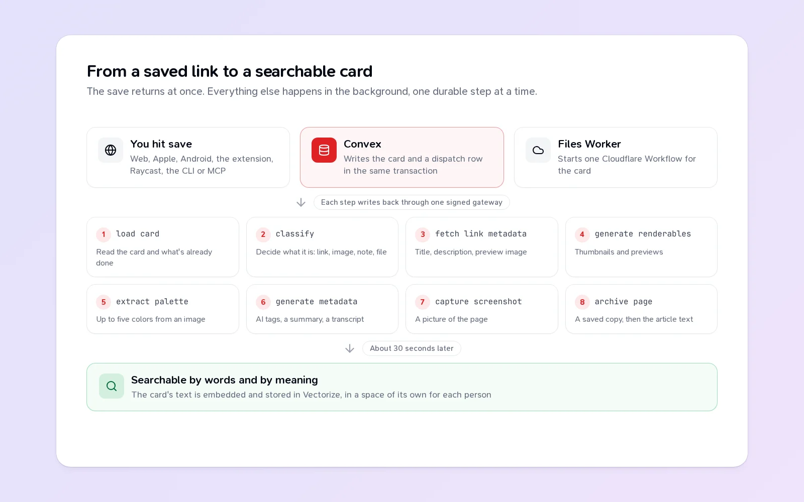

When you save a link in Teak, the card shows up right away, a little bare. A few seconds later it has a preview image, a title, tags, a summary, and a saved copy of the page. A moment after that, search can find it by meaning.

None of that happens while you wait. Here's what goes on in between, and a few lessons from building it.

## 1. The save

Every Teak app saves the same way. The web, iPhone, iPad, Mac and Android apps call the backend, which runs on [Convex](https://www.convex.dev). The browser extension, Raycast, the CLI, MCP and your own scripts go through the public API, which ends up in the same place. Either way, you're signed in through WorkOS, so the backend knows whose library the card belongs to.

The save does two things in one transaction: it writes the card, and it writes a row in a small outbox table that says "this card needs processing". Either both happen or neither does. There's no window where a card exists but nothing knows to process it.

That's the only work your save waits for. Everything after this point is in the background.

## 2. Handing off

Convex is good at data and terrible at heavy lifting. Downloading a 40 MB video or rendering a PDF doesn't belong there. So the outbox is flushed to a Cloudflare Worker, the Core Worker, which starts one durable [Workflow](https://developers.cloudflare.com/workflows/) for each card.

Resending is safe. If the same card is handed off twice, Teak sees that its Workflow already exists and counts it as started, so a retry never doubles the work.

## 3. The steps

A Workflow runs as named steps. Each step's result is saved, so if a step fails, the run picks up from there instead of starting over. For a link, the main ones are:

1. **Load card:** read the card and what's already been done.
2. **Classify:** decide what it is. A link, an image, a note, a document.
3. **Fetch link metadata:** the page's title, description and preview image, through a fetcher that refuses private and local addresses.
4. **Categorize:** is this an article, a recipe, a product, a podcast? That decides how it's marked done later: read, cooked, bought, listened.
5. **Generate renderables:** thumbnails and previews.
6. **Generate metadata:** AI tags and a summary, in the language of the page.
7. **Capture screenshot:** a picture of the page, and the words in it, so `text:` search can find them.
8. **Archive page:** a saved copy of the page, then the article text for Teak's reader.

Images get their colors pulled out. Audio and video get transcribed. A podcast page that links to its audio gets its episode found and transcribed too. The models all run on Cloudflare Workers AI, and decisions like "what type is this" come back as probabilities for a fixed set of answers, never free text, so the answer is always one Teak knows how to handle.

A code comment in that file says "Step names are durable history: never rename one." Workflows remember finished steps by name, so renaming a step would make every run in flight do it again.

## 4. Writing back

Each step writes its result to Convex through one signed gateway. Every write carries the run's processing revision. If you edit the card while it's processing, the revision changes, the older run's next write is refused, and that run ends quietly. A slow run can never overwrite something newer.

Files never pass through Convex. They live in a private R2 bucket, and Convex hands out signed links that the Core Worker checks before streaming a byte. Convex holds no storage or AI credentials at all.

## 5. Into search

About 30 seconds after a card changes, Teak turns its text, summary and tags into an embedding and stores it in Vectorize, in a namespace that belongs only to you. That's what lets `cozy reading nook` find a photo of an armchair. Edits within those 30 seconds push the deadline back, so a burst of changes costs one embedding. I wrote about how this part was built in [Inside a release: search by meaning](/blog/search-by-meaning).

## How it got here

This pipeline wasn't designed in one go. The first version, in August 2025, ran inside Convex: a background action kept files in Convex's own storage and called OpenAI for tags and summaries. In November 2025, AI moved to Groq and page rendering to a hosted browser service. In 2026, files moved to R2, AI moved to Workers AI, page rendering came back to Cloudflare, and finally, in October, the workflows themselves moved from Convex to Cloudflare Workflows.

That last move had plain reasons. Running every processing step in Convex was expensive, its workflow pool was limited in how many could run at once, and the work belonged next to the storage and models it used. Now Convex is the control plane: it knows what should happen. The Worker is where it happens.

If you want to read the real thing, the whole pipeline is open source. The [architecture guide](/docs/architecture) is the map.
