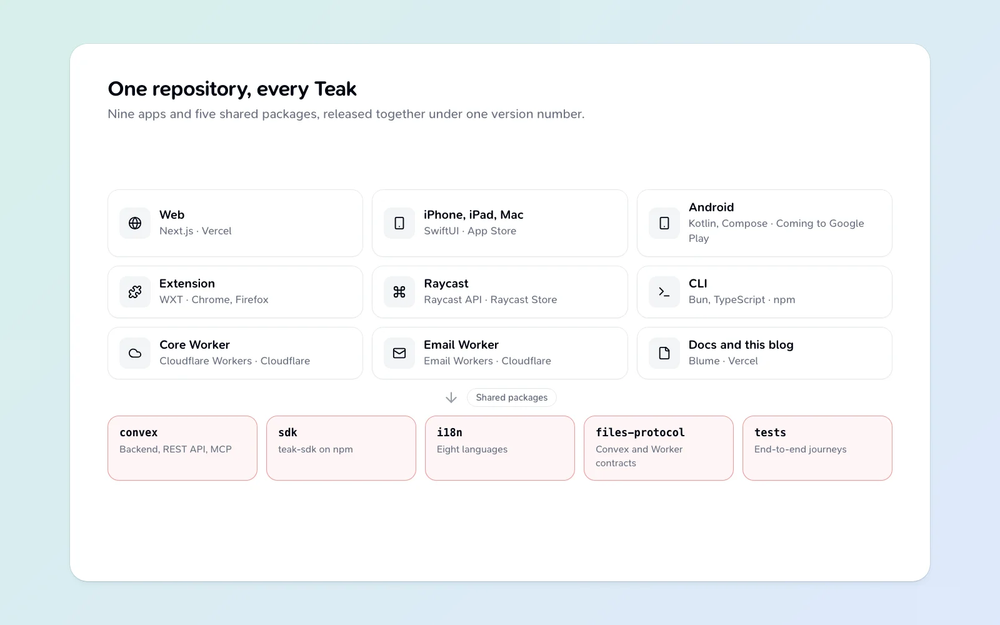

Teak runs in a lot of places: a web app, native apps for iPhone, iPad and Mac, an Android app on its way to Google Play, browser extensions for Chrome and Firefox, Raycast, a command-line tool, an MCP server for AI assistants, and two Cloudflare Workers behind them. One repository holds all of it, and every one of those pieces ships under the same version number.

Here's how that works, and why I'd do it again.

## What's in the repository

The repository has nine apps and five shared packages.

| App | Built with | Ships to |
| --- | --- | --- |
| Web | Next.js | Vercel |
| iPhone, iPad and Mac | SwiftUI | App Store |
| Android | Kotlin and Jetpack Compose | Coming to Google Play |
| Browser extension | WXT | Chrome Web Store, Firefox Add-ons |
| Raycast | Raycast API | Raycast Store |
| CLI | Bun and TypeScript | npm |
| Files Worker | Cloudflare Workers | Cloudflare |
| Email Worker | Cloudflare Email Workers | Cloudflare |
| Docs, and this blog | Blume | Vercel |

The packages are what they share: `convex` (the backend, the REST API and the MCP server), `sdk` (published as `teak-sdk`), `i18n` (every string in eight languages), `files-protocol` (the contracts between Convex and the Workers), and `tests` (end-to-end journeys).

Bun runs the JavaScript side, Turborepo runs tasks only where something changed, and one pre-commit hook typechecks, lints and builds whatever a commit touches.

## One version for everything

Every app and package moves in lockstep. A release starts with one command that sets the next version in every `package.json`, the Safari extension's manifest, the MCP registry file and the Apple project, then checks they all agree.

This sounds rigid, and it is. That's the point. When someone writes in about a bug, "which version are you on?" has one answer across every app. I never have to remember which version of the extension goes with which version of the backend.

Each platform still has its own runbook, because the App Store, Google Play, the Chrome Web Store and npm all want different things. But they all start from the same number.

## A feature lands everywhere, or it isn't done

The rule I care most about is parity. Anything you can do through Teak's public API, you can also do through MCP, the TypeScript SDK and the CLI, and they all ship in the same pull request.

A rule like that only holds if something checks it. A script lists every public API operation next to its MCP tool, SDK method and CLI command, or records why one is deliberately missing. Its test calls each one. Forget the CLI command for a new endpoint and the build fails before anyone has to notice.

The native apps follow a similar idea. Search parsing, for example, is written once in TypeScript and ported to Swift and Kotlin with the same test cases, so `tag:design -is:archived` finds the same cards on every device.

## Eight languages, one catalog

Teak's web app, extension and native apps speak English, Spanish, Brazilian Portuguese, German, French, Japanese, Korean and Simplified Chinese. Every string lives in one shared catalog, and the rule is simple: new English text goes into all seven other languages in the same pull request. A test fails when any catalog is missing a key, so a half-translated screen can't ship.

## Things that didn't survive

The repository didn't start this tidy. Mobile began as an Expo app in August 2025 and became native SwiftUI and Kotlin in October 2026. The desktop app went from Tauri to Electron to deleted, and the Mac became part of the native Apple app instead. The extension started on one framework and moved to WXT within its first month. At one point I flattened the whole monorepo into a single app, then split it back into `apps/` and `packages/` with Turborepo two months later.

Each of those moves was easier because everything was in one place. Moving mobile to native meant the new apps could read the same backend code, the same translation catalog and the same search tests on day one.

## Would I do it again?

Yes. One repository costs some tooling and some discipline. In return, every app sees every change, a feature can't quietly skip a platform, and a single pull request can change the backend, the web app, the extension and the CLI together, tested together.

If you want to look around, the code is on [GitHub](https://github.com/praveenjuge/teak), and the [architecture guide](/docs/architecture) explains how the pieces connect.
