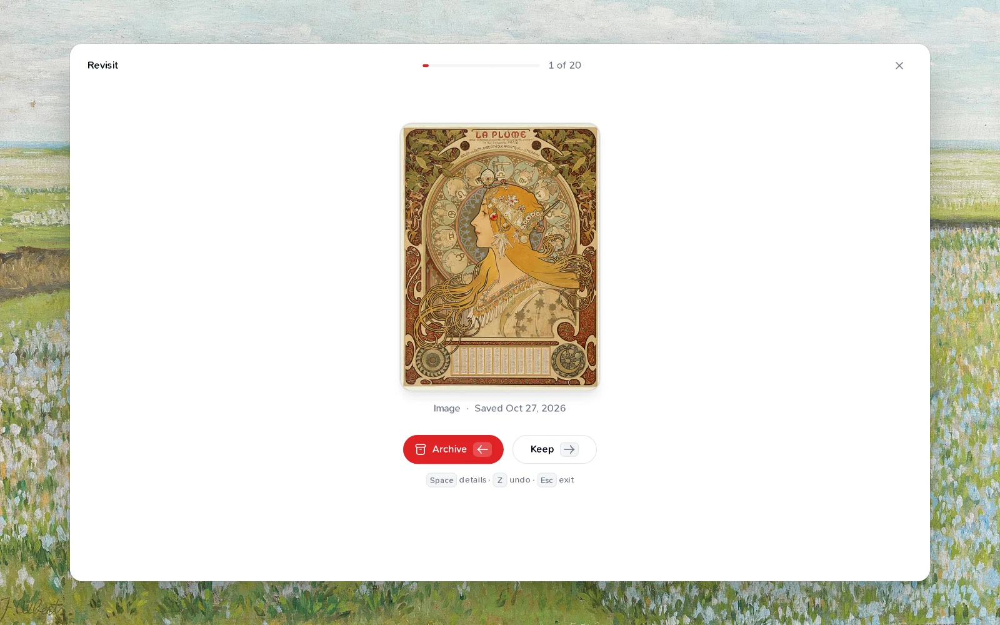

Most of us are good at saving things. We bookmark, screenshot, star, clip and forward all day. The problem shows up later: a library that only grows, where nothing comes back out.

I've come to think that saving is the easy half. The real work is rediscovery: getting an idea back at the moment it's useful, often long after you've forgotten you had it. Most of what I've built into Teak this year is about that second half.

There are three ways back to something you saved: you search for it, it finds you, or another card leads you to it.

## When you're looking for something

Search is the obvious one, but it fails in an obvious way: you rarely remember the exact words. You remember that a photo was moody, or blue, or had a spiral staircase in it. So Teak searches more than titles.

When you save something, Teak reads it and writes down what it finds: tags, a summary, the colors in an image, the words in a screenshot or a scanned PDF, the text of a document, and what's said in a video or podcast. Search covers all of that, so you can find:

- A receipt by its invoice number, with `text:4411`.
- An image by its color (`teal`, `#3B82F6`) or its look (`minimal`, `cinematic`, `hand-drawn`).
- A video by a line someone said in it.
- Images by a feeling: `mood:"moody brutalist"`.

Search also understands meaning, not only matching words. `cozy reading nook` finds a photo of an armchair by a window, and a search in Spanish finds cards saved in English. I wrote about how that works in [Inside a release: search by meaning](/blog/search-by-meaning).

When you find one good card, open its **⋯** menu and choose **More like this**. Teak lists the cards closest to it in meaning, of any type, which is often where the best references are hiding.

## When you're not looking

The ideas I'm most glad to find again are the ones I wasn't searching for. A library you only search can't surprise you, so Teak has two ways to resurface things.

**Shuffle**, in the **View** menu, shows your cards in a random order that holds still while you scroll. It works anywhere: your whole library, a tag, a folder, a search. I use it on a project folder before I start designing, to see the references with fresh eyes.

**Revisit** shows 20 random cards, one at a time. Press `→` to keep a card or `←` to archive it. It's a few minutes of tidying that brings back forgotten things and clears out what no longer matters. Archived cards aren't deleted; they just step out of the way.

## When one idea leads to another

Ideas rarely live alone. A note about a client project points at three references; an article you highlighted connects to a book you saved last year. So Teak lets cards point at each other.

Type `[[` in a note and pick a card. The link shows as a pill you can open, and the card you linked to lists **Linked from**, so the connection works in both directions.

When you save an article, Teak keeps a copy of the page and lets you read it in a calm layout. Select a passage and press `H` to highlight it. Highlights show in the card's details and come with you through the API and exports, so the part that mattered is the part you see first.

## Organizing, but only when it helps

None of this needs you to file anything when you save it. When you do want structure, it's there:

- **Folders** for projects, where a card can live in several at once.
- **Smart folders** that save a search and fill themselves. `is:todo folder:"Reading list"` is everything you haven't read yet.
- **Tags**, which Teak adds for you and you can rename or merge across every card at once.

I've stopped thinking of my library as an archive. It's closer to a garden: things grow in it, some come back around, and a little tending now and then keeps it alive. Teak's job is to make the coming back around happen.
