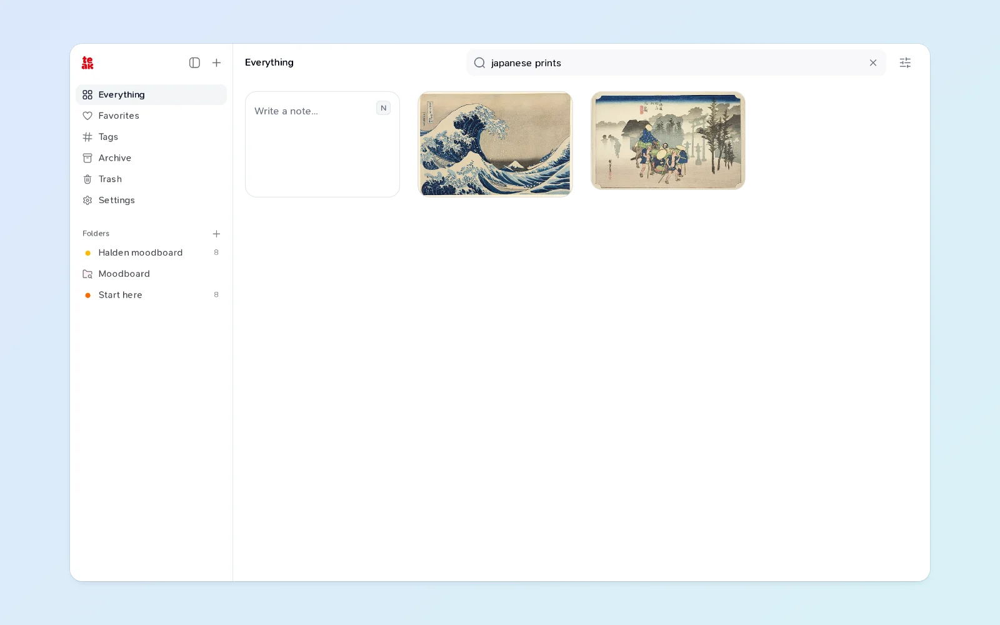
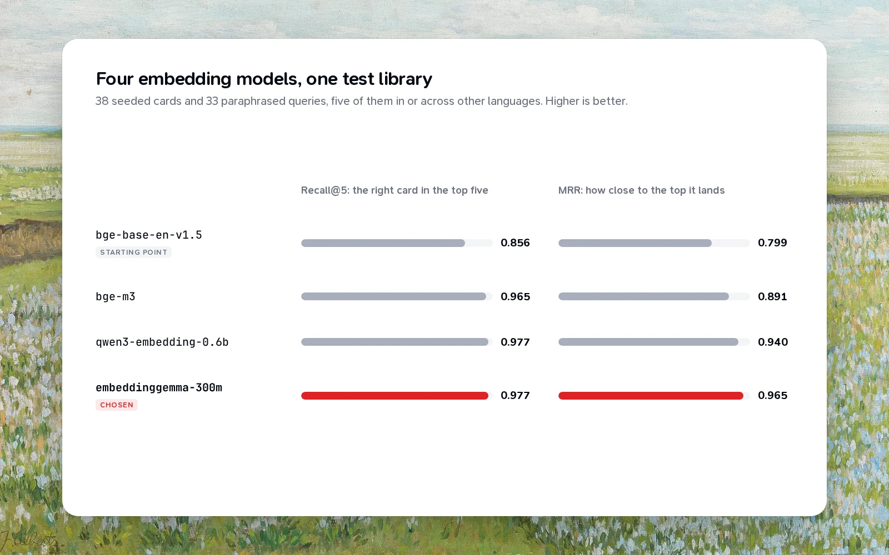

In December 2025 I wrote a positioning document for Teak. It compared Teak to other tools in a neat table, and one row said "AI-powered semantic search (coming soon)".

It stayed "coming soon" for almost ten months. In October 2026 it went from plan to shipped in four days. This is how it went, including the parts that didn't work the first time.

## Why it mattered

Teak already searched a lot: titles, descriptions, AI tags, the words in images, the text of documents. But all of that was keyword search. If you typed `cozy reading nook` and the photo was tagged `armchair` and `window`, you got nothing.

People don't remember the words they saved something with. They remember what it was about. Search that only matches words fails at the moment search matters most.

## Planning in phases

The work started as part of a larger roadmap, written on October 14 as 31 small phase plans. Three of them were for this feature:

1. Turn every card into an embedding, a list of numbers that captures its meaning.
2. Blend meaning matches into the existing search.
3. Use the same embeddings for **More like this** and searching images by mood.

Each phase was its own pull request, with its own proof that it worked in the running app, and each one shipped to the API, MCP, the SDK and the CLI at the same time as the web app.

## Choosing a model

Before writing any search code, I needed to pick an embedding model, and I didn't want to pick on reputation. So I built a small test: 38 cards from Teak's sample library, and 33 queries written the way people search, not the way the cards were titled, with the right answers marked by hand. Five of the queries were in Spanish, German, Hindi or Japanese, or mixed languages, because Teak's users don't all search in English.

Four models ran the same test. The English-only baseline missed most of the non-English queries. The other three were close on recall, but EmbeddingGemma put the right card nearest the top, ranking every query's first relevant card in the top three. It also has smaller vectors than the next best model.

It came with two costs I chose to accept. It's a beta model. And it reads at most 512 tokens, so a long card is embedded from its title, summary and opening rather than all of it. With a test set this small, small differences are noise, so I kept the tradeoffs written down where the next person to touch search will find them.

## Building it

Embeddings live in Cloudflare Vectorize, and each person's cards sit in a namespace of their own, so a search only ever looks inside your own library.

The fiddly part was keeping vectors in step with cards. People edit a note five times in a minute, add tags, rename things. Embedding on every keystroke would be slow and wasteful. So an edit marks the card as due about 30 seconds later, and every later edit pushes that back. A burst of edits costs one embedding. If a card is unchanged, nothing is sent at all.

Search then runs both ways at once. Cards that match your words appear immediately, and cards related by meaning join them a moment later, blended into one ranked list. Every filter you already knew still applies to both: `type:image`, `tag:`, `-is:archived`, and the rest.

## What broke

The first version embedded each card as soon as it was due. That was fine for one card, but importing a few hundred bookmarks fired a burst of requests at Vectorize, which answered with rate-limit errors. The fix was to batch: due cards are now claimed in groups and written together, so an import becomes a handful of requests instead of hundreds.

Older cards needed vectors too. A backfill worked through every existing library in the background, with a ledger to make sure nothing was missed and nothing was embedded twice.

## What shipped

The October changelog put it in one line: search understands what you mean. In practice:

- `cozy reading nook` finds the armchair by the window.
- A misspelled `typograhpy` still finds your type notes.
- A search in another language finds cards saved in English.
- **More like this** on any card shows the closest cards in meaning, of any type.
- `mood:"moody brutalist"` finds images by their look and description.

And "coming soon" finally came.

If you want the details, search operators and all, they're in the [features guide](/docs/features#smart-search).
