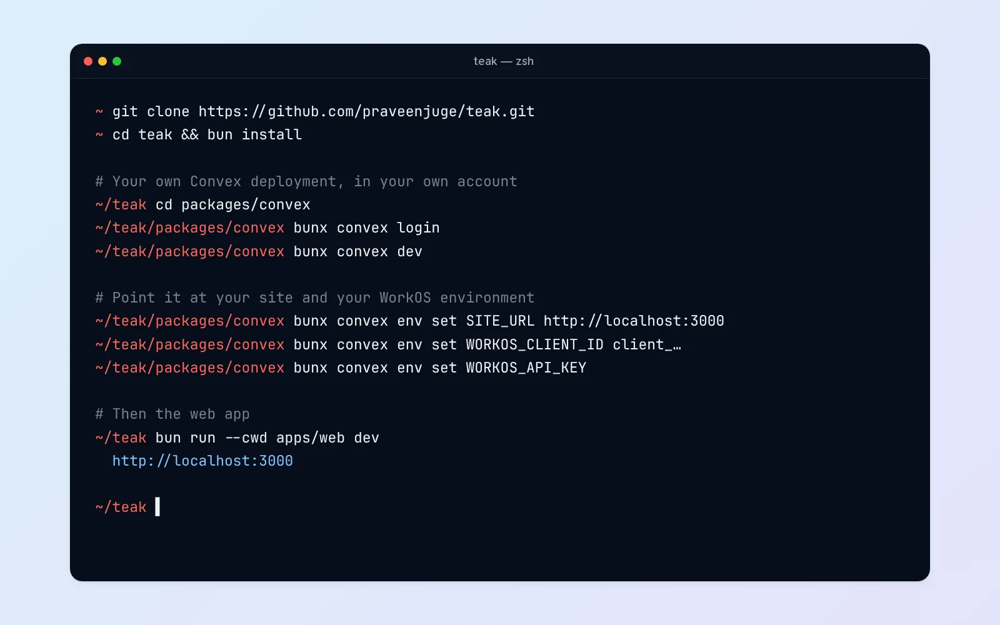

Teak has been MIT-licensed since August 2025, two weeks after its first commit. The whole thing, from the web app and native apps to the backend and the workers that process your cards, is on [GitHub](https://github.com/praveenjuge/teak) under the MIT license. You can read it, change it, and run your own copy.

This post is about that last part: what self-hosting Teak involves, and how to decide whether it's for you.

## Why it's open

A personal library holds a lot of you: what you're curious about, what you're working on, what you want to come back to. I think you should be able to see exactly how that's handled, and leave with all of it if you want.

Open source covers the first part. The second part doesn't need self-hosting at all: every account can export its whole library as a ZIP: the original files, a bookmarks file your browser can import, and a spreadsheet and JSON of every card. Self-hosting is for people who want to go further and own the servers too.

## What a self-hosted Teak runs

Self-hosted Teak is the same software as teakvault.com, on accounts you own.

You'll need:

- **A Convex deployment.** Your data, the backend functions, the REST API and the MCP server live here.
- **A WorkOS account.** Teak signs in only through WorkOS AuthKit, on every app.
- **A host for the web app.** It's a Next.js app, so Vercel or any Next.js host works.
- **Cloudflare, on Workers Paid,** for anything involving files or AI: storage in R2, thumbnails, screenshots, transcripts, tags and summaries, and search by meaning. You can start without it, but most of what makes Teak feel like Teak lives here.
- **Optional:** Polar if you want billing, and the Email Worker if you want save by email.

## Trying it locally

The quickest way to see it running is on your own machine:

1. Clone the repository and run `bun install`.
2. From `packages/convex`, run `bunx convex login` and `bunx convex dev`. Convex creates a development deployment in your account and prints its URLs.
3. Set your site URL and your WorkOS staging values with `bunx convex env set`. Leaving a value off makes it prompt for it, which keeps secrets out of your shell history.
4. Write `apps/web/.env.local` and run `bun run --cwd apps/web dev`.

The [self-hosting guide](/docs/self-hosting) has the full list of variables and the WorkOS settings to make, including the redirect URLs and the webhook that keeps accounts in sync.

One thing to know: the `bun run dev` and `bun run setup` commands you'll see in the [development guide](/docs/development) are for working on Teak itself, against Teak's shared development deployment. On your own deployment, run Convex and the web app directly, as above.

## Going to production

Production adds a few steps on top:

- **Name an admin.** Sign up your own account first, then promote it with one command.
- **Deploy the Files Worker** to Cloudflare with your own R2 bucket and files domain, and give it the same signing secret as Convex. Every upload and download goes through it.
- **Point everything at your domain:** `SITE_URL` on Convex, your WorkOS production environment, and the web app's environment.
- **Build and start** the web app.

The guide walks through each of these, including the Cloudflare queues, KV namespaces and Vectorize index the Files Worker expects.

## Should you?

Honestly, most people shouldn't, and that's fine. Self-hosting means you own the uptime, the secrets, the upgrades, and the bills from several services. Self-hosting is still marked beta, because the setup has more steps than I'd like.

Self-host if you want your library on infrastructure you control, if you're curious how a product like this fits together, or if you want to change Teak in ways that wouldn't make sense for everyone. The [pricing page](/pricing) calls it "same features, different headache level", and I still think that's fair.

If you just want Teak to work, the hosted version is the same software, and its free plan holds 200 cards. If you do run your own, I'd love to hear how it goes. Issues and pull requests are welcome on [GitHub](https://github.com/praveenjuge/teak).
