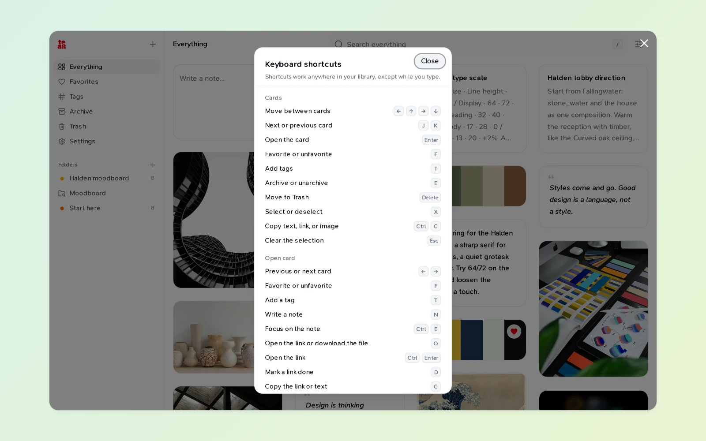

Some of my favorite parts of Teak don't have a button. Here are the ones I use every day, starting with the one that shows you the rest.

## In the web app

**Press `?`** anywhere in your library to see every keyboard shortcut. A few worth learning first:

- `/` jumps to search. `⌘K` (`Ctrl+K` on Windows and Linux) opens the command palette.
- `J` and `K` move between cards, and `Enter` opens one.
- `F` favorites the focused card, `T` adds a tag, and `E` archives it.
- `X` selects cards, so you can act on several at once.
- `G` then `F` goes to Favorites. `G` then `E` goes back to Everything. `A`, `T` and `S` after `G` go to Archive, Trash and Settings.
- In an open link, `D` marks it read, watched or done, and `R` switches between the page preview and Teak's reader.

**Type a place into search.** `fav`, `archive` or `trash` in the search box opens that page. Type it again to go back.

**Backspace removes a filter.** In an empty search box, `Backspace` removes the last filter pill, so you can peel a search back one step at a time.

**Paste many links at once.** Paste a list of links, one per line, and Teak saves each as its own card, up to 100 at a time.

**Tables in notes.** Type `/table` in a note for a table with a header row. `Tab` moves to the next cell.

**Undo in Revisit.** Archived the wrong card while tidying in Revisit? Press `Z`.

## Searching

**Find what's left to read.** `is:todo` lists the articles, films, products and recipes you haven't marked done. Save it as a smart folder and you have a reading list that empties itself.

**Search the words in images.** `text:"total due"` finds a receipt by what's printed on it.

**Hide cards without deleting them.** Tag a card `secret` or `hidden` and it leaves your library and search until you search for that tag.

## In the browser

**A keyboard shortcut to save.** `Alt+Shift+S` (`⌥⇧S` on a Mac) saves the page you're on in Chrome or Firefox, without opening the popup.

**Search from the address bar.** Type `teak`, press Space, then what you're looking for. Your top matches appear as suggestions, before you've opened Teak at all.

**Already saved?** The toolbar icon shows a check when the page you're on is already in your library.

## Without opening Teak

**Save by email.** Turn on **Settings → Integrations → Save by email**, then forward anything to `save@in.teakvault.com` from your sign-in address. A link becomes a link card, attachments become their own cards, and everything is tagged `email`.

**Quick Capture on the Mac.** Turn on the Quick Capture shortcut in the Mac app's settings, and `⌃⌥⌘T` opens a small window over any app for a note or a link. **Save to Teak** in the **Services** menu works on selected text, images and files.

**Shortcuts and Siri on iPhone.** Teak's actions are in the Shortcuts app, so "Search Teak" works by voice, and you can put **New Note** on the Action button or in Control Center.

**Raycast.** **Random Cards** brings back 20 shuffled cards from your library without leaving the keyboard.

**Share to the web app.** Install Teak from Chrome on Android or ChromeOS and it shows up in the system share sheet.

---

If you have a favorite I missed, tell me on [X](https://x.com/praveenjuge). The full list lives in the [features guide](/docs/features#keyboard-shortcuts).
