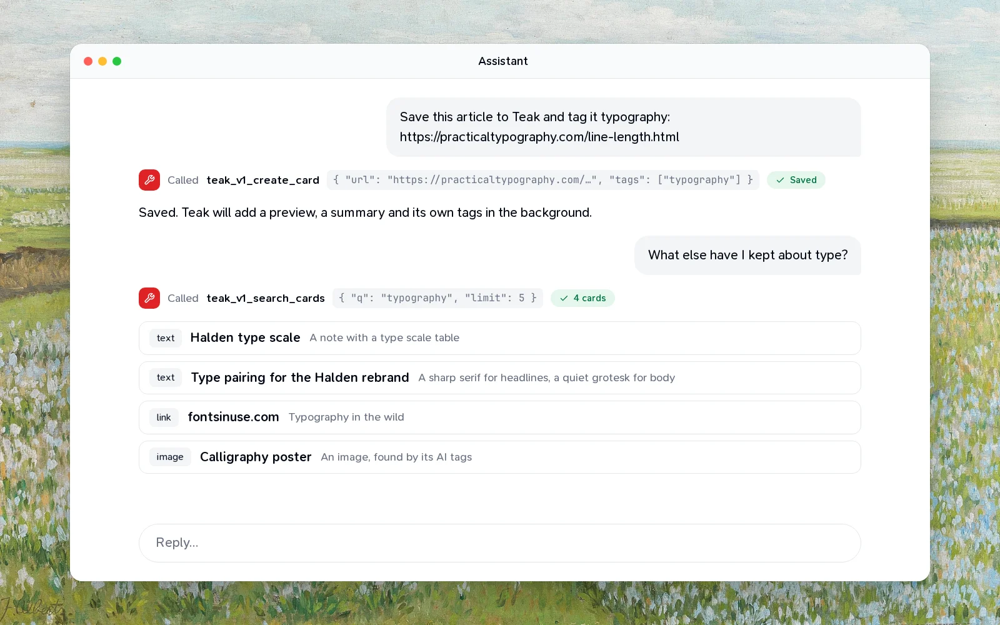
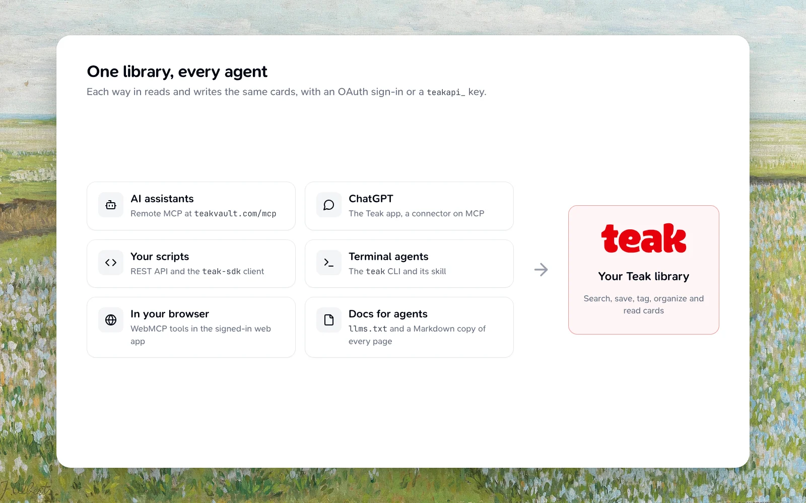
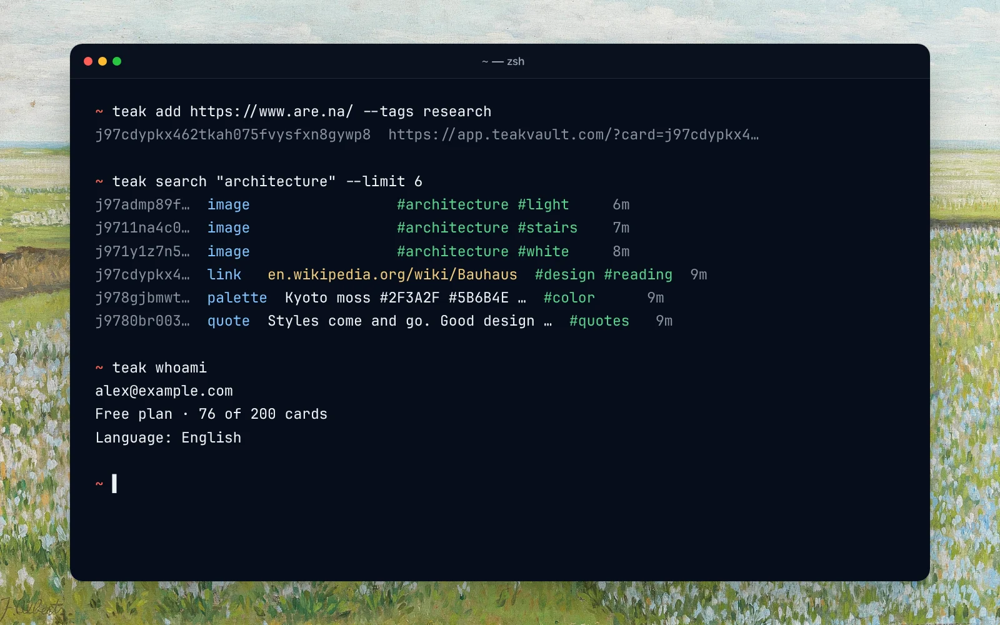

More and more of my research happens in conversation with an AI assistant. It's good at finding things, and bad at remembering them: when the chat ends, so does everything in it.

Teak is a good place for what's worth remembering. So I made sure an assistant can use it the same way I do. It can save a link you found together, search the references you collected last year, put cards in a folder, or read a PDF you saved, all with your permission and nothing more.

There are four ways in, and they all reach the same library.



## MCP, for assistants

The Model Context Protocol is how most AI assistants connect to outside tools. Teak runs a remote MCP server at `https://teakvault.com/mcp`, so there's nothing to install.

In Claude Code:

```bash
claude mcp add --transport http teak https://teakvault.com/mcp
```

In Codex:

```bash
codex mcp add teak --url https://teakvault.com/mcp
```

Cursor and VS Code have one-click install links in the [MCP guide](/docs/mcp#connect-your-client), and ChatGPT can add Teak as a custom connector.

The first time the assistant uses Teak, your browser opens and asks you to sign in and approve it. The assistant never sees your password, and it gets a token that works only for Teak's MCP server, nowhere else.

Once connected, the assistant has tools for nearly everything you can do in the app: list, search and fetch cards, find similar ones, create and update cards, favorite or archive them, read a document's full text or a video's transcript, manage tags and folders, and work with highlights. Each tool says whether it only reads, changes something, or deletes, so a careful client can ask you first before anything destructive.

Some things I ask an assistant to do with Teak:

- "Save this article and tag it `typography`."
- "What have I saved about onboarding flows? Summarize the three most useful."
- "Find my references for the Halden project and put them in a folder."
- "Read the PDF I saved last week and pull out the pricing table."

## The CLI, for the terminal

If you live in a terminal, or your agent does, the `teak` command does the same things:

```bash
npm i -g teak-cli
teak login
teak add https://example.com --tags research
teak search "blue buttons"
teak content <card-id>
```

`teak login` signs in through your browser, the same as MCP. For scripts and CI, set `TEAK_API_KEY` instead and skip the browser entirely. Add `--json` to any command for output a script can read.



`teak content` is the one I use most with agents: it prints a card's full text, so an agent can read a saved PDF, an article or a transcript and work with it.

## A skill, so agents know how

Connecting is half the job. An agent also needs to know how Teak works: that search takes `tag:` and `type:` filters, that saving a link twice moves it to the top instead of duplicating it, and which tool to reach for. That's what Teak's agent skill is for:

```bash
npx skills add praveenjuge/teak --skill teak
```

It teaches an agent to use Teak through whichever way in it has: MCP, the CLI, the API or the SDK.

## The API and SDK, for everything else

Under all of this is a REST API at `https://teakvault.com/api/v1`, with an OpenAPI description, and a TypeScript SDK, `teak-sdk`, with no runtime dependencies. If you're building your own integration, start with the [API quickstart](/docs/api-quickstart).

One rule keeps these in step: anything the API can do, MCP, the SDK and the CLI can do too, and a test fails the build if one of them falls behind.

## You stay in control

Every connection shows up in **Settings → Security → Connected apps**. Disconnect one and its access stops immediately, including any MCP session already open. API keys live in **Settings → Integrations**, up to ten at a time, and you can revoke any of them.


An assistant with a good memory is a lot more useful than one without. I'd rather that memory be a library I can see, search and clean up myself, and Teak is that library.
