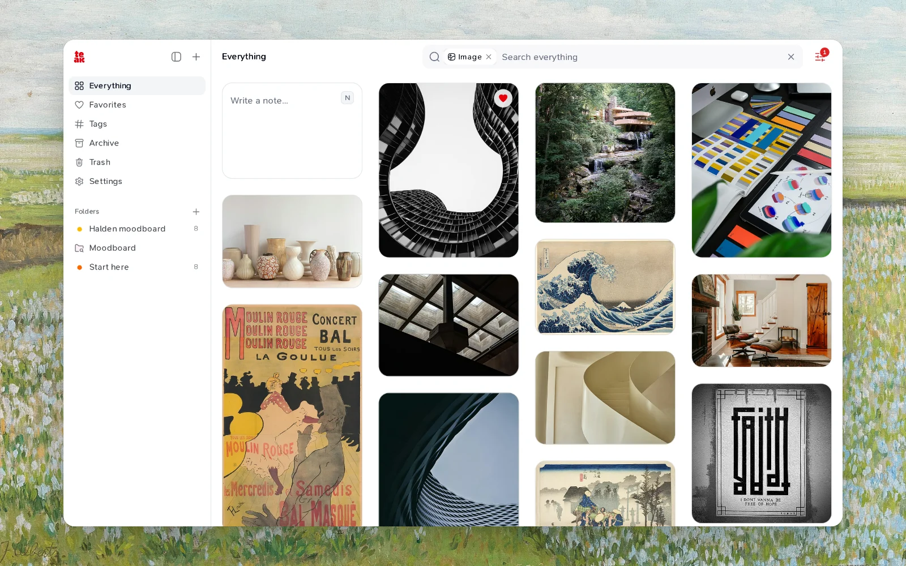

I'm a designer, and a lot of my work starts long before I open a design tool. It starts with a photo of a staircase, a poster in a shop window, a color palette someone shared, a sentence in an article that changes how I think about a layout.

For years, all of that lived in too many places. Screenshots in my camera roll. Bookmarks in three browsers. Pins on a board I stopped visiting. Notes in an app I only opened to write, never to read. When a project needed "that concrete building with the curved balconies", I knew I had saved it. I just couldn't find it.

Teak started on August 10, 2025, as a small grid of cards on my own machine. I wanted one place to drop things into, and one place to look when I needed them.

## Saving should take one click

The first thing I cared about was capture. If saving takes effort, you stop doing it, and the idea is gone.

So Teak tries to take whatever you have, wherever you are. Paste a link and it becomes a card. Drop an image, a PDF, a voice memo. Right-click on a web page and choose **Save Asset to Teak**. Forward an email. Press a shortcut in the browser. On the Mac, open a small Quick Capture window over any app. The rest of the work happens after you've moved on.

You don't have to file anything when you save it. No folder to pick, no tags to type. You can add them, but nothing breaks if you don't.

## Finding should take seconds

The second thing was rediscovery, and it turned out to be the harder half.

A pile of bookmarks is easy to build. What makes it useful is getting the right thing back when you need it, usually months later, usually without remembering what it was called. So Teak looks at what you save and describes it for you: tags, a short summary, the colors in an image, the words in a screenshot, what's said in a video. Search uses all of it.

Today you can type `minimal`, a color like `#3B82F6`, or a phrase like `cozy reading nook` and find images that never had those words attached. I wrote more about that in [You saved it, now what?](/blog/rediscovering-what-you-saved).

## Made for people who think in pictures

When I started, Teak was a general "personal knowledge hub". It still is, but by November 2025 I'd admitted who it was really for: people like me, who collect visual references and need to find them by how they look.

That shaped a lot of small decisions. The library is a masonry grid, so images keep their shape. Color palettes are cards of their own. Every image gets its colors pulled out, and search understands visual styles like `minimal`, `cinematic`, or `hand-drawn`. A smart folder called **Moodboard** comes with every new account, collecting every image and palette you save.

It's not only for designers. Researchers, developers, and people whose ideas arrive faster than they can put them away use it too. But the visual side is where Teak began, and it's still what I reach for every day.

## Calm, and yours

A few principles have held since the first version:

- **One library, everywhere.** The same cards on the web, iPhone, iPad, Mac, in the browser extension, Raycast, the command line, and AI assistants.
- **No feed, no ads, no social layer.** Teak is a private place. Nothing you save is shown to anyone else.
- **Every feature on every plan.** The free plan holds 200 cards. Pro removes the limit; it doesn't unlock features.
- **Open source.** The code is MIT-licensed on [GitHub](https://github.com/praveenjuge/teak), and you can [run your own copy](/blog/self-hosting-teak).

## What's next

This blog is where I'll write about how Teak works, how people use it, and what I'm learning along the way. If you've ever lost a reference you knew you'd saved, I built Teak for you. I hope it helps you find it.
