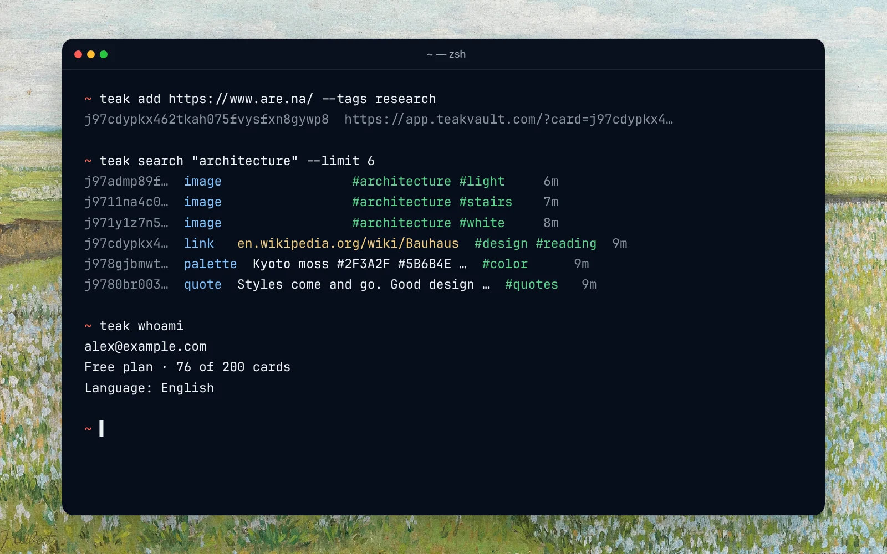
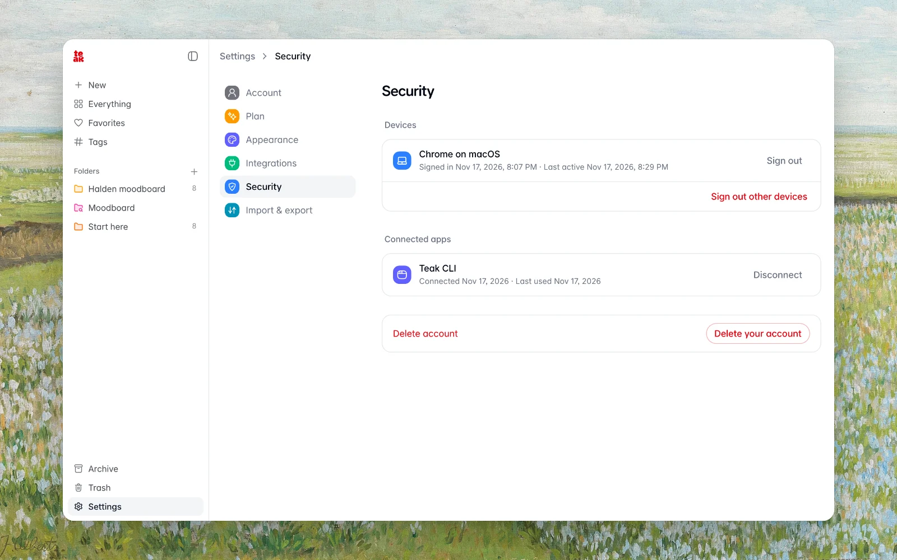

Save, search, tag, favorite, pin, update, delete, restore and export cards from your terminal.



## Install

```package-install
npm i -g teak-cli
```

This puts the `teak` command on your PATH. To try it without installing: `npx teak-cli@latest --help`.

## Authentication

<Tabs param="auth">
  <Tab title="Browser sign-in">
    Run:

    ```bash
    teak login
    ```

    Teak opens your browser; approve the CLI on the consent screen and return
    to the terminal. You stay signed in until you run `teak logout` or
    disconnect the app in Settings.

    `teak login --no-browser` prints the sign-in URL; open it on the same
    computer, since sign-in finishes on a local callback. In CI or a coding
    agent's shell, `teak login` always prints the link.
  </Tab>
  <Tab title="API key">
    Set `TEAK_API_KEY` to skip interactive sign-in in scripts and CI:

    ```bash
    TEAK_API_KEY=teakapi_... teak ls --json
    ```

    Or pass `--api-key -` to read it from standard input, out of your shell
    history (`teak --api-key - ls < key.txt`); a terminal prompts without
    echoing it.

    Create keys in **Settings → Integrations → API keys** ([API keys](/docs/api#authentication)).
  </Tab>
</Tabs>

`teak auth status` shows which account and credential the CLI is using. `teak whoami` shows your email, plan, cards used, and your Teak language (for example, `Language: Deutsch`).

```bash
teak logout
```

`teak logout` revokes browser sign-in and disconnects every CLI installation; reconnecting can take about 15 minutes. If the saved sign-in already expired, logout clears only this device and says so; disconnect other installations in **Settings → Security → Connected apps**. If the network fails, credentials stay saved; run `teak logout` again before signing in to revoke the old session. API keys are unaffected.



Credentials are stored per API deployment, so local development can't use or clear your production sign-in. With `--api-url` or `TEAK_API_URL`, `teak login` signs in to that deployment. The CLI is built on [`teak-sdk`](/docs/sdk).

## Commands

```bash
teak add "A note from the terminal" --tags research
teak add --url https://example.com --tags research,web
teak add --file ./screenshot.png --notes "Inspiration" --tags inspiration
teak add --file ./component.tsx --tags source
teak add "A line worth keeping" --source-url https://example.com/essay --source-title "An essay"
teak ls
teak search "blue buttons"
teak cards get <card-id>
teak open <card-id>
teak download <card-id> -o ./poster.png
teak cards update <card-id> --title "Homepage ideas" --tags design,reference
teak tags add <card-id> inspiration
teak tags remove <card-id> inspiration
teak fav <card-id>
teak unfav <card-id>
teak pin <card-id>               # pin to the top of the library (up to 12)
teak unpin <card-id>
teak cards pins                  # the pinned cards, first to last
teak cards pins order <id> <id>  # every pinned card's id, in the new order
teak done <card-id>
teak todo <card-id>              # not done yet
teak cards save-pdf <card-id>
teak rm <card-id>
teak trash
teak restore <card-id>
teak archive <card-id>
teak unarchive <card-id>
teak folders
teak folders add Reading <card-id>
teak refresh <card-id>
teak cards thumbnail <card-id> ./cover.png
teak cards thumbnail <card-id> --reset
teak content <card-id>
teak content <card-id> --kind article
teak highlights list <card-id>
teak highlights add <card-id> "a passage of the article" --note "why it matters"
teak links <card-id>
teak tags
teak tags rename Design design-systems --dry-run
teak tags rename Design design-systems --wait
```

Every card command lives under `teak cards`; common ones have top-level shortcuts with the same arguments: `ls`, `search`, `similar`, `trash`, `add`, `rm`, `restore`, `refresh`, `archive`, `unarchive`, `content`, `links`, `open`, `download`, `fav`, `unfav`, `pin`, `unpin`, `done` and `todo`. `teak ls` is `teak cards list`, `teak add` is `teak cards create`, `teak rm` is `teak cards delete` and `teak fav` is `teak cards favorite`. In every group, `rm` is short for `delete`, and `remove` takes something out of a card or folder without deleting it.

### Save

`teak add` detects what you give it: a URL becomes a link, a file path uploads that file, and other text becomes a note, quote or palette, as on the web. A link plus other words becomes a note mentioning it; text given with `--url` (`teak add "Read before Friday" --url https://example.com`) is saved with the link as the card's content. Pass `--url`, `--file` or `--type text` (or `quote`, `palette`, …) to be explicit. Structured Markdown stays a text card, as written. Files take the same formats and limits as [uploads](/docs/api#upload-files).

With no text, `--url` or `--file`, `teak add` saves what you pipe in (`pbpaste | teak add`). Piped text is always text, even if it names a file; `teak add --url` never reads standard input, so it's safe in a `while read` loop. `teak add` and `teak cards bulk` send an `Idempotency-Key`, so a retry never saves a card twice.

Saving a link already in Teak [re-saves that card](/docs/api#saving-a-link-again) and prints `Already in Teak, moved to the top: <card-id>` (`(already in Teak, moved to the top)` for a `teak cards bulk create` item). Tags and notes passed with it are ignored; use `teak cards update`. `--source-url` and `--source-title` record the page a text came from without making it a link; `teak cards get` shows it as `from:`.

`teak cards duplicate <url>` prints the ID of the card saving that link ([matched like the API](/docs/api#check-for-a-saved-url)), or exits with the not-found code, so scripts can check before saving.

### Read and edit

`teak cards get` shows a card's title, dates (with `saved again: <date>` for a re-saved link), a product's price, notes, tags, Teak's AI tags and summary, colors, file, transcript, and web link. `--json` adds the link's [saved copy](/docs/api#saved-copies-of-pages) as `archive`. `teak open` opens the card in your browser (or prints the link without one); `teak download` saves a file card's original (`--force` overwrites), and `-o -` writes it to standard output, as in `teak download <card-id> -o - | pdftotext - -`. A failed or stopped download leaves no partial file.

`teak content` prints a card's [full text](/docs/api#read-a-cards-text); `--kind article` prints a link's article as Markdown (never printed without it), and `--kind document`, `transcript` or `content` picks one kind. Truncated text adds a note on standard error; a card without that text exits with the not-found code.

`teak links` (also `teak cards links`) lists the cards a card [links to](/docs/api#links-between-cards) under **Links**, then those linking to it under **Linked from**, one per line as `<id>  <type>  <title>`; a missing card shows `(missing)`. To link, write `[[Title|teak:<card-id>]]` in a note, for example with `teak cards update <card-id> --content -`.

`teak cards update --tags` replaces the card's own tags, and `--content -` reads new content from standard input. `teak tags add` and `teak tags remove` change one card's tags without retyping the rest; `remove` also removes Teak's tags. `teak cards update <card-id> --add-color "#2A9D8F" --remove-color f50` changes a palette's colors (repeat either flag; removes apply first).

`teak refresh` [refreshes](/docs/api#refresh-a-cards-details) cards and returns at once; check later with `teak cards get`. `teak cards thumbnail <card-id> <file>` [replaces a link's image](/docs/api#replace-a-links-image), and `--reset` restores the one Teak found. `teak cards save-pdf` saves an arXiv link's paper as its own document card and prints its ID.

`teak tags rename <from> <to>`, `teak tags merge <from> <into>`, and `teak tags delete <tag>` [change a tag on every card](/docs/api#rename-merge-and-delete-tags). Each prints the change's ID and returns at once; `--wait` waits, or check with `teak tags status <id>`. `--dry-run` only counts the cards with the tag (Archive and Trash change too but aren't counted). `teak tags delete` asks first, naming that count, or takes `--yes`.

### Trash

`teak rm` trashes cards, `teak restore` brings them back, and `teak trash` lists them. `teak rm --permanent` deletes for good (trashing first if needed); it asks in a terminal and needs `--yes` in scripts. `rm`, `restore`, `archive` and `unarchive` send up to 100 cards per request.

Both take several IDs and try each, printing what worked, then on stderr each failed ID and why, the failure count, and a command to retry those. `--json` adds a `failed` array and a `summary`. Any failure exits non-zero.

### Archive

`teak archive` and `teak unarchive` move cards in and out of Archive; `teak ls --archived` lists them. Like `teak rm`, both take several IDs.

### Hidden cards

[Hidden cards](/docs/features#hidden-cards) stay out of `teak ls` and `teak search` until you search their tag: `teak search "#secret"` or `teak ls --tag hidden`. Their lines end with `hidden`, `--json` includes `isHidden`, and `teak cards get` still shows them.

### Folders

`teak folders` lists your folders with card counts, and `teak folders get <folder>` shows one. `teak folders create <name> --color blue` creates one, `teak folders rename <folder> <name>` renames it (`--color` recolors, `--color none` clears), and `teak folders delete` (or `rm`) deletes folders but not their cards, asking first or needing `--yes`. `teak folders add <folder> <card-ids...>` and `teak folders remove <folder> <card-ids...>` change a folder's contents. Name folders by name (case-insensitive) or ID; `teak ls --folder <folder>` lists the cards.

A manual folder can have [rules](/docs/features#folder-rules): `teak folders rules Fonts --auto-tag type --auto-file 'tag:typography'` tags every card put in Fonts `type` and files cards matching the search into it. `--auto-tag` repeats and replaces the tags, `--no-auto-tags` and `--no-auto-file` clear them, and `--pause` and `--resume` stop and restart the search; `teak folders create` takes `--auto-tag` and `--auto-file` too. Saving rules runs them over your cards: `--wait` waits, `teak folders rule-run Fonts` shows progress, and `teak folders undo-rule-run Fonts` reverts it within a day. `teak folders` shows each folder's rules after its name.

A smart folder saves a search and lists its matches: `teak folders create "Design links" --query 'tag:design type:link'` makes one, and `teak folders rename "Design links" --query 'tag:design'` changes its search. `teak folders` shows a dash and its search instead of a count. `teak folders add` refuses smart folders.

### Highlights

`teak highlights list <card-id>` lists a link's [highlights](/docs/api#highlights) in article order, one per line as `<id>  <quote>`, with the note indented below. `teak highlights add <card-id> "<quote>"` highlights a passage by its text; `--note` adds a note, and `--prefix` or `--suffix` picks a later repeat. `teak highlights note <id> "<text>"` changes a note, `--clear` removes it, and `teak highlights delete <ids...>` (or `rm`) deletes highlights and notes, asking first or taking `--yes`. A card without a saved article exits with `NO_ARTICLE`, and a quote not in the article with `QUOTE_NOT_FOUND`.

### Filter and page through cards

`teak ls`, `teak search`, `teak trash`, `teak cards favorites`, and `teak cards pins` accept these filters:

| Option | Filter |
| --- | --- |
| `--type <type>` | Card type. Repeat to match any of several. |
| `--tag <tag>` | Exact tag. Repeat to match any of several. |
| `--favorited` / `--trashed` / `--archived` | Favorites only / Trash only / Archive only |
| `--pinned` | Pinned cards only, first to last |
| `--folder <folder>` | Cards in one folder, by name or ID |
| `--style <style>` | Visual style, such as `minimal` or `vintage`. Repeatable. |
| `--hue <hue>` | Color family, such as `blue` or `neutral`. Repeatable. |
| `--hex <color>` | Exact color, such as `#112233`. Repeatable. |
| `--date <phrase>` | When it was saved: `today`, `last week`, `march 2026`, `2026-01-01 to 2026-02-01` |
| `--created-after` / `--created-before` | A date such as `2026-01-01` (midnight UTC), a date and time such as `2026-01-01T09:30:00Z`, an age such as `30m`, `2h`, `3d` or `1w` (that long ago), or a millisecond timestamp. Anything else is a usage error (exit code 2). |
| `--mode hybrid\|keyword\|semantic` | How search text matches: words and meaning (the default), words only, or meaning only. When meaning search is unavailable, the CLI prints `mode: keyword` to stderr (`searchMode` with `--json`). |
| `--sort newest\|oldest\|relevance\|shuffle` | Order. `relevance` (Best match, with `--query`) puts the best matches first; the CLI prints `relevance: unranked` when it couldn't score them. |
| `-n, --limit <number>`, `--next <cursor>` | Paging. While more remain, the CLI prints `Next page: --next <cursor>` to stderr (`pageInfo.nextCursor` with `--json`); pass it back to continue. |
| `--seed <number>` | Shuffle's seed, to repeat an order. Without it, `--sort shuffle` picks one and prints it (`seed` in `--json` output). For a shuffle's next page, pass `--sort shuffle`, its seed and the cursor together, such as `--sort shuffle --seed <number> --next <cursor>`: a cursor works only with the seed that issued it. |
| `--include content,metadata,processing` | Extra fields (`content` by default) |
| `-a, --all` | Fetch every page, up to 10,000 cards. Longer listings stop there, say so, and print `Next page: --next <cursor>` to continue. |

```bash
teak ls --type image --type link --hue blue --date "last month"
teak search "homepage" --tag design --all --json > cards.json
```

Search text takes the same qualifiers and operators as [search on the web](/docs/features#smart-search). Quote the whole search for your shell; a search starting with `-` goes after `--`, or the CLI reads it as a flag and says so:

```bash
teak search 'site:github.com tag:design "design system"'
teak search 'folder:"Reading list" is:fav'
teak search 'lamp price:>20 price:<100'
teak search 'text:"total due"'
teak search 'design -tag:old'
teak search '(site:github.com OR site:gitlab.com) -is:archived'
teak search -- -tag:old
teak search "cozy reading nook" --mode semantic
teak similar <card-id> --type link
```

`teak similar <id>` (or `teak cards similar <id>`, or `--similar-to <id>` on any listing) lists the cards closest in meaning to a card, with the same filters.

### Export

```bash
teak export -o teak-backup.zip
```

`teak export` starts a ZIP [export](/docs/export) of every card and original file. `--wait` waits (`--timeout 30m` changes how long; default 10 minutes), and `-o` waits and saves the ZIP (`-o -` to standard output); if the file exists, it stops before starting unless you add `--force`. `teak export status` shows progress, and `teak export download` saves the latest ready export. You can start one export every 7 days.

### Sync and bulk edits

```bash
teak cards changes --since 1d --json
teak cards bulk update --file updates.json --dry-run
teak cards bulk update --file updates.json
```

`teak cards changes` lists cards [changed](/docs/api#sync-changes) since a time (`--since` takes the same forms as `--created-after`, such as `2026-01-01` or `1d`), one per line, then a `deleted <card-id>` line per card trashed or permanently deleted. More pages print `Next page: --next <cursor>` to stderr.

`teak cards bulk` runs one of the [API's bulk operations](/docs/api#bulk-actions) on up to 100 items, read from `--file` (`-` or no `--file` reads standard input) as a JSON array or an `{"items": [...]}` object. `--dry-run` checks locally that each item has its operation's fields (a `cardId`, `isFavorited` for `favorite`, `tags` for `addTags`…) and exits 2 naming each item that would fail; Teak still checks the rest, such as whether the card exists. Successes print card IDs on stdout, failures their errors on stderr, then the failure count. Any failure exits non-zero.

### Waiting

`--wait` on `teak export`, `teak tags rename`, `merge`, `delete` and `status`, and `teak folders rules`, `rule-run` and `undo-rule-run` waits for the work to finish. After 10 minutes, or `--timeout` (such as `90s`, `30m` or `1h`), it exits with code 1 and prints the command to check on it; the work keeps going. Ctrl+C does the same, exiting 130.

### Global options

| Option | Purpose |
| --- | --- |
| `--json` | Machine-readable output |
| `--fields <names>` | With `--json`, keep only these keys, such as `--fields id,url,tags`. In a listing it applies to each card and keeps the paging. |
| `--api-key <key>` | Use an API key for this command, or `-` to read it from standard input. Prefer `TEAK_API_KEY` or `-`: a key passed as a flag stays in your shell history and other processes can see it |
| `--api-url <url>` | Point at another API, such as a self-hosted or development deployment (same as `TEAK_API_URL`) |
| `-v, --version` | Print the version |

### Getting help

`--help` on any command shows its options and examples; `teak --help` also lists exit codes and environment variables. `teak help --search` finds a command by what it does, and `--json` gives every command's arguments, options and examples as data. Help never signs in or makes requests.

```bash
teak --help
teak add --help
teak help --search "move to trash"
teak help --json
teak cards list --help --json
```

### Shell completion

`teak completion bash`, `zsh` or `fish` prints a script that completes commands and options:

```bash
echo 'eval "$(teak completion bash)"' >> ~/.bashrc
teak completion zsh > "${fpath[1]}/_teak"
teak completion fish > ~/.config/fish/completions/teak.fish
```

## Output Format

Standard output holds only the answer: the cards, the ID or the JSON. Status, warnings, the next page and errors go to standard error, as does `teak login`'s sign-in link.

In a terminal, a listing has a header row, then one card per line in aligned, truncated columns: ID, type, the start of the text (the file name for a photo, video, recording or document), up to four tags and time since last saved (a re-saved link restarts at `1m`). Piped, there's no header and each line holds the fields in full, tab-separated: ID, type, text, tags (comma-separated), creation time in ISO UTC, and `hidden` for a hidden card. Piped, `teak tags` prints `<name><tab><count>`.

Human output drops control characters from saved text and errors (escape sequences that could retitle your terminal, hide text or write to the clipboard); `--json` keeps them, escaped.

```bash
teak ls --tag design | cut -f1
```

`--json` on any command gives JSON for `jq` or other tools. An empty listing prints a short message such as `No cards match that search.` to stderr and nothing to stdout, so a pipe stays empty; `--json` still prints the empty list.

```bash
teak search "buttons" --json | jq '.items[].url'
teak ls --json --fields id,url
```

An unknown `--fields` name is a usage error listing the available ones. After a command that changes something, the result still prints and the CLI only warns on stderr.

An error is a headline, any request ID to quote to [Support](/docs/support), and what to do next, such as `Card not found: <card-id>` followed by how to find a card's ID. In a terminal it starts with `✗`, and a warning with `!`. With `--json` it's one line on stderr: `{"error":{"code","reason","message","next","requestId","status"}}`, with `retryAt` when Teak says when to retry. A mistyped option or command is a `USAGE` error. When several values are wrong, the CLI names each before making any request, and `--json` lists them in `problems`.

`reason` is one stable word for scripts and agents to branch on:

| Reason | Meaning |
| --- | --- |
| `invalid_usage` | An unknown command or option, or a bad value |
| `missing_input` | A required argument or value is missing |
| `confirmation_required` | The command can't be undone and needs `--yes` where no one can answer its question |
| `login_required` / `login_failed` | Not signed in or the key was refused / sign-in didn't complete |
| `not_found`, `conflict`, `forbidden`, `limit_reached`, `invalid_input` | Teak refused the request: nothing there, the library is in another state, not allowed, a limit was reached, or a value Teak can't take |
| `rate_limited`, `network`, `timed_out`, `unavailable`, `server` | Slow down, check the connection, the request or wait timed out, Teak is busy, or Teak failed |
| `cancelled` | Stopped with Ctrl+C or a signal |
| `config`, `unknown` | The CLI is set up wrong, or something unexpected went wrong |

### Exit codes

| Code | Meaning |
| --- | --- |
| `0` | Success |
| `1` | The request failed, a `--wait` timed out, or some items in a batch failed |
| `2` | Usage: an unknown command or option, a bad value, or a missing `--yes` |
| `3` | Not signed in, or the API key was refused |
| `4` | Not found |
| `5` | Rate limited |
| `130` | Stopped with Ctrl+C (`143` when terminated, `129` when the terminal closed) |

A stopped `--wait` says the work continues and how to check it; a stopped change says what was already sent may still finish.

### Scripts, CI and agents

The CLI asks only when someone can answer. With `CI` set, or in a coding agent's shell (`CLAUDECODE`, `CURSOR_AGENT`, `GEMINI_CLI`, `CODEX_SANDBOX` or `AI_AGENT`), it never prompts, opens a browser or shows tips: a command that would ask, such as `teak rm --permanent`, needs `--yes` instead. In a terminal, some commands print a next step on success, such as `Open it with: teak open <card-id>` after `teak add`.

When Teak is briefly busy (`429`, `502`, `503` or `504`) or the network drops, the CLI retries reads up to twice, waiting as long as Teak asks (up to 5 seconds), before reporting the error.

### Updates

At most daily, in a terminal, the CLI checks npm for a newer `teak-cli` and prints the update command if there is one. It sends nothing about you or your library, never installs anything, and is skipped with `--json`, when output is piped, in CI and in coding agents' shells. Set `TEAK_NO_UPDATE_CHECK=1` to turn it off.

## Troubleshooting

<Accordion>
  <AccordionItem title="teak: command not found">
    - Confirm the global install: `npm ls -g teak-cli`
    - Make sure your npm global bin directory is in your `PATH`.
  </AccordionItem>
  <AccordionItem title="Login opens the browser but never completes">
    - Check your internet connection.
    - Try again; the local callback port may have been in use.
    - Or use `TEAK_API_KEY` with a key from Settings.
  </AccordionItem>
  <AccordionItem title='Commands return "Unauthorized"'>
    - Run `teak login` to refresh your session.
    - With `TEAK_API_KEY`, check the key is still active in Teak Settings.
  </AccordionItem>
  <AccordionItem title="Still stuck?">
    See [Support](/docs/support).
  </AccordionItem>
</Accordion>
