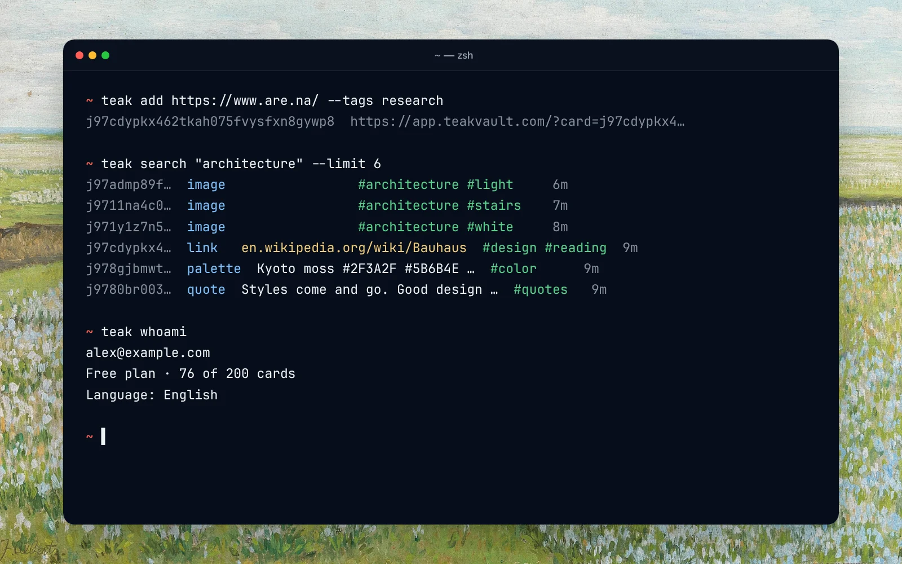
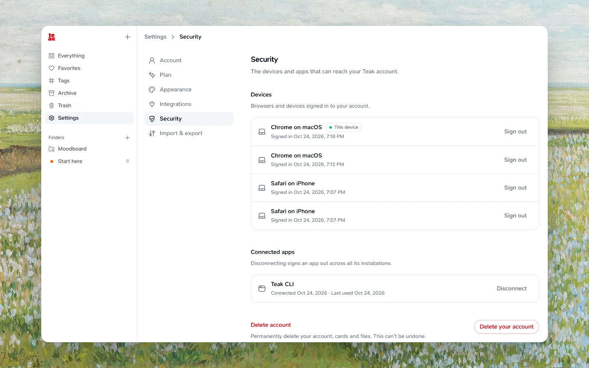

The Teak CLI lets you save, search, tag, favorite, pin, update, delete, restore, and export cards without leaving your terminal.



## Install

```package-install
npm i -g teak-cli
```

After installing globally, the `teak` command is available on your PATH. To try it without installing: `npx teak-cli@latest --help`.

## Authentication

<Tabs param="auth">
  <Tab title="Browser sign-in">
    Run:

    ```bash
    teak login
    ```

    Teak opens your browser to authorize the CLI. Approve the request on the
    consent screen, then return to the terminal. You stay signed in until you
    run `teak logout` or disconnect the app in Settings.

    `teak login --no-browser` prints the sign-in URL instead of opening it.
    Open it in a browser on the same computer, because sign-in finishes on a
    local callback.
  </Tab>
  <Tab title="API key">
    Set `TEAK_API_KEY` to skip interactive sign-in in scripts and CI:

    ```bash
    TEAK_API_KEY=teakapi_... teak ls --json
    ```

    Create keys in **Settings → Integrations → API keys** ([API keys](/docs/api#authentication)).
  </Tab>
</Tabs>

Check which account and credential the CLI is using with `teak auth status`. `teak whoami` shows your email, plan, how many cards you've used, and the language you chose in Teak's Settings (for example, `Language: Deutsch`).

```bash
teak logout
```

`teak logout` revokes browser sign-in and disconnects every CLI installation; reconnecting can take about 15 minutes. If the saved sign-in has already expired, logout clears only this device and says so — disconnect other installations in **Settings → Security → Connected apps**. If the network fails, credentials stay saved; run `teak logout` again before signing in so Teak can revoke the previous session. API keys are unaffected.



Credentials are stored separately for each API deployment, so local development can't use or clear your production sign-in. With `--api-url` or `TEAK_API_URL`, `teak login` signs in to that deployment. The CLI is built on [`teak-sdk`](/docs/sdk).

## Commands

```bash
teak add "A note from the terminal" --tags research
teak add --url https://example.com --tags research,web
teak add --file ./screenshot.png --notes "Inspiration" --tags inspiration
teak add --file ./component.tsx --tags source
teak add "A line worth keeping" --source-url https://example.com/essay --source-title "An essay"
teak ls
teak search "blue buttons"
teak cards get <card-id>
teak open <card-id>
teak download <card-id> -o ./poster.png
teak cards update <card-id> --title "Homepage ideas" --tags design,reference
teak tags add <card-id> inspiration
teak tags rm <card-id> inspiration
teak fav <card-id>
teak pin <card-id>               # pin to the top of the library (up to 12); --remove unpins
teak cards pins                  # the pinned cards, first to last
teak cards pins order <id> <id>  # every pinned card's id, in the new order
teak done <card-id>
teak done <card-id> --undo
teak cards save-pdf <card-id>
teak rm <card-id>
teak trash
teak restore <card-id>
teak archive <card-id>
teak unarchive <card-id>
teak folders
teak folders add Reading <card-id>
teak refresh <card-id>
teak cards thumbnail <card-id> ./cover.png
teak cards thumbnail <card-id> --reset
teak content <card-id>
teak content <card-id> --kind article
teak highlights list <card-id>
teak highlights add <card-id> "a passage of the article" --note "why it matters"
teak links <card-id>
teak tags
teak tags rename Design design-systems --wait
```

### Save

`teak add` works out what you give it: a URL becomes a link, a file path uploads that file, and other text becomes a note, quote or palette, as on the web. A link followed by other words is saved as a note that mentions it, and text given with `--url` (`teak add "Read before Friday" --url https://example.com`) is saved with the link as the card's content. Pass `--url`, `--file` or `--type text` (or `quote`, `palette`, …) to be explicit. Structured Markdown always stays a text card, stored exactly as written. Files take the same formats and limits as [uploads](/docs/api#upload-files).

With no text, `--url` or `--file`, `teak add` saves what you pipe into it (`pbpaste | teak add`). Piped text is always saved as text, even when it names a file, and `teak add --url` never reads standard input, so it's safe inside a `while read` loop. `teak add` and `teak cards bulk` send an `Idempotency-Key`, so a retried request never saves a card twice.

Saving a link that's already in Teak [re-saves that card](/docs/api#saving-a-link-again) instead of making a second one, and prints `Already in Teak, moved to the top: <card-id>` (`(already in Teak, moved to the top)` for a `teak cards bulk create` item). Tags and notes passed with it are ignored; change them with `teak cards update`. `--source-url` and `--source-title` keep the page a text came from without making it a link; `teak cards get` shows it as `from:`.

`teak cards duplicate <url>` prints the ID of the card that saves that link ([matched like the API](/docs/api#check-for-a-saved-url)), or exits with the not-found code, so a script can check before saving.

### Read and edit

`teak cards get` shows a card's title, dates (with `saved again: <date>` when its link was saved again), a product link's price, notes, tags, Teak's AI tags and summary, colors, file, transcript, and a link to open it on the web. With `--json` it also includes the link's [saved copy](/docs/api#saved-copies-of-pages) as `archive`. `teak open` opens the card in your browser (or prints the link on a machine without one), and `teak download` saves a file card's original file (`--force` replaces an existing file).

`teak content` prints a card's [full text](/docs/api#read-a-cards-text) so you can pipe it to other tools; `--kind article` prints a link's article as Markdown, and `--kind document`, `transcript` or `content` picks one kind. Without `--kind` it never prints an article. When the text was cut, a note goes to standard error, and a card without that text exits with the not-found code.

`teak links` (also `teak cards links`) lists the cards a card [links to](/docs/api#links-between-cards) under **Links**, then the cards that link to it under **Linked from**, one per line as `<id>  <type>  <title>`; a missing card shows `(missing)`. To link cards, write `[[Title|teak:<card-id>]]` in a note, for example with `teak cards update <card-id> --content -`.

`teak cards update --tags` replaces the card's own tags, and `--content -` reads the new content from standard input. `teak tags add` and `teak tags rm` change one card's tags without retyping the rest; `teak tags rm` also removes tags Teak added. `teak cards update <card-id> --add-color "#2A9D8F" --remove-color f50` changes a palette's colors (repeat either flag; removes apply first).

`teak refresh` [refreshes](/docs/api#refresh-a-cards-details) one or more cards and returns right away; check the result later with `teak cards get`. `teak cards thumbnail <card-id> <file>` [replaces a link's image](/docs/api#replace-a-links-image), and `--reset` goes back to the one Teak found. `teak cards save-pdf` saves an arXiv link's paper as its own document card and prints its ID.

`teak tags rename <from> <to>`, `teak tags merge <from> <into>`, and `teak tags delete <tag>` [change a tag on every card](/docs/api#rename-merge-and-delete-tags). Each prints the change's ID and returns right away; add `--wait` to wait for it, or check later with `teak tags status <id>`. `teak tags delete` asks first, or takes `--yes` in scripts.

### Trash

`teak rm` moves cards to Trash, and `teak restore` brings them back. `teak trash` lists what's there. `teak rm --permanent` deletes cards in Trash for good: it asks first in a terminal, and needs `--yes` in scripts.

Both accept several card IDs and try every one. They list the IDs that failed and why (a `failed` array with `--json`) and exit with a non-zero code if any did.

### Archive

`teak archive` and `teak unarchive` move cards into and out of Archive, and `teak ls --archived` lists them. Like `teak rm`, both accept several IDs and report the ones that failed.

### Hidden cards

[Hidden cards](/docs/features#hidden-cards) stay out of `teak ls` and `teak search` until you search for their tag: `teak search "#secret"` or `teak ls --tag hidden`. Their lines end with `hidden`, `--json` includes `isHidden`, and `teak cards get` still shows them.

### Folders

`teak folders` lists your folders with how many cards each holds, and `teak folders get <folder>` shows one. `teak folders create <name> --color blue` creates one, `teak folders rename <folder> <name>` renames it (`--color` changes its color, and `--color none` clears it), and `teak folders rm` deletes folders without deleting their cards. `teak folders add <folder> <card-ids...>` and `teak folders remove <folder> <card-ids...>` change what's in a folder. Name a folder by its name (ignoring case) or its ID, and list its cards with `teak ls --folder <folder>`.

A manual folder can have [rules](/docs/features#folder-rules): `teak folders rules Fonts --auto-tag type --auto-file 'tag:typography'` gives every card put in Fonts the tag `type` and files cards that match the search into it. `--auto-tag` repeats and replaces the folder's tags, `--no-auto-tags` and `--no-auto-file` clear them, and `--pause` and `--resume` stop and restart the search. `teak folders create` takes `--auto-tag` and `--auto-file` too. Saving rules runs them over your cards: add `--wait` to wait for it, `teak folders rule-run Fonts` shows how far it got, and `teak folders undo-rule-run Fonts` takes it back within a day. `teak folders` shows each folder's rules after its name.

A smart folder saves a search and lists whatever matches it: `teak folders create "Design links" --query 'tag:design type:link'` makes one, and `teak folders rename "Design links" --query 'tag:design'` changes its search. `teak folders` shows a dash instead of a count for a smart folder, followed by its search. Smart folders don't take cards, so `teak folders add` refuses them.

### Highlights

`teak highlights list <card-id>` lists a link's [highlights](/docs/api#highlights) in article order, one per line as `<id>  <quote>`, with the note indented below. `teak highlights add <card-id> "<quote>"` highlights a passage found by its text; `--note` adds a note, and `--prefix` or `--suffix` picks a later repeat. `teak highlights note <id> "<text>"` changes a note, `--clear` removes it, and `teak highlights rm <ids...>` removes highlights. A card without a saved article exits with `NO_ARTICLE`, and a quote the article doesn't have with `QUOTE_NOT_FOUND`.

### Filter and page through cards

`teak ls`, `teak search`, `teak trash`, `teak cards favorites`, and `teak cards pins` accept these filters:

| Option | Filter |
| --- | --- |
| `--type <type>` | Card type. Repeat to match any of several. |
| `--tag <tag>` | Exact tag |
| `--favorited` / `--trashed` / `--archived` | Favorites only / Trash only / Archive only |
| `--pinned` | Pinned cards only, first to last |
| `--folder <folder>` | Cards in one folder, by name or ID |
| `--style <style>` | Visual style, such as `minimal` or `vintage`. Repeatable. |
| `--hue <hue>` | Color family, such as `blue` or `neutral`. Repeatable. |
| `--hex <color>` | Exact color, such as `#112233`. Repeatable. |
| `--date <phrase>` | When it was saved: `today`, `last week`, `march 2026`, `2026-01-01 to 2026-02-01` |
| `--created-after` / `--created-before` | Millisecond timestamps, such as `1767225600000`. Anything else is a usage error (exit code 2). For dates, use `--date`. |
| `--mode hybrid\|keyword\|semantic` | How the search text finds cards: words and meaning (the default), words only, or meaning only. When meaning search is unavailable, the CLI prints `mode: keyword` to stderr (`searchMode` with `--json`). |
| `--sort newest\|oldest\|relevance\|shuffle`, `--limit`, `--cursor` | Order and paging. `relevance` (Best match, with `--query`) puts the best matches first; the CLI prints `relevance: unranked` when it couldn't score them. |
| `--seed <n>` | Shuffle's seed, to get the same order again. Without it, `--sort shuffle` picks one and prints it (with `--json`, as `seed` in the output). To get the next page of a shuffle, pass `--sort shuffle`, its seed, and the cursor together, for example `--sort shuffle --seed <n> --cursor <cursor>`: a cursor works only with the seed that issued it. |
| `--include content,metadata,processing` | Extra fields (`content` by default) |
| `--all` | Fetch every page |

```bash
teak ls --type image --type link --hue blue --date "last month"
teak search "homepage" --tag design --all --json > cards.json
```

The search text takes the same qualifiers and operators as [search on the web](/docs/features#smart-search). Quote the whole search for your shell; a search that starts with `-` goes after `--`, or the CLI reads it as a flag and says so:

```bash
teak search 'site:github.com tag:design "design system"'
teak search 'folder:"Reading list" is:fav'
teak search 'lamp price:>20 price:<100'
teak search 'text:"total due"'
teak search 'design -tag:old'
teak search '(site:github.com OR site:gitlab.com) -is:archived'
teak search -- -tag:old
teak search "cozy reading nook" --mode semantic
teak similar <card-id> --type link
```

`teak similar <id>` (or `teak cards similar <id>`, or `--similar-to <id>` on any listing) lists the cards closest in meaning to a card, with the same filters.

### Export

```bash
teak export -o teak-backup.zip
```

`teak export` starts a ZIP [export](/docs/export) of every card and original file. Add `--wait` to wait for it, or `-o` to wait and save the ZIP; when that file already exists, the CLI stops before starting unless you add `--force`. `teak export status` shows progress, and `teak export download` saves the latest ready export. You can start one export every 7 days.

### Sync and bulk edits

```bash
teak cards changes --since 1767225600000 --json
teak cards bulk update --input updates.json
```

`teak cards changes` lists cards [changed](/docs/api#sync-changes) since a millisecond timestamp, one per line, then a `deleted <card-id>` line for each card moved to Trash or permanently deleted. When there are more, it prints `nextCursor: <cursor>` to stderr; pass it back with `--cursor`.

`teak cards bulk` runs one of the [API's bulk operations](/docs/api#bulk-actions) on up to 100 items, read from `--input` or standard input as a JSON array or an `{"items": [...]}` object. The output lists each item's card ID or error, and the command exits with a non-zero code if any item failed.

### Global options

| Option | Purpose |
| --- | --- |
| `--json` | Machine-readable output |
| `--api-key <key>` | Use an API key for this command. Prefer `TEAK_API_KEY`: a key passed as a flag stays in your shell history and other processes can see it |
| `--api-url <url>` | Point at another API, such as a self-hosted or development deployment (same as `TEAK_API_URL`) |

### Getting help

Run any command with `--help` to see available options:

```bash
teak --help
teak add --help
teak search --help
```

## Output Format

By default, commands print human-readable output. Add `--json` to any command for JSON, for piping into `jq` or other tools. With `--json`, standard output holds only JSON: `teak --json login` prints its sign-in link to standard error.

A listing with nothing in it prints a short message such as `No cards match that search.` to stderr and nothing to stdout, so a pipe stays empty; `--json` still prints the empty list.

```bash
teak search "buttons" --json | jq '.items[].url'
```

When Teak is briefly busy (`429`, `502`, `503` or `504`) or the network drops, the CLI reads again up to twice, waiting as long as Teak asks (up to 5 seconds), before it reports the error.

## Troubleshooting

<Accordion>
  <AccordionItem title="teak: command not found">
    - Confirm the package installed globally: `npm ls -g teak-cli`
    - Make sure your npm global bin directory is in your `PATH`.
  </AccordionItem>
  <AccordionItem title="Login opens the browser but never completes">
    - Check your internet connection.
    - Try again in case the local callback port was already in use.
    - As a fallback, use `TEAK_API_KEY` with a key from Settings.
  </AccordionItem>
  <AccordionItem title='Commands return "Unauthorized"'>
    - Run `teak login` to refresh your session.
    - If using `TEAK_API_KEY`, confirm the key is still active in Teak Settings.
  </AccordionItem>
  <AccordionItem title="Still stuck?">
    Reach out via [Support](/docs/support).
  </AccordionItem>
</Accordion>
