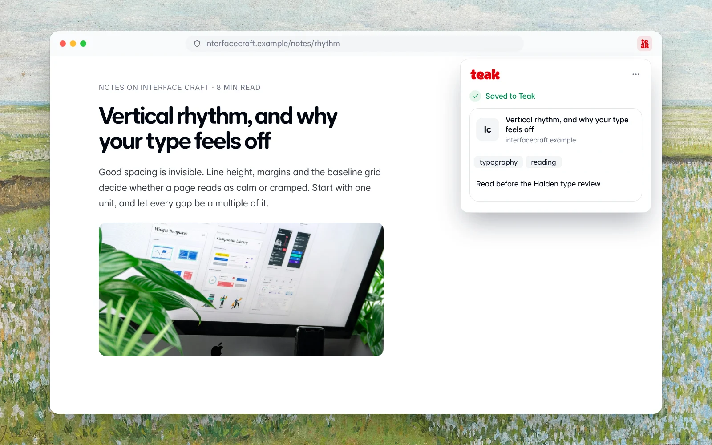

The Chrome and Firefox extension saves pages, images, links, selected text and social posts. The Safari extension, included with the Teak app for [Mac](/docs/mac) and [iPhone and iPad](/docs/mobile), saves the current page.



## Install for Chrome and Chromium

Works in Chrome, Edge, Brave, Arc and other Chromium browsers.

<Steps>
  <Step title="Edge users: allow other stores">
    In Edge, open `edge://extensions` and turn on **Allow extensions from other stores**.
  </Step>
  <Step title="Add Teak">
    Open [Teak in the Chrome Web Store](https://chromewebstore.google.com/detail/teak/negnmfifahnnagnbnfppmlgfajngdpob), click **Add to Chrome** (or your browser's equivalent), and confirm.
  </Step>
  <Step title="Sign in">
    Click the Teak toolbar icon and choose **Sign in**.
  </Step>
</Steps>

## Install for Firefox

Same features as Chrome; needs Firefox 140 or later.

<Steps>
  <Step title="Add Teak">
    Open [Teak on Firefox Add-ons](https://addons.mozilla.org/firefox/addon/teak/), click **Add to Firefox**, review what Teak can access and sends (pages and text you save, their addresses, your searches), and click **Add**.
  </Step>
  <Step title="Sign in">
    Click the Teak toolbar icon and choose **Sign in**.
  </Step>
</Steps>

For private windows, open `about:addons`, choose Teak, and set **Run in Private Windows** to **Allow**. In always-private Firefox, Teak forgets your sign-in and unsent saves on close, and the popup says so.

## Safari

The Safari extension uses the Teak app's sign-in and saves the current page; everything else here is Chrome and Firefox only.

- **Mac:** in Teak's **Settings › General**, choose **Open Safari Settings…** and turn on **Teak** under **Extensions**, then click **Teak** in Safari's toolbar.
- **iPhone and iPad:** in Safari, tap the address bar's extensions button, choose **Manage Extensions**, and turn on **Teak**. Then tap **Teak** in that menu.

If asked to sign in, choose **Sign In**, finish in the Teak app, and try again.

## Auto-save on open

Opening the popup saves the current page and shows its icon, title, site, and whether it was saved, already in your library, or can't be saved.

A page already saved shows **Already in your Teak** and moves to the top, leaving Archive if needed (see [Saving something again](/docs/features#saving-something-again)). Safari says **Saved to Teak** either way.

For a local file up to 100 MB, choose **Upload file** in the popup's **⋯** menu. Firefox uses a small Teak window instead, since it closes the popup when a file picker opens.

### Add tags and a note after saving

Then the popup shows **Add tags** and **Add a note**, prefilled for a card already in your library.

- Type a tag and press Enter or comma; your most used and recent tags are suggested. Tags are up to 64 characters.
- They save on Enter, leaving the field, or closing the popup. If saving fails, the popup keeps your text and offers **Retry**.

## Chrome and Firefox features

### Save with a shortcut

**Alt+Shift+S** (**⌥⇧S** on Mac) saves the current tab without the popup. The Teak icon shows the result:

| Icon | Means |
| ---- | ----- |
| **…** | Saving |
| **✓** | Saved, or already in Teak and moved to the top |
| **!** | Couldn't save; hover the icon to see why. It clears after a few seconds |

Signed out or at your free plan limit, the popup opens instead. Pages Teak can't save, such as `chrome://` pages and add-on stores, show **!**.

To change the shortcut (**Save this page to Teak**), open `chrome://extensions/shortcuts` (or your browser's equivalent), or in Firefox open `about:addons`, click the gear, and choose **Manage Extension Shortcuts**.

### Already in Teak

Signed in, the Teak icon shows **✓** (tooltip **Already in Teak**) when the current page is in your library, including Archive but not Trash. Answers are cached for five minutes, so a just-deleted card can keep its **✓** that long. Private windows and browser pages such as `chrome://` and `about:` are never checked.

### Context menu

Right-click on a page:

| Menu item | What it saves |
| --- | --- |
| **Save Page to Teak** | The current page |
| **Save Text to Teak** | The selected text, as a text card that links back to its page (a selection that's only a URL is saved as a link) |
| **Save Asset to Teak** | An image, video, audio file or other file; on a link to a web page, the link |

The popup opens to show the save; in browsers that can't open it from the menu, such as Chrome before version 127, the save still happens.

Teak doesn't download local, private-network, `file:` or `blob:` addresses; use **Upload file** for files on your computer.

### Address bar search

Type `teak`, Space or Tab, then your search in the address bar.

- After two characters, your top five matches appear with title, type and site; choose one to open it in Teak.
- Enter opens the full search in Teak; Alt+Enter (⌘+Enter on Mac) opens it in a new tab.
- Filters such as `#design`, `type:image` or `site:example.com` work; hidden cards never appear.
- Signed out, the suggestion reads **Sign in to Teak to search**.

Teak doesn't keep what you type in the address bar.

### Save buttons on social sites

Signed in, Teak adds a save button to each post on Instagram, Pinterest, X, Hacker News, Sidebar and HeyDesigner. They need access to websites; in Firefox you can turn that off under Teak's **Permissions and data** in `about:addons`, and the toolbar button still works.

### Language

Signed in, the popup, menus, suggestions and save buttons follow your [Teak language](/docs/features#language).

### Free tier limit

:::info[Free plan: 200 cards]
At your free plan card limit, the extension popup shows an upgrade prompt instead of saving. **Upgrade to Pro** opens **Settings → Plan** in Teak. Pro has [unlimited cards](/pricing).
:::

## Sign in

In Chrome and Firefox, choose **Sign in** in the popup and approve Teak in your browser. Sign-in survives restarts and renews in the background; you sign in again only if it was disconnected. **Sign out** is in the popup's **⋯** menu, under your email.

Signing out disconnects the extension in every browser it's installed in; reconnecting can take about 15 minutes. If the saved sign-in already expired, only this browser signs out, and the popup says so; disconnect the others in Teak **Settings → Security → Connected apps**. If the network fails, your sign-in and interrupted saves are kept; retry or discard them from the popup.

## Build from source

The extension is open source; store packages are built from the repository's release tags. To build the same package:

<Steps>
  <Step title="Install the toolchain">
    Install Git, and Bun and Node.js at the versions pinned in the repository's `package.json` (`packageManager` and `engines.node`).
  </Step>
  <Step title="Check out a release">
    ```bash
    git clone https://github.com/praveenjuge/teak.git
    cd teak
    git checkout v<version>
    bun install --frozen-lockfile
    ```
  </Step>
  <Step title="Build against production">
    ```bash
    export VITE_PUBLIC_CONVEX_URL=https://uncommon-ladybug-882.convex.cloud
    export VITE_PUBLIC_CONVEX_SITE_URL=https://uncommon-ladybug-882.convex.site
    export VITE_PUBLIC_API_URL=https://teakvault.com/api
    bun run --cwd apps/extension build:firefox   # or: build, for Chrome
    ```

    The Firefox build lands in `apps/extension/.output/firefox-mv3` and matches the Firefox Add-ons package file for file. Each GitHub release attaches the Firefox package and a sources archive, `teak-extension-<version>-sources.zip`.
  </Step>
</Steps>

## Troubleshooting

<Accordion>
  <AccordionItem title="The popup shows an error">
    - Check you're signed in at [app.teakvault.com](https://app.teakvault.com).
    - Reload the tab and try again.
  </AccordionItem>
  <AccordionItem title="Save buttons don't appear on a social site">
    - Check you're signed in to the extension.
    - Reload the page after it fully loads.
    - Check the extension is on, with access to websites, in `chrome://extensions` or Firefox's `about:addons`.
    - Buttons appear only on the sites listed above.
  </AccordionItem>
  <AccordionItem title="Still stuck?">
    See [Support](/docs/support).
  </AccordionItem>
</Accordion>
