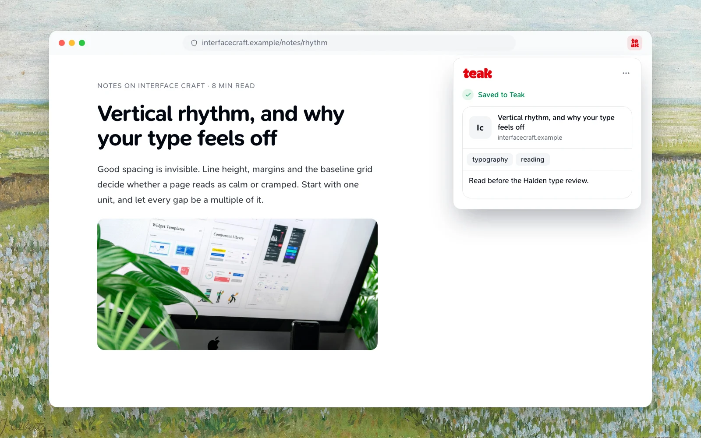

The extension for Chrome and Firefox saves pages, images, links, selected text and social media posts. The Safari extension saves the current page and comes with the Teak app for [Mac](/docs/mac) and [iPhone and iPad](/docs/mobile).



## Install for Chrome and Chromium

The extension works in Chrome, Edge, Brave, Arc and other Chromium browsers.

<Steps>
  <Step title="Edge users: allow other stores">
    In Edge, open `edge://extensions` and turn on **Allow extensions from other stores**.
  </Step>
  <Step title="Add Teak">
    Open [Teak in the Chrome Web Store](https://chromewebstore.google.com/detail/teak/negnmfifahnnagnbnfppmlgfajngdpob), click **Add to Chrome** (or your browser's equivalent), and confirm.
  </Step>
  <Step title="Sign in">
    Click the Teak icon in your toolbar and choose **Sign in**.
  </Step>
</Steps>

## Install for Firefox

The Firefox extension has the same features as the Chrome one and needs Firefox 140 or later.

<Steps>
  <Step title="Add Teak">
    Open [Teak on Firefox Add-ons](https://addons.mozilla.org/firefox/addon/teak/) and click **Add to Firefox**. Firefox lists what Teak can access and the data it sends to Teak: the pages and text you save, their addresses, and what you search for. Click **Add** to confirm.
  </Step>
  <Step title="Sign in">
    Click the Teak icon in your toolbar and choose **Sign in**.
  </Step>
</Steps>

In private windows, Teak runs only if you allow it: open `about:addons`, choose Teak, and set **Run in Private Windows** to **Allow**. If Firefox always uses private browsing, Teak forgets your sign-in and any unsent saves when Firefox closes, and the popup says so.

## Safari

The Safari extension comes with the Teak app and uses its sign-in. It saves the page you're on; the other features on this page are Chrome and Firefox only.

- **Mac:** in Teak, open **Settings › General**, choose **Open Safari Settings…**, and turn on **Teak** under **Extensions**. Then click **Teak** in Safari's toolbar.
- **iPhone and iPad:** in Safari, tap the extensions button in the address bar, choose **Manage Extensions**, and turn on **Teak**. Then open the extensions menu and tap **Teak**.

If it asks you to sign in, choose **Sign In**, finish in the Teak app, and try again.

## Auto-save on open

Opening the popup saves the current page. The popup shows the page's icon, title and site, and says whether it was saved, was already in your library, or can't be saved.

A page that's already in your library says **Already in your Teak** and moves that card to the top, bringing it back from Archive if needed (see [Saving something again](/docs/features#saving-something-again)). Safari says **Saved to Teak** either way.

To save a local file up to 100 MB, choose **Upload file** from the popup's **⋯** menu. In Firefox, this opens a small Teak window to pick the file in, because Firefox closes the popup when a file picker opens.

### Add tags and a note after saving

Once the page is saved, the popup shows **Add tags** and **Add a note**, filled in with the card's current tags and note if it was already in your library.

- Type a tag and press Enter or comma. Your most used and most recent tags are suggested as you type. Tags can be up to 64 characters.
- Tags and the note save when you press Enter, leave the field, or close the popup. If a change can't be saved, the popup keeps what you typed and offers **Retry**.

## Chrome and Firefox features

### Save with a shortcut

Press **Alt+Shift+S** (**⌥⇧S** on Mac) to save the current tab without opening the popup. The Teak icon shows how it went:

| Icon | Means |
| ---- | ----- |
| **…** | Saving |
| **✓** | Saved, or already in Teak and moved to the top |
| **!** | Couldn't save; hover the icon to see why. It clears after a few seconds |

If you're signed out or at your free plan limit, the popup opens instead. Pages Teak can't save, such as `chrome://` pages and add-on stores, show **!**.

To change the shortcut, open `chrome://extensions/shortcuts` (or your browser's equivalent), or in Firefox open `about:addons`, click the gear, and choose **Manage Extension Shortcuts**. Change **Save this page to Teak**.

### Already in Teak

While you're signed in, the Teak icon shows **✓**, with the tooltip **Already in Teak**, when the current page is in your library. Archived cards count; cards in Trash don't. Each answer is remembered for five minutes, so a card you just deleted can keep its **✓** that long. Pages in private windows and browser pages such as `chrome://` and `about:` are never checked.

### Context menu

Right-click on a page:

| Menu item | What it saves |
| --- | --- |
| **Save Page to Teak** | The current page |
| **Save Text to Teak** | The selected text, as a text card that links back to its page (a selection that's only a URL is saved as a link) |
| **Save Asset to Teak** | An image, video, audio file or other file; on a link to a web page, the link |

The context menu works on standard web pages. Teak doesn't download local, private-network, `file:` or `blob:` addresses; use **Upload file** for a file on your computer.

### Address bar search

Type `teak` in the address bar, press Space or Tab, and type your search.

- After two characters, your top five matches appear, with their title, type and site. Choose one to open it in Teak.
- Press Enter to open the full search in Teak, or Alt+Enter (⌘+Enter on Mac) to open it in a new tab.
- Search filters such as `#design`, `type:image` or `site:example.com` work. Hidden cards never appear.
- Signed out, the suggestion reads **Sign in to Teak to search**.

Teak doesn't keep what you type in the address bar.

### Save buttons on social sites

On Instagram, Pinterest, X, Hacker News, Sidebar and HeyDesigner, Teak adds a save button to each post once you're signed in. The buttons need Teak's access to websites; in Firefox you can turn that off in `about:addons` under Teak's **Permissions and data**, and the toolbar button still works.

### Language

The popup, menus, suggestions and save buttons follow your [Teak language](/docs/features#language) once you're signed in.

### Free tier limit

:::info[Free plan: 200 cards]
When you reach your free plan card limit, the extension popup shows an upgrade prompt instead of saving. Click **Upgrade to Pro** to open **Settings → Plan** in Teak. Pro has [unlimited cards](/pricing).
:::

## Sign in

In Chrome and Firefox, choose **Sign in** in the popup and approve Teak in your browser. You stay signed in across restarts, and Teak renews your sign-in in the background; you sign in again only if it was disconnected. **Sign out** is in the popup's **⋯** menu, under your email.

Signing out disconnects the extension on every browser it's installed in; reconnecting can take about 15 minutes. If the saved sign-in has already expired, it signs out only this browser and says so; disconnect the others in Teak **Settings → Security → Connected apps**. If the network fails, your sign-in and any interrupted saves are kept so you can retry, or discard the saves from the popup.

## Build from source

The extension is open source, and the store packages are built from the repository's release tags. To build the same package yourself:

<Steps>
  <Step title="Install the toolchain">
    Install Git, and Bun and Node.js at the versions pinned in the repository's `package.json` (`packageManager` and `engines.node`).
  </Step>
  <Step title="Check out a release">
    ```bash
    git clone https://github.com/praveenjuge/teak.git
    cd teak
    git checkout v<version>
    bun install --frozen-lockfile
    ```
  </Step>
  <Step title="Build against production">
    ```bash
    export VITE_PUBLIC_CONVEX_URL=https://uncommon-ladybug-882.convex.cloud
    export VITE_PUBLIC_CONVEX_SITE_URL=https://uncommon-ladybug-882.convex.site
    bun run --cwd apps/extension build:firefox   # or: build, for Chrome
    ```

    The Firefox build lands in `apps/extension/.output/firefox-mv3` and matches the package on Firefox Add-ons file for file. Each GitHub release also attaches the Firefox package and a sources archive, `teak-extension-<version>-sources.zip`.
  </Step>
</Steps>

## Troubleshooting

<Accordion>
  <AccordionItem title="The popup shows an error">
    - Check that you're signed in at [app.teakvault.com](https://app.teakvault.com).
    - Reload the tab and try again.
  </AccordionItem>
  <AccordionItem title="Save buttons don't appear on a social site">
    - Make sure you're signed in to the extension.
    - Reload the page after it fully loads.
    - Check that the extension is on, with access to websites, in `chrome://extensions` or Firefox's `about:addons`.
    - The buttons only appear on the sites listed above.
  </AccordionItem>
  <AccordionItem title="Still stuck?">
    Reach out via [Support](/docs/support).
  </AccordionItem>
</Accordion>
