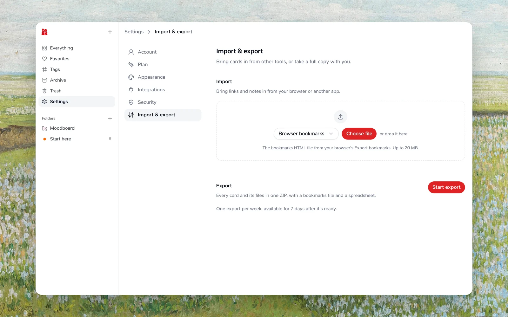

Teak can prepare a portable ZIP archive of your cards and the original files attached to them, with a bookmarks file your browser can import and a spreadsheet of every card. Exports are available from Settings in the web app.

:::note[Exports are read-only]
Starting an export does not change, delete, or move anything in your Teak library.
:::

## Start an Export

<Steps>
  <Step title="Open Export">
    Open the Teak web app, then find **Import/Export Data** and choose **Manage**.
  </Step>
  <Step title="Start export">
    Switch to the **Export** tab and choose **Start export**, then keep working while Teak prepares the archive in the background.
  </Step>
  <Step title="Download">
    When the export is ready, choose **Download archive**.
  </Step>
</Steps>

You can cancel an export while it is still preparing. Canceled and failed exports do not count toward your weekly export limit.

## What the Archive Includes

Each export is a ZIP with every card outside Trash, archived cards included:

| File | What it holds |
|---|---|
| `cards.json` | Every card with its type, content, title, link, notes, tags, AI tags and summary, folder names, favorite and archive state, when a link was marked done (`completedAt`), and dates: `createdAt` (first saved) and `savedAt` (last saved, later when a link was saved again). Teak imports this file back, keeping both, so the library comes back in the same order. |
| `files/` | The original file attached to each image, video, audio, and document card. |
| `bookmarks.html` | Your link cards in the bookmark format Chrome, Firefox, and Safari import. Links in no folder come first; each folder is its own bookmarks folder, and a link in several folders appears in each. Your tags are kept where the browser supports them. |
| `cards.csv` | One row per card for Excel, Numbers, or Google Sheets: `id`, `type`, `title`, `url`, `content`, `notes`, `tags`, `aiTags`, `aiSummary`, `folders`, `isFavorited`, `isArchived`, `createdAt`, and, for text saved from a page, `sourceUrl` and `sourceTitle`. Tags and folders are separated by commas. |
| `manifest.json` | When the archive was made, its card and file counts, and its format version (`schemaVersion` 2). |

`cards.csv` is safe to open in a spreadsheet: a cell that starts with `=`, `+`, `-`, or `@` begins with an apostrophe so it shows as text instead of running as a formula.

[Importing the archive](/docs/import) adds the exported cards and included files that satisfy import limits, back in their folders and with their archive state and titles; cards with missing or oversized (>20 MiB) files fail to import.

## What Is Not Included

Exports focus on portable library content: Trash, transcripts, generated previews, and account data are not included. If an original file cannot be read, its card is still included in the archive, but the card cannot be restored on re-import.

## Limits and Availability

| Limit | Details |
|---|---|
| Frequency | One successful export every 7 days. |
| Active jobs | One export can prepare at a time. |
| Download window | Ready archives stay available for 7 days. |
| Library size | Exports support up to 10,000 cards outside Trash or an estimated 5 GB archive. |

If your latest export is still available, download it from **Settings → Import/Export Data → Manage**. After it expires, you can start a new export when your weekly quota allows it.

## Troubleshooting

<Accordion>
  <AccordionItem title='I see "Available in..."'>
    You recently completed an export. Wait for the shown time, then start another one.
  </AccordionItem>
  <AccordionItem title="My export failed">
    Open **Import/Export Data** and try again. Failed exports do not count toward the weekly limit.
  </AccordionItem>
  <AccordionItem title="Some files are unavailable">
    The archive still includes those cards in `cards.json`, but their original files were unavailable when the export was built.
  </AccordionItem>
  <AccordionItem title="The archive is too large">
    If your library is over the export limit, delete unneeded cards or permanently remove old trash items, then try again.
  </AccordionItem>
</Accordion>
