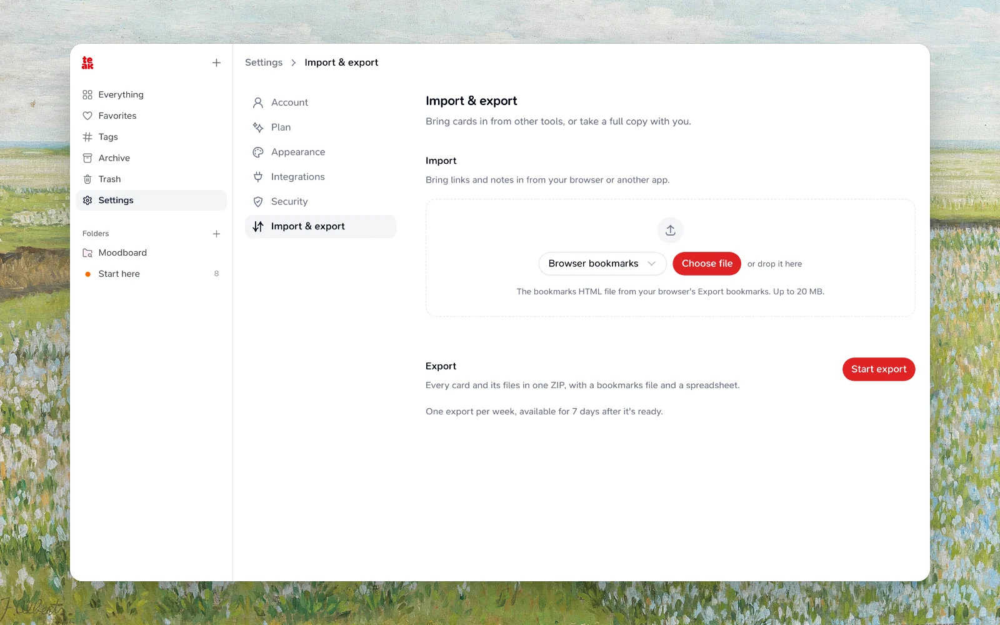

Download a portable ZIP of your cards and their original files, with a bookmarks file your browser can import and a spreadsheet of every card. Exporting doesn't change anything in your library. Exports run from Settings in the web app.

## Start an export

<Steps>
  <Step title="Open Export">
    Open the Teak web app and go to **Settings → Import & export**.
  </Step>
  <Step title="Start export">
    Switch to the **Export** tab and choose **Start export**, then keep working while Teak prepares the archive in the background.
  </Step>
  <Step title="Download">
    When the export is ready, choose **Download archive**.
  </Step>
</Steps>

You can cancel an export while it's preparing. Canceled and failed exports don't count toward the weekly limit.

## What the archive includes

Each export is a ZIP with every card outside Trash, archived cards included:

| File | What it holds |
|---|---|
| `cards.json` | Every card with its type, content, title, link, notes, tags, AI tags and summary, folders, favorite, pinned (`pinPosition`) and archive state, when a link was marked done (`completedAt`), its `highlights`, and when it was first saved (`createdAt`) and last saved (`savedAt`). This is the file Teak imports back. |
| `files/` | The original file attached to each image, video, audio, and document card. |
| `bookmarks.html` | Your links in the bookmark format Chrome, Firefox and Safari import, with each folder as a bookmarks folder and tags where the browser supports them. |
| `cards.csv` | One row per card for Excel, Numbers or Google Sheets: `id`, `type`, `title`, `url`, `content`, `notes`, `tags`, `aiTags`, `aiSummary`, `folders`, `isFavorited`, `isArchived`, `isPinned`, `createdAt`, `sourceUrl`, `sourceTitle` and `highlights`. Cells that start with `=`, `+`, `-` or `@` begin with an apostrophe, so they never run as formulas. |
| `manifest.json` | When the archive was made, its card and file counts, and its format version. |

Trash, transcripts, generated previews and account data aren't included. You can [import the archive](/docs/import) back into Teak; a card whose file was missing or over 20 MiB fails to import.

## Limits

| Limit | Details |
|---|---|
| Frequency | One successful export every 7 days. |
| Active jobs | One export can prepare at a time. |
| Download window | Ready archives stay available for 7 days. |
| Library size | Exports support up to 10,000 cards outside Trash or an estimated 5 GB archive. |

Download your latest export from **Settings → Import & export** while it's available.

## Troubleshooting

<Accordion>
  <AccordionItem title='I see "Available in..."'>
    You made an export in the last 7 days. Wait for the time shown, then start another.
  </AccordionItem>
  <AccordionItem title="My export failed">
    Try again from **Settings → Import & export**. Failed exports don't count toward the weekly limit.
  </AccordionItem>
  <AccordionItem title="Some files are unavailable">
    Those cards are still in `cards.json`, but their original files couldn't be read when the export was built.
  </AccordionItem>
  <AccordionItem title="The archive is too large">
    Delete cards you don't need, then try again.
  </AccordionItem>
</Accordion>
