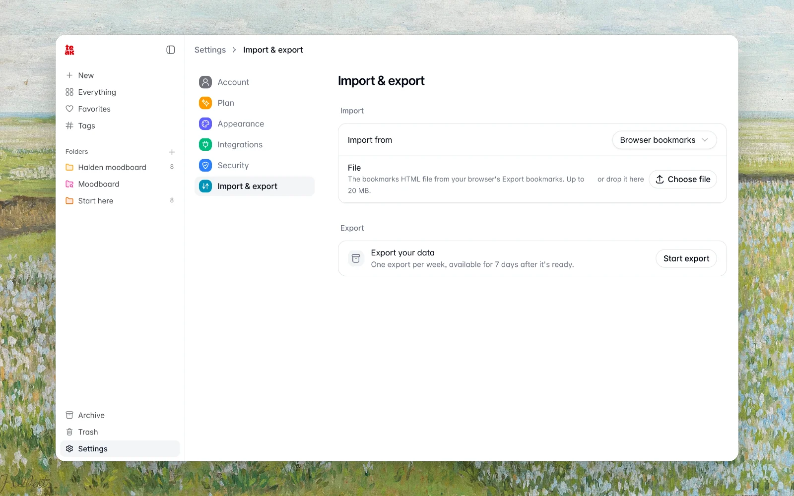

Download a ZIP of your cards and original files, plus a bookmarks file for your browser and a spreadsheet of every card. Exporting changes nothing in your library. Exports run from Settings in the web app.

## Start an export

<Steps>
  <Step title="Open Export">
    In the Teak web app, go to **Settings → Import & export**.
  </Step>
  <Step title="Start export">
    Switch to the **Export** tab and choose **Start export**. Keep working while Teak prepares the archive.
  </Step>
  <Step title="Download">
    When it's ready, choose **Download archive**.
  </Step>
</Steps>

You can cancel an export while it's preparing. Canceled and failed exports don't count toward the weekly limit.

## What the archive includes

The ZIP holds every card outside Trash, archived ones included:

| File | What it holds |
|---|---|
| `cards.json` | Every card's type, content, title, link, notes, tags, AI tags and summary, folders, favorite, pinned (`pinPosition`) and archive state, done time (`completedAt`), `highlights`, and first (`createdAt`) and last (`savedAt`) save times. Teak imports this file back. |
| `files/` | The original file of each image, video, audio, and document card. |
| `bookmarks.html` | Your links in the bookmark format Chrome, Firefox and Safari import, with folders as bookmark folders and tags where supported. |
| `cards.csv` | One row per card for Excel, Numbers or Google Sheets: `id`, `type`, `title`, `url`, `content`, `notes`, `tags`, `aiTags`, `aiSummary`, `folders`, `isFavorited`, `isArchived`, `isPinned`, `createdAt`, `sourceUrl`, `sourceTitle` and `highlights`. Cells starting with `=`, `+`, `-` or `@` get a leading apostrophe so they never run as formulas. |
| `manifest.json` | Creation time, card and file counts, and format version. |

Trash, transcripts, generated previews and account data aren't included. [Import the archive](/docs/import) back into Teak; a card whose file is missing or over 20 MiB fails to import.

## Limits

| Limit | Details |
|---|---|
| Frequency | One successful export every 7 days. |
| Active jobs | One export at a time. |
| Download window | 7 days after the archive is ready, from **Settings → Import & export**. |
| Library size | Up to 10,000 cards outside Trash, or an estimated 5 GB archive. |

## Troubleshooting

<Accordion>
  <AccordionItem title='I see "Available in..."'>
    You exported in the last 7 days. Wait for the time shown.
  </AccordionItem>
  <AccordionItem title="My export failed">
    Try again from **Settings → Import & export**; failed exports don't count toward the limit.
  </AccordionItem>
  <AccordionItem title="Some files are unavailable">
    Those cards are in `cards.json`, but their original files couldn't be read during the export.
  </AccordionItem>
  <AccordionItem title="The archive is too large">
    Delete cards you don't need, then try again.
  </AccordionItem>
</Accordion>
