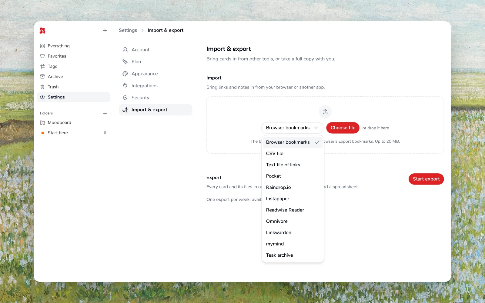

Teak can import your saved links and notes from a browser bookmarks file, Pocket, Raindrop.io, Instapaper, Readwise Reader, Omnivore, Linkwarden, mymind, OneTab, or a Teak data archive. Imports are available from Settings in the web app.

:::note[Imports only add, never remove]
Importing does not delete or modify any of your existing cards. Links that match a card you already have are skipped, not duplicated.
:::

## Start an Import

<Steps>
  <Step title="Open Import">
    Open the Teak web app, then find **Import/Export Data** and choose **Manage**.
  </Step>
  <Step title="Choose the source and file">
    Pick where your file comes from under **Import from**. Teak says which file to upload for that source. Choose **Choose file** and pick it.
  </Step>
  <Step title="Start import">
    Choose **Start import** to begin. Progress updates live as Teak parses the file and creates cards.
  </Step>
</Steps>

You can cancel an import while it is uploading or in progress. If your browser closes or reloads mid-upload, reopen the dialog and choose **Resume upload** to continue from where it left off.

## Sources

Every source keeps a link's original save date when the file has one. Folders become Teak folders: a nested folder becomes one folder named after its path, like **Work / Design**. A card goes into a folder with the same name if you already have one.

| Source | File to upload | What comes in |
|---|---|---|
| **Browser bookmarks** | The HTML file from your browser's export (`.html`) | Each bookmark becomes a link card with its name and tags. Bookmark folders become folders. |
| **Pocket** | The CSV from Pocket's export (`.csv`), or its older HTML export | Links with their titles and tags. Archived items go to Archive. |
| **Raindrop.io** | The CSV from **Settings → Backups → Export** (`.csv`) | Links with titles, notes, tags, favorites, and saved dates. Collections become folders. |
| **Instapaper** | The CSV from **Settings → Export** (`.csv`) | Links with titles, tags, and highlighted text as the note. **Archive** goes to Archive, **Starred** to Favorites, and your own folders become folders. |
| **Readwise Reader** | The CSV from **Export library as CSV** (`.csv`) | Links with titles and tags. Archived items go to Archive, and shortlisted ones (by location or the `shortlist` tag) to Favorites. Feed items are skipped. |
| **Omnivore** | The ZIP from Omnivore's export, as downloaded (`.zip`, up to 5 GiB), or one of its `metadata_*.json` files (up to 20 MiB) | Links with titles, labels as tags, and highlights as the note. Archived items go to Archive. |
| **Linkwarden** | The JSON backup from **Settings → Data → Export** (`.json`) | Links with names, tags, and descriptions as notes. Collections become folders, and pinned links become Favorites. |
| **mymind** | The CSV from **Settings → Export** (`.csv`) | Links with titles, tags, and notes. Cards with only text become notes. |
| **OneTab** | The text from **Export URLs**, saved as a `.txt` file | Each saved tab becomes a link card with its title. |
| **Teak archive** | A ZIP previously downloaded from [Export Your Data](/docs/export) (`.zip`) | Cards are recreated with their original type, content, tags, notes, favorite status, palette colors, and attached files. Archives with `schemaVersion` 2 in `manifest.json` also bring back titles, archived cards (into Archive), and folders. AI tags and summaries are written fresh. Older archive document cards backed by `.md` or `.markdown` files become editable text cards with their raw Markdown and original source attachment. |

:::note[Folders are no longer tags]
Before October 2026, folders in bookmark and Raindrop files were added to each card as tags. They now become Teak folders instead, and keep their nesting in the folder name.
:::

## Duplicate Handling

Before creating a card, Teak checks whether a non-deleted card with the same URL already exists in your library. Matching items are skipped and counted separately from created and failed items — they do not create a duplicate card.

Bookmark and Raindrop files can also contain duplicate links within the same file; only the first occurrence of a URL is imported, and later occurrences are skipped.

## Limits

| Limit | Details |
|---|---|
| File size | 20 MiB for every source except Teak archives and Omnivore ZIPs, which can be up to 5 GiB. |
| Cards per import | Up to 10,000 items in a single file. |
| File attachments | Each file inside a Teak archive must be 20 MiB or smaller and present in the archive; otherwise that card fails to import. |
| Markdown text | Imported `.md` and `.markdown` content must be valid UTF-8 and no larger than 512 KiB. |
| Folders | A card goes into up to 50 folders, and an account holds up to 500; folders past either limit are skipped and the card still imports. |
| Concurrent imports | One import can run at a time. |

## After an Import Finishes

Teak shows how many items were created, skipped, and failed. If any items failed, you can copy or download a text report listing each one and the reason it could not be imported.

## Troubleshooting

<Accordion>
  <AccordionItem title="My import failed immediately">
    Teak says "This doesn't look like a … export" when the file doesn't match the source you picked. Check **Import from**, and that the file is the one the source's guidance names. A wrong file fails before any cards are created.
  </AccordionItem>
  <AccordionItem title="Some items were skipped">
    Skipped items already exist in your library with the same URL. This is expected and does not indicate an error.
  </AccordionItem>
  <AccordionItem title="Some items failed">
    Open the import error report to see whether each item had an unsafe URL, exceeded a limit, or was missing from the archive.
  </AccordionItem>
  <AccordionItem title="My upload was interrupted">
    Reopen **Import/Export Data** and choose **Resume upload** with the same file.
  </AccordionItem>
  <AccordionItem title="Still stuck?">
    Reach out via [Support](/docs/support).
  </AccordionItem>
</Accordion>
