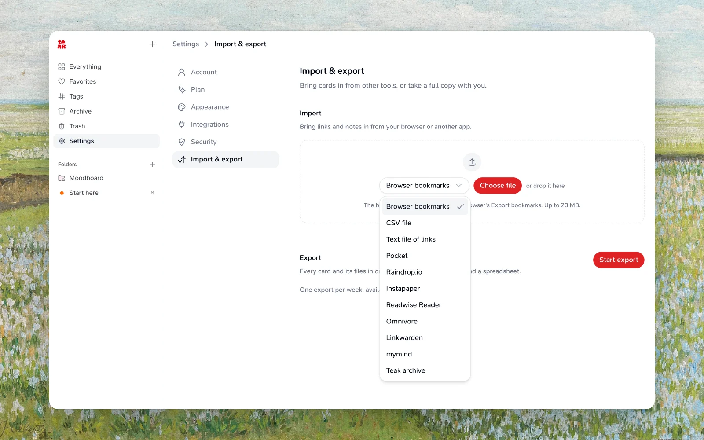

Bring your saved links and notes into Teak from a browser, a CSV or text file, another read-later or bookmark app, or a Teak archive. Imports run from Settings in the web app.

:::note[Imports only add, never remove]
Importing does not delete or modify any of your existing cards. Links that match a card you already have are skipped, not duplicated.
:::

## Start an import



<Steps>
  <Step title="Open Import">
    Open the Teak web app and go to **Settings → Import & export**.
  </Step>
  <Step title="Choose the source and file">
    Pick where your file comes from under **Import from**. Teak says which file to upload for that source. Choose **Choose file** and pick it.
  </Step>
  <Step title="Start import">
    Choose **Start import**. Progress updates live as Teak reads the file and creates cards.
  </Step>
</Steps>

You can cancel an import while it uploads or runs. If your browser closes mid-upload, reopen **Settings → Import & export** and choose **Resume upload** with the same file.

## Sources

Every source keeps a link's original save date when the file has one. Folders become Teak folders: a nested folder becomes one folder named after its path, like **Work / Design**. A card goes into a folder with the same name if you already have one.

| Source | File to upload | What comes in |
|---|---|---|
| **Browser bookmarks** | The HTML file from your browser's export (`.html`) | Each bookmark becomes a link card with its name and tags. Bookmark folders become folders. |
| **CSV file** | Any CSV with a header row (`.csv`), separated by commas, semicolons or tabs | Each row becomes a link card. Teak reads the columns in [CSV columns](#csv-columns) and ignores the rest. Folder paths like `Work/Design` become one folder, **Work / Design**. |
| **Text file of links** | A `.txt` file with one link per line, optionally followed by ` \| Title`. OneTab's **Export URLs** text works as it is. | Each link becomes a link card, with its title when the line has one. Blank lines are skipped; other lines that aren't links are listed in the import report with their line number. |
| **Pocket** | The CSV from Pocket's export (`.csv`), or its older HTML export | Links with their titles and tags. Archived items go to Archive. |
| **Raindrop.io** | The CSV from **Settings → Backups → Export** (`.csv`) | Links with titles, notes, tags, favorites, and saved dates. Collections become folders, and the `highlights` column becomes [highlights](/docs/features#highlights). |
| **Instapaper** | The CSV from **Settings → Export** (`.csv`) | Links with titles, tags, and the highlighted text as a [highlight](/docs/features#highlights). **Archive** goes to Archive, **Starred** to Favorites, and your own folders become folders. |
| **Readwise Reader** | The CSV from **Export library as CSV** (`.csv`) | Links with titles and tags. Archived items go to Archive, and shortlisted ones (by location or the `shortlist` tag) to Favorites. Feed items are skipped. |
| **Omnivore** | The ZIP from Omnivore's export, as downloaded (`.zip`, up to 5 GiB), or one of its `metadata_*.json` files (up to 20 MiB) | Links with titles, labels as tags, and highlights with their notes as [highlights](/docs/features#highlights). A highlights file with no quotes in it stays the card's note. Archived items go to Archive. |
| **Linkwarden** | The JSON backup from **Settings → Data → Export** (`.json`) | Links with names, tags, and descriptions as notes. Collections become folders, and pinned links become Favorites. |
| **mymind** | The CSV from **Settings → Export** (`.csv`) | Links with titles, tags, and notes. Cards with only text become notes. |
| **Teak archive** | A ZIP downloaded from [Export](/docs/export) (`.zip`) | Cards come back with their type, title, content, tags, notes, palette colors, files, folders, favorites, archive and done state, highlights, and pins in order (up to 12 pinned cards in all, counting ones you already have). AI tags and summaries are written fresh. |

Imported highlights appear once Teak has prepared each link's article. One whose words aren't in the article is kept, marked **Not found in the saved article**.

### CSV columns

The first row names the columns. Teak matches the names whatever their case, spaces, `_` or `-`, so `Date Added`, `date_added` and `DATE-ADDED` are the same column. Only `url` is required.

| Field | Column names |
|---|---|
| Link (required) | `url`, `link`, `href`, `address`, `website` |
| Title | `title`, `name` |
| Tags | `tags`, `tag`, `labels`, `keywords`. Separate tags with commas, or with `\|` or `;` when the cell has no comma. A leading `#` is dropped. |
| Folder | `folder`, `folders`, `collection`, `category`, `list` |
| Note | `note`, `notes`, `comment`, `comments`, `description` |
| Date saved | `created`, `created at`, `date`, `date added`, `added`, `saved`, `saved at`, `time added`, `timestamp`. ISO dates (`2024-05-01`, `2024-05-01T10:00:00Z`), `2024-05-01 10:00`, or Unix time in seconds or milliseconds. |

```csv
url,title,tags,folder,note,created
https://example.com,Example,"design, type",Work/Design,A note,2024-05-01
```

Quote a cell that holds a comma or a line break. If two columns share a name, Teak reads the first. The separator is read from the header row: commas, or semicolons or tabs when the header has no comma.

Rows without a valid `http` or `https` link, or with a quote that never closes, are listed in the import report with their spreadsheet row number (the header is row 1); the other rows still import.

## Duplicate handling

A link you already have outside Trash, or that appears twice in the file, is skipped and counted as skipped, not created again. Links count as the same by the rules in [Saving something again](/docs/features#saving-something-again); a `#/` or `#!` route still makes a link different.

## Limits

| Limit | Details |
|---|---|
| File size | 20 MiB for every source except Teak archives and Omnivore ZIPs, which can be up to 5 GiB. |
| Cards per import | Up to 10,000 items in a single file. |
| File attachments | Each file inside a Teak archive must be 20 MiB or smaller and present in the archive; otherwise that card fails to import. |
| Markdown text | Imported `.md` and `.markdown` content must be valid UTF-8 and no larger than 512 KiB. |
| Folders | A card goes into up to 50 folders, and an account holds up to 500; folders past either limit are skipped and the card still imports. |
| Concurrent imports | One import can run at a time. |

## After an import finishes

Teak shows how many items were created, skipped and failed. If any failed, copy or download the report, which lists each one and why.

## Troubleshooting

<Accordion>
  <AccordionItem title="My import failed immediately">
    Teak says "This doesn't look like a … export" when the file doesn't match the source you picked. Check **Import from**, and that the file is the one the source's guidance names. A wrong file fails before any cards are created.
  </AccordionItem>
  <AccordionItem title="My CSV has no url column">
    The first row of the file must name the columns, and one of them must be the link: `url`, `link`, `href`, `address` or `website`. Add that header row and import the file again.
  </AccordionItem>
  <AccordionItem title="Some items were skipped">
    Skipped items are links already in your library. That's expected, not an error.
  </AccordionItem>
  <AccordionItem title="Some items failed">
    Open the import error report to see whether each item had an unsafe URL, exceeded a limit, or was missing from the archive.
  </AccordionItem>
  <AccordionItem title="My upload was interrupted">
    Reopen **Settings → Import & export** and choose **Resume upload** with the same file.
  </AccordionItem>
  <AccordionItem title="Still stuck?">
    Reach out via [Support](/docs/support).
  </AccordionItem>
</Accordion>
