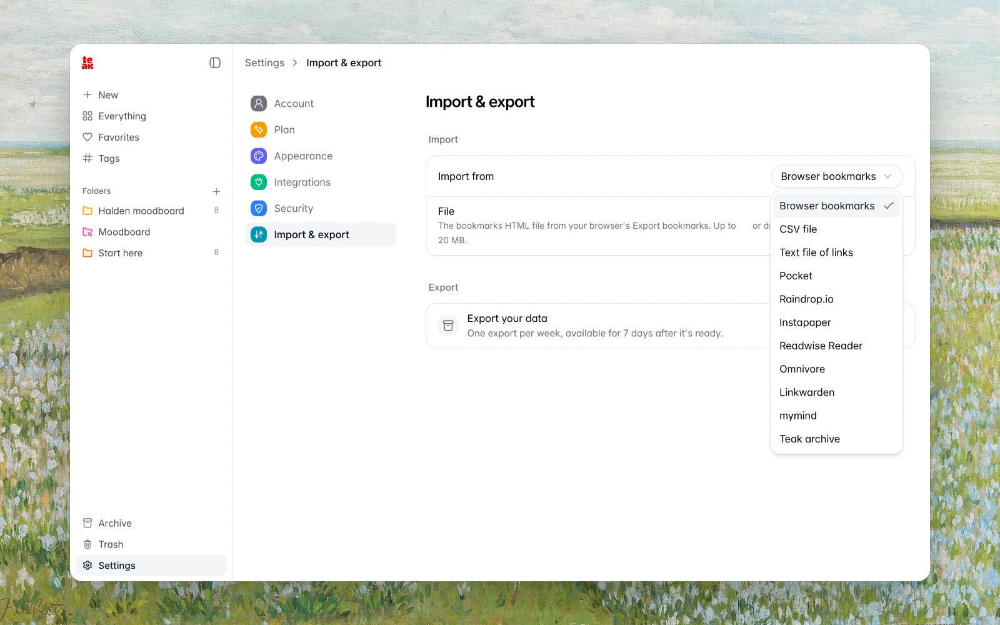

Bring links and notes into Teak from a browser, a CSV or text file, another read-later or bookmark app, or a Teak archive. Imports run from Settings in the web app.

:::note[Imports only add, never remove]
Importing never changes or deletes existing cards, and links you already have are skipped.
:::

## Start an import



<Steps>
  <Step title="Open Import">
    In the Teak web app, go to **Settings → Import & export**.
  </Step>
  <Step title="Choose the source and file">
    Pick the source under **Import from**; Teak says which file to upload. Choose **Choose file** and pick it.
  </Step>
  <Step title="Start import">
    Choose **Start import**. Progress updates live.
  </Step>
</Steps>

You can cancel an import while it uploads or runs. If the upload is interrupted, choose **Resume upload** with the same file.

## Sources

Every source keeps a link's original save date when the file has one. A nested folder becomes one Teak folder named after its path, like **Work / Design**, and cards join an existing folder with the same name.

| Source | File to upload | What comes in |
|---|---|---|
| **Browser bookmarks** | Your browser's HTML export (`.html`) | Link cards with names and tags. Bookmark folders become folders. |
| **CSV file** | Any CSV with a header row (`.csv`), separated by commas, semicolons or tabs | One link card per row, from the [CSV columns](#csv-columns); other columns are ignored. |
| **Text file of links** | A `.txt` file with one link per line, optionally followed by ` \| Title`. OneTab's **Export URLs** text works as is. | Link cards, titled when the line has one. Blank lines are skipped; other non-link lines are listed in the import report by line number. |
| **Pocket** | Pocket's CSV export (`.csv`) or its older HTML export | Links with titles and tags. Archived items go to Archive. |
| **Raindrop.io** | The CSV from **Settings → Backups → Export** (`.csv`) | Links with titles, notes, tags, favorites, and saved dates. Collections become folders; the `highlights` column becomes [highlights](/docs/features#highlights). |
| **Instapaper** | The CSV from **Settings → Export** (`.csv`) | Links with titles, tags, and highlighted text as a [highlight](/docs/features#highlights). **Archive** goes to Archive, **Starred** to Favorites, other folders become folders. |
| **Readwise Reader** | The CSV from **Export library as CSV** (`.csv`) | Links with titles and tags. Archived items go to Archive, shortlisted ones (by location or the `shortlist` tag) to Favorites. Feed items are skipped. |
| **Omnivore** | Omnivore's export ZIP as downloaded (`.zip`, up to 5 GiB), or one of its `metadata_*.json` files (up to 20 MiB) | Links with titles, labels as tags, and highlights with their notes as [highlights](/docs/features#highlights). A highlights file without quotes stays the card's note. Archived items go to Archive. |
| **Linkwarden** | The JSON backup from **Settings → Data → Export** (`.json`) | Links with names, tags, and descriptions as notes. Collections become folders; pinned links become Favorites. |
| **mymind** | The CSV from **Settings → Export** (`.csv`) | Links with titles, tags, and notes. Text-only cards become notes. |
| **Teak archive** | A ZIP downloaded from [Export](/docs/export) (`.zip`) | Cards return with type, title, content, tags, notes, palette colors, files, folders, favorites, archive and done state, highlights, and pin order (up to 12 pinned cards in total, including existing ones). AI tags and summaries are regenerated. |

Imported highlights appear once Teak prepares the link's article; ones not found in it are kept, marked **Not found in the saved article**.

### CSV columns

The first row names the columns. Names ignore case, spaces, `_` and `-`, so `Date Added`, `date_added` and `DATE-ADDED` match. Only `url` is required.

| Field | Column names |
|---|---|
| Link (required) | `url`, `link`, `href`, `address`, `website` |
| Title | `title`, `name` |
| Tags | `tags`, `tag`, `labels`, `keywords`. Separated by commas, or by `\|` or `;` when there's no comma. A leading `#` is dropped. |
| Folder | `folder`, `folders`, `collection`, `category`, `list` |
| Note | `note`, `notes`, `comment`, `comments`, `description` |
| Date saved | `created`, `created at`, `date`, `date added`, `added`, `saved`, `saved at`, `time added`, `timestamp`. ISO dates (`2024-05-01`, `2024-05-01T10:00:00Z`), `2024-05-01 10:00`, or Unix time in seconds or milliseconds. |

```csv
url,title,tags,folder,note,created
https://example.com,Example,"design, type",Work/Design,A note,2024-05-01
```

Quote cells that hold a comma or line break. If two columns share a name, Teak reads the first. Semicolons or tabs separate cells only when the header has no comma.

Rows without a valid `http` or `https` link, or with an unclosed quote, are listed in the import report by spreadsheet row number (the header is row 1); other rows still import.

## Duplicate handling

A link you already have outside Trash, or that appears twice in the file, is skipped. Links match by the rules in [Saving something again](/docs/features#saving-something-again); a `#/` or `#!` route still makes a link different.

## Limits

| Limit | Details |
|---|---|
| File size | 20 MiB, or 5 GiB for Teak archives and Omnivore ZIPs. |
| Cards per import | Up to 10,000 items per file. |
| File attachments | Each file in a Teak archive must be present and at most 20 MiB, or that card fails to import. |
| Markdown text | `.md` and `.markdown` content must be valid UTF-8, up to 512 KiB. |
| Folders | Up to 50 per card and 500 per account; folders past either limit are skipped, and the card still imports. |
| Concurrent imports | One at a time. |

## After an import finishes

Teak shows how many items were created, skipped and failed. Copy or download the report to see each failure and why.

## Troubleshooting

<Accordion>
  <AccordionItem title="My import failed immediately">
    "This doesn't look like a … export" means the file doesn't match the source under **Import from**. Pick the right source, or upload the file it asks for. Nothing was imported.
  </AccordionItem>
  <AccordionItem title="My CSV has no url column">
    The first row must name the columns, including a link column: `url`, `link`, `href`, `address` or `website`. Add that header row and import again.
  </AccordionItem>
  <AccordionItem title="Some items were skipped">
    Skipped items are links already in your library. That's expected.
  </AccordionItem>
  <AccordionItem title="Some items failed">
    The import report says whether each had an unsafe URL, exceeded a limit, or was missing from the archive.
  </AccordionItem>
  <AccordionItem title="My upload was interrupted">
    Reopen **Settings → Import & export** and choose **Resume upload** with the same file.
  </AccordionItem>
  <AccordionItem title="Still stuck?">
    Reach out via [Support](/docs/support).
  </AccordionItem>
</Accordion>
