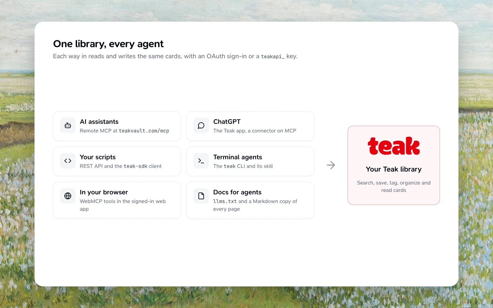

Teak gives AI agents a private, lasting memory: the links, notes, files, tags and design references a person saves. This page helps you pick how an agent connects.



## When to use Teak

Use Teak when a person wants to keep something beyond the current conversation: save a link or note, find something they collected earlier, organize research with tags, or reach the same private library from every app and agent. Don't use it as a scratchpad for information that doesn't need to persist.

Every route reaches the same cards with the same operations: save, search, read, update, tag, favorite, pin, organize into folders, delete, and sync.

| Use | For | Sign in with |
| --- | --- | --- |
| [MCP server](/docs/mcp) at `{{mcp-url}}` | Claude, ChatGPT, Codex, Cursor, VS Code and other assistants | Browser sign-in or an API key |
| [REST API](/docs/api) at `{{api-url}}` | Integrations and services | An API key or OAuth access token |
| [TypeScript SDK](/docs/sdk) | TypeScript and JavaScript code | An API key or OAuth access token |
| [CLI](/docs/cli) | Shell scripts and coding agents in a terminal | Browser sign-in (`teak login`) or `TEAK_API_KEY` |
| [WebMCP](/docs/webmcp) | Agents running in the signed-in Teak web app | Your browser session |

[Connect your client](/docs/mcp#connect-your-client) has the setup for each assistant, including Teak's Claude Code plugin. ChatGPT connectors and Deep Research use Teak's `search` and `fetch` tools.

## What should coding agents read first?

<Visibility for="web">

Prefer the compact map first, then deepen into API or MCP pages as needed:

</Visibility>

<Visibility for="agents">

Load these URLs in order before calling Teak tools. Prefer `.md` mirrors when
you need the full page body without HTML chrome.

</Visibility>

- `https://teakvault.com/llms.txt` for the compact documentation map
- `https://teakvault.com/llms-full.txt` for the full docs context
- `https://teakvault.com/docs/api.md` for the REST API contract
- `https://teakvault.com/reference` for the interactive OpenAPI reference
- `https://teakvault.com/docs/mcp.md` for MCP setup and tools
- `https://teakvault.com/docs/webmcp.md` for in-browser WebMCP tools
- `https://teakvault.com/.well-known/mcp.json` for remote MCP discovery metadata
- `https://teakvault.com/agent-readability.json` for the machine-readable docs surface map
- `https://teakvault.com/.well-known/agent-skills/index.json` for the Teak Agent Skill

## Is there an Agent Skill?

Yes. Teak's public Agent Skill teaches an agent to save, search, retrieve, update, favorite, pin, delete, and sync Teak cards through the CLI, API, SDK, or MCP server. Install it from [Skills.sh](https://skills.sh/praveenjuge/teak):

```bash
npx skills add praveenjuge/teak --skill teak
```

It works with Codex, Claude Code, Cursor, GitHub Copilot, Windsurf, and other agents that support skills. It covers which route to use, how to sign in, and never printing, storing or committing secrets.

<Prompt
  description="Ask the agent to use the Teak skill."
  actions={["copy"]}
>
  Use the Teak skill to save this research link with the tags ai and reference.
</Prompt>

### Discovery

Agents that find skills on websites read Teak's Agent Skills discovery index at either address:

- `https://teakvault.com/.well-known/agent-skills/index.json`
- `https://api.teakvault.com/.well-known/agent-skills/index.json`, which redirects to the first

The index lists the `teak` skill with a `sha256:` digest of its `SKILL.md`, so an agent can check that the file it downloads is the one Teak published.
