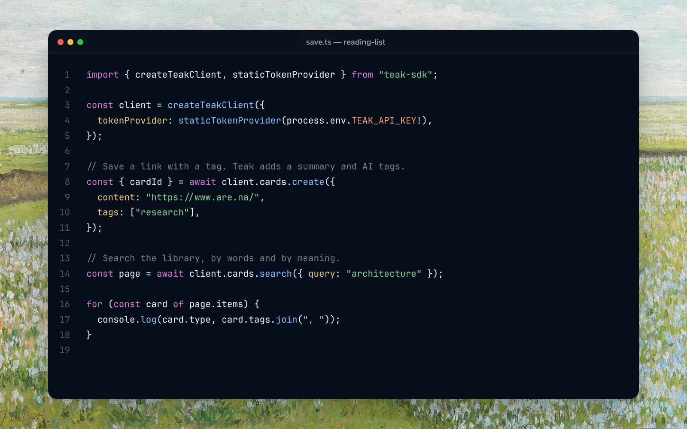

`teak-sdk` is the typed client for the [Teak API](/docs/api): one bundle with no runtime dependencies, versioned with the other Teak apps. The [CLI](/docs/cli), the browser extension and Raycast use it too.



## Install

```package-install
npm i teak-sdk
```

## Create a client

```ts
import { createTeakClient, staticTokenProvider } from "teak-sdk";

const client = createTeakClient({
  baseUrl: "https://teakvault.com/api",
  tokenProvider: staticTokenProvider(process.env.TEAK_API_KEY!),
});

await client.cards.create({ content: "A note from my script", tags: ["research"] });
const page = await client.cards.search({ query: "typography" });
```

`baseUrl` defaults to `https://teakvault.com/api`, and requests time out after 10 seconds unless you pass `timeoutMs`. Use an API key from **Settings → Integrations → API keys**, or an OAuth access token from [sign-in](#sign-in-with-workos-connect).

## What the client covers

Each method calls one [API](/docs/api) operation and follows its rules, limits and errors:

- **Cards:** `cards.list`, `search`, `favorites`, `pinned`, `similar`, `get`, `links`, `content` (`{ kind: "article" }` for a link's article), `create`, `update`, `duplicate`, `setFavorite`, `setPinned`, `reorderPinned`, `setArchived`, `setDone`, `savePdf`, `refresh`, `setThumbnail` (bytes and a MIME type, or `{ fileKey }` from `createThumbnailUpload`), `resetThumbnail`, `delete` (`{ permanent: true }` deletes a card in Trash for good), `restore`, `bulk`, and `changes`. Listings take the same filters as [`GET /v1/cards`](/docs/api#search-and-favorites) (`CARD_LIST_PARAMS` lists them, with what each takes; `SEARCH_QUERY_HELP` describes every search qualifier), and an `AbortSignal` as `{ signal }`.
- **Folders:** `folders.list`, `get`, `create`, `update` (including a manual folder's rules), `delete`, `addCards`, `removeCards`, `getRuleRun`, `waitForRuleRun`, and `undoRuleRun`.
- **Tags:** `tags.list`, `rename`, `merge`, `delete`, `operation`, and `waitFor`.
- **Highlights:** `highlights.list(cardId)`, `create(cardId, { quote, note?, prefix?, suffix? })`, `update(id, { note })`, and `delete(id)`.
- **Everything else:** `me`, `uploads.create` and `uploads.putFile`, `exports.start`, `exports.latest` and `exports.waitFor`, and `pageSnapshots.createUpload`, which lets a browser extension send the page it shows as a link's [saved copy](/docs/api#saved-copies-of-pages).

A few methods run a whole task:

- `cards.createFromFile({ bytes, fileName, mimeType?, tags?, notes? })` checks the file is a type and size Teak takes, uploads it and creates its card. `onUploaded` hands you the finished upload; pass it back as `uploaded` to retry only the create.
- `cards.pages(filters)` iterates a listing page by page, following `nextCursor`; stop iterating to stop fetching.
- `tags.waitFor(operation)`, `folders.waitForRuleRun(folderId, run)` and `exports.waitFor()` poll background work until it finishes, backing off up to 3 seconds and giving up after `timeoutMs` (10 minutes by default). A tag change that stops making progress comes back `failed`. `waitFor` does the same for anything you poll yourself.

Pass `{ idempotencyKey }` to `cards.create`, `cards.createFromFile` or `cards.bulk` to make retries safe. `formatBytes(card.fileSize)` turns a file size into the label Teak shows, such as `4.6 MB`.

## Errors and retries

Errors are `TeakApiError`s with a `code`, `status`, `retryAt`, and the response's `requestId`; `ERROR_CODES` lists every code. Each also has a `kind` to word it by: `auth` (sign in again; `AUTH_ERROR_CODES`), `not_found`, `rate_limited`, `network`, `unavailable`, `invalid`, `limit`, `conflict`, `forbidden`, `config` or `server`. The SDK's own messages name no client, so show them as they are or replace them by `kind`. An answer that isn't JSON, such as a proxy's HTML error page, is named by its status (`UNAUTHORIZED`, `RATE_LIMITED`, `SERVICE_UNAVAILABLE`…), and `retryAt` comes from `Retry-After` when the body has none.

Reads, and writes sent with an `idempotencyKey`, are retried up to twice when Teak is busy (`429`, `502`, `503`, `504`, or a `409 IN_PROGRESS` replay) or the network drops, waiting as long as `Retry-After` asks, up to 5 seconds; a longer wait is returned as the error. Pass `retries: 0` to `createTeakClient` to turn this off. Writes without a key are never sent twice.

## Token providers

A `TokenProvider` has `getAccessToken()`, which returns the token for each request, and an optional `onUnauthorized(rejectedToken: string)`. When a request returns a retry-eligible 401, `onUnauthorized` receives the access token that request used. Return a refreshed or newer stored token to retry the request once, or `null` to stop. Compare the rejected token with the current session before refreshing: a late response may refer to an older token, and refreshing for it could replace newer credentials.

## Sign in with WorkOS Connect

`createOAuthSession({ apiUrl, surface, store, lock })` is the whole sign-in, as the CLI and the browser extension use it. You give it where to keep the tokens (`store.read` and `store.write`, where `null` clears them) and, if several processes share them, a `lock`; it gives you:

- `tokenProvider()` for `createTeakClient`. It sends a saved token without discovery while it has more than a minute left (`ACCESS_TOKEN_REFRESH_MARGIN_MS`), refreshes it once for concurrent requests and saves the rotated refresh token first, refreshes after a 401 and sends the request again, keeps the sign-in through an outage, and clears it only when WorkOS refuses the refresh token. `tokenProvider({ ownerId })` refuses another account's sign-in.
- `signIn({ redirectUri, authorize })`, where `authorize(url)` opens the URL in a browser and returns the redirect it ends on. It checks the state, exchanges the code, confirms the account, and disconnects a sign-in it replaces.
- `signOut()`, which disconnects the grant and clears it. `"signed-out-here"` means the grant was already dead, so other installations stay connected until they're disconnected in Settings.

A failed step throws an `OAuthSessionError` whose `reason` (`provider_changed`, `signed_out`, `sign_out_first`, `token_rejected`…) you can word for your app.

The steps it is built from are exported too:

- `discoverAuthServer("https://teakvault.com/api")` returns the deployment's sign-in endpoints and the client ID for your surface, in one request, and caches the result for up to 60 seconds. You don't need it while a saved access token is still fresh: send that token to the deployment it was issued for, and discover when you refresh it, after a 401, and at sign-in and sign-out. Pass `{ forceRefresh: true }` after a sign-in or refresh failure. For a cloud development backend with a local sign-in server, pass that server's loopback origin as `localIssuer`; remote metadata can't enable loopback by itself.
- `randomBase64Url` and `createPkceChallenge` for PKCE, and `createConnectAuthorizeUrl` for the browser step. It requests the right [OAuth resource](/docs/api#authentication) for the deployment.
- `requestConnectTokens` for code and refresh grants. It returns `refresh_token_rejected` only when WorkOS says the refresh token is no longer valid; treat other failures as temporary and keep the saved sign-in.
- `fetchConnectOwnerId` binds the tokens to an account, and `disconnectConnectGrant` signs the surface out.

The SDK never stores credentials or opens a browser. Keep tokens in your platform's secure storage.
