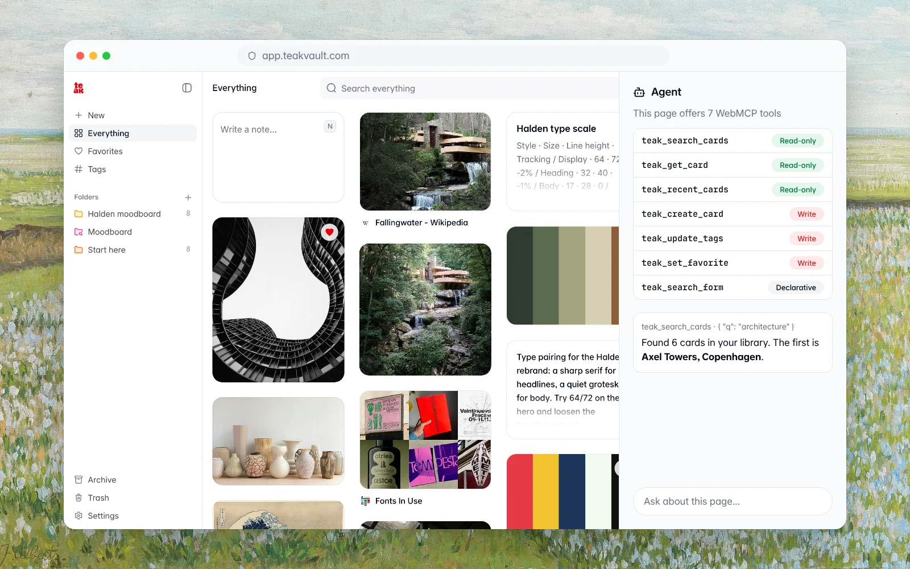

Teak's web app exposes [WebMCP](https://webmachinelearning.github.io/webmcp/)
tools in browsers with the draft `document.modelContext` API. Unlike the
[remote MCP server](/docs/mcp), they run in your signed-in browser session, so
an agent in the Teak web app needs no extra sign-in or API key.



## Requirements

- A browser with the draft WebMCP API, such as Chrome's WebMCP preview behind
  an experimental flag.
- A signed-in Teak web app session; the tools are registered only then.

## Available tools

The page registers eight tools: seven imperative and one declarative search form.

| Tool | Kind | What it does |
| --- | --- | --- |
| `teak_search_cards` | Read-only | Search your cards |
| `teak_get_card` | Read-only | Read one card |
| `teak_recent_cards` | Read-only | List your newest cards |
| `teak_create_card` | Write | Save a text, quote or link card |
| `teak_update_tags` | Write | Add or remove tags on a card |
| `teak_set_favorite` | Write | Favorite or unfavorite a card |
| `teak_set_pinned` | Write | Pin a card to the top of the library, or unpin it |
| `teak_search_form` | Declarative | Fill in and submit the search box |

`limit` is 1 to 50 (default 20) wherever a tool takes it, and `type` accepts `text`, `link`, `image`, `video`, `audio`, `document`, `palette`, or `quote`. A `CardSummary` is `{ id, type, title, url, excerpt, tags, isFavorited, isPinned, createdAt, updatedAt }`.

### Read tools

- `teak_search_cards` <Badge variant="success">Read-only</Badge>
  - Input: `{ q?: string, limit?: number, type?: string, favorited?: boolean }`
  - Output: `{ items: CardSummary[], total: number }`. Omit `q` to list
    recent cards.
- `teak_get_card` <Badge variant="success">Read-only</Badge>
  - Input: `{ cardId: string }`
  - Output: the card's summary plus `content`, `contentTruncated` and
    `notes`, or `null` for an unknown ID.
- `teak_recent_cards` <Badge variant="success">Read-only</Badge>
  - Input: `{ limit?: number, type?: string }`
  - Output: `{ items: CardSummary[], total: number }`, newest first.

### Write tools

- `teak_create_card` <Badge variant="warning">Write</Badge>
  - Input: `{ content: string, type?: "text" | "quote" | "link", url?: string, notes?: string, tags?: string[] }`.
    `type` defaults to `text`.
  - Output: `{ id, type, url, tags }`. Teak processes the new card in the
    background like any save.
- `teak_update_tags` <Badge variant="warning">Write</Badge>
  - Input: `{ cardId: string, add?: string[], remove?: string[] }`. List at
    least one tag in `add` or `remove`, never the same tag in both. Tags
    match ignoring case; tags you don't mention are kept.
  - Output: `{ id, tags }`, the card's tags after the change.
- `teak_set_favorite` <Badge variant="warning">Write</Badge>
  - Input: `{ cardId: string, favorited: boolean }`
  - Output: `{ id, isFavorited }`.
- `teak_set_pinned` <Badge variant="warning">Write</Badge>
  - Input: `{ cardId: string, pinned: boolean }`. Up to 12 cards can be
    pinned; archived cards can't.
  - Output: `{ id, isPinned }`.

### Declarative search

The home page's search box is the declarative `teak_search_form` tool (WebMCP
rejects duplicate names). With `toolautosubmit`, an agent fills in `q` and
submits it as if typing. It drives the page instead of returning data.

## Try it

<WebMcpStatus />

In the signed-in web app, list the registered tools from the DevTools console:

```js
const tools = await document.modelContext.getTools();
tools.map((tool) => tool.name);
```

## Security

- Every tool acts as you, on your own cards only.
- Read tools carry `readOnlyHint` and `untrustedContentHint`, since card
  content and notes are user-generated; write tools carry `consequentialHint`.
- Writes only create cards, change tags, and favorite or pin. Deleting,
  archiving, folders and the rest stay on the
  [remote MCP server](/docs/mcp#available-tools) and the [REST API](/docs/api).
- Tool descriptions are static and never include card content, per the spec's
  tool-poisoning guidance.
- The `tools` permission keeps its default allowlist, `self`, and the web app
  can't be framed, so only Teak's own pages can register and call these tools.
