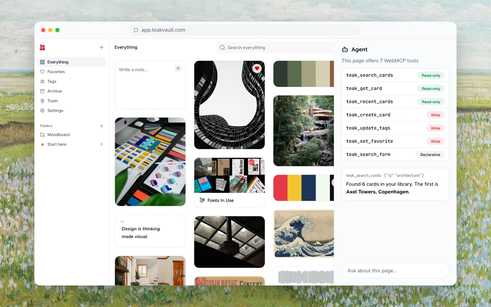

Teak's web app exposes [WebMCP](https://webmachinelearning.github.io/webmcp/)
tools in browsers that ship the draft `document.modelContext` API. Unlike the
[remote MCP server](/docs/mcp), these tools run inside your signed-in browser
session, so an agent helping you in the Teak web app needs no extra sign-in or
API key.



## Requirements

- A browser with the draft WebMCP API. As of September 2026 this is
  Chrome's WebMCP preview behind its experimental flag.
- A signed-in Teak web app session. The tools query your cards with your
  session and are registered only while you are signed in.

## Available tools

The page registers seven tools: six imperative tools and one declarative search form.

| Tool | Kind | What it does |
| --- | --- | --- |
| `teak_search_cards` | Read-only | Search your cards |
| `teak_get_card` | Read-only | Read one card |
| `teak_recent_cards` | Read-only | List your newest cards |
| `teak_create_card` | Write | Save a text, quote or link card |
| `teak_update_tags` | Write | Add or remove tags on a card |
| `teak_set_favorite` | Write | Favorite or unfavorite a card |
| `teak_search_form` | Declarative | Fill in and submit the search box |

`limit` is 1 to 50 and defaults to 20 wherever a tool takes it, and `type` accepts `text`, `link`, `image`, `video`, `audio`, `document`, `palette`, or `quote`. A `CardSummary` is `{ id, type, title, url, excerpt, tags, isFavorited, createdAt, updatedAt }`.

### Read tools

- `teak_search_cards` <Badge variant="success">Read-only</Badge>
  - Input: `{ q?: string, limit?: number, type?: string, favorited?: boolean }`
  - Output: `{ items: CardSummary[], total: number }`. Omit `q` to list
    recent cards.
- `teak_get_card` <Badge variant="success">Read-only</Badge>
  - Input: `{ cardId: string }`
  - Output: the card's summary plus `content`, `contentTruncated` and
    `notes`, or `null` when the ID does not exist.
- `teak_recent_cards` <Badge variant="success">Read-only</Badge>
  - Input: `{ limit?: number, type?: string }`
  - Output: `{ items: CardSummary[], total: number }`, newest first.

### Write tools

- `teak_create_card` <Badge variant="warning">Write</Badge>
  - Input: `{ content: string, type?: "text" | "quote" | "link", url?: string, notes?: string, tags?: string[] }`.
    `type` defaults to `text`.
  - Output: `{ id, type, url, tags }` for the new card. Teak processes it
    in the background, as it does any card you save.
- `teak_update_tags` <Badge variant="warning">Write</Badge>
  - Input: `{ cardId: string, add?: string[], remove?: string[] }`. At least
    one of `add` or `remove` must list a tag, and a tag can't be in both.
    Tags match ignoring case, and tags you don't mention are kept.
  - Output: `{ id, tags }` with the card's tags after the change.
- `teak_set_favorite` <Badge variant="warning">Write</Badge>
  - Input: `{ cardId: string, favorited: boolean }`
  - Output: `{ id, isFavorited }`.

### Declarative search

The search box on the home page is annotated as the declarative `teak_search_form`
tool. Its name stays distinct from the imperative tools above because WebMCP
rejects duplicate tool names. The form carries `toolautosubmit`, so agents can
fill in the `q` field and submit through the same search path as typing without
needing a submit button. Unlike the imperative search tool, the declarative
form drives the page UI rather than returning structured data.

## Try it

<WebMcpStatus />

On the signed-in web app you can also inspect the registered tools from the
DevTools console:

```js
const tools = await document.modelContext.getTools();
tools.map((tool) => tool.name);
```

## Security

- Every tool acts as you, in your signed-in session, on your own cards only.
- Read tools are annotated `readOnlyHint` and `untrustedContentHint`, because
  card content and notes are user-generated. Write tools are annotated
  `consequentialHint`.
- Writes are limited to creating a card, changing its tags and setting its
  favorite. Deleting, archiving, folders and the rest stay on the
  [remote MCP server](/docs/mcp#available-tools) and the [REST API](/docs/api).
- Tool descriptions are static strings. They never interpolate card content,
  following the spec's tool-poisoning guidance.
- The web app serves `Permissions-Policy: tools=(self)`, so only Teak's own
  pages can register and call these tools.

## Related

- [MCP](/docs/mcp) for external clients such as Claude Code and ChatGPT.
- [Teak for AI Agents](/docs/ai-agents) for choosing between MCP, REST, CLI,
  and in-browser tools.
