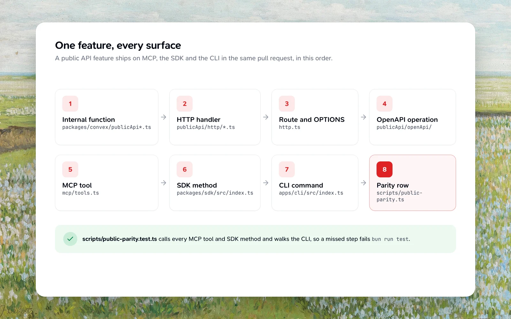

Read this before adding a field, a table, an index, an API operation or a background step. [Architecture](/docs/architecture#working-in-each-workspace) and the generated Convex guidelines (`packages/convex/_generated/ai/guidelines.md`) apply on top of it.



## One feature, every surface

A feature in the public API ships on MCP, the SDK and the CLI in the same pull request, in this order:

1. Internal function in `packages/convex/publicApi*.ts`.
2. The operation in `PUBLIC_API_OPERATIONS` (`packages/convex/shared/publicApiContract.ts`): its `operationId`, method, path and whether it reads a JSON body. The Convex routes, `GET /v1`, the 404 and 405 answers and the OpenAPI paths come from it.
3. Its handler in `publicApi/http/*.ts`, added to `HANDLERS` in `publicApi/http/router.ts`. The router has already checked the credential and parsed the body; TypeScript fails until every operation has a handler.
4. Its OpenAPI description in `publicApi/openApi/`, keyed by `operationId`; TypeScript fails until every operation has one.
5. The tool in `mcp/catalog.ts`: its Zod arguments (the JSON Schema clients see is generated from them), the operation it calls and its summary.
6. The method in `packages/sdk/src/index.ts`, which calls the operation by `operationId`.
7. The command in `apps/cli/src/index.ts` and `library.ts`.
8. The row in `scripts/repo/public-parity.ts`: the SDK method, CLI command and Raycast AI tool that use the operation, or the reason a surface leaves it out. The MCP column is read from the catalog.

Enum values, limits and error codes the surfaces share live in `publicApiContract.ts` too, and the SDK, CLI, Raycast and MCP App read them from there. `scripts/repo/public-parity.test.ts` calls every MCP tool and SDK method, walks the CLI command tree and checks the card list parameters (`CARD_LIST_PARAMS`) on the API, MCP, SDK and CLI, so a missed step fails the root `bun run test`. A new error code goes in `PUBLIC_API_ERROR_CODES`; the SDK's `ERROR_CODES` include it.

Update the [API](/docs/api), [MCP](/docs/mcp), [SDK](/docs/sdk) and [CLI](/docs/cli) docs with it ([Docs](#docs) maps each source to its page).

## Convex data

- Every card write goes through `insertCard` or `patchCard` (`card/cardWrites.ts`). They set the fields derived from the rest of the card (`urlHost`, `urlKey`, `isHidden`, `aiPending`, in `card/derivedFields.ts`), `savedAt` and `shuffleKey`, keep the free plan's count, and run the change hook (`card/onCardChanged.ts`) that keeps search, tag, folder, link and embedding rows in step. A new field the hook reads goes in its `CARD_CHANGE_FIELDS`.
- A new boolean flag is `v.optional(v.literal(true))`, never `true | false`, so `false` and missing can't disagree in an index.
- Stay backward compatible: new arguments are optional, and every client tolerates enum values it doesn't know, because the native apps update on their own schedule. Code kept only for old clients or old data gets an entry in `.agents/records/sunset.md` saying when it can go.
- A new user table, per-card row or R2 key is removed by account deletion: list every table with a user key in `accountDeletion/tables.ts`, as swept by `ancillaryPage`, deleted by another step, or kept with the reason (`__tests__/accountDeletion/tables.test.ts` fails otherwise); per-card rows go in `accountDeletion.ts` `deleteAccountDataHandler`. It is also removed by card hard delete (`card/deleteCard.ts`, `card/trashCleanup.ts`) and by `cardStorageObjectKeys` (`storage/cardObjectKeys.ts`). Seed it in the "complete stages" test in `edge/accountDeletionWorkflow.test.ts`, which runs the Core Worker's account deletion workflow against the test database.
- Card processing runs in the Core Worker (`apps/core-worker/src/workflows/cardProcessing/run.ts`). Add new steps after the existing ones and never rename one ([Rules every change keeps](/docs/architecture#rules-every-change-keeps)). Every Convex write a step makes passes the run's `guard: { cardId, rev }`, and every function it calls is listed in `packages/convex/workflows/rpcAllowlist.ts` (`__tests__/workflows/rpcAllowlist.test.ts` checks the list against the Worker's `internal.*` calls).
- Analytics events go in `shared/analytics.ts` first, with low-cardinality properties and never card content, URLs, file names, prompts or outputs.
- Values that are the same in every deployment are typed code with an optional environment override, not new configuration (see `scripts/release/build-metadata.ts`).

## Indexes and reads

- Add a new index beside the one it replaces, move every reader to it, and drop the old one in a separate pull request once the new code has run in production for a day.
- When a scan budget bounds a read, count every row the read touches. A `.filter()` on the query skips rows the loop never sees, so the budget stops capping the work. Check the field in the loop after charging the budget.
- Paginated public reads pass `maximumRowsRead` so a sparse filter can't read without limit.

## Backfills

A backfill is a self-scheduling, paged internal mutation in `packages/convex/migration/` built on `runBackfillPage` (`migration/runner.ts`), whose `dryRun` defaults to `true` (see `backfillUrlHost.ts`): the backfill names its table and what it does with one page, and the runner pages, adds up the counts and logs them at the end. Every migration or backfill needs the owner's explicit approval, and production runs are the owner's. Run the dry run, read its counts, then run the pages. Once the production run finishes, delete the backfill and its tests in the next pull request.

## Deploys

- Core Worker changes deploy before the Convex and web changes that use them.
- `Backend Deploy` deploys Convex when `main` changes a backend path, after it waits for a compatible Core Worker. Vercel deploys the web app and the docs from `main`.

## Plans and limits

Every feature is free on every plan. The free plan's 200-card cap is the only limit; saving past it returns `400 CARD_LIMIT_REACHED`.

## UI

Use the shadcn new-york primitives in `apps/web/src/components/ui` and [Vadivam](https://vadivam.praveenjuge.com) icons from `vadivam-react`. Vadivam keeps Lucide's icon names, so when the shadcn CLI adds a component with `lucide-react` imports, switch them to `vadivam-react`. One primary action per surface; secondary actions go in menus. Use skeletons for loading lists, sentence-case copy, and undo toasts for destructive or bulk actions. Check every state (empty, loading, one item, many, very long names, error) in light and dark at 390, 768 and 1440 px.

Text people read in the web app and browser extension comes from the message catalogs, in every language in the same pull request ([Translating](/docs/translating)).

## Docs

A feature people can use updates its page in these docs and, once it ships, its month's [changelog](/changelog) entry, in the same pull request as the change:

| When you change | Update |
| --- | --- |
| The public API (`packages/convex/http.ts`, `shared/publicApiContract.ts`, `publicApi/http/*.ts`, `publicApi/openApi/*.ts`) | `content/docs/(developers)/api.mdx` |
| MCP (`packages/convex/mcp`) | `content/docs/(developers)/mcp.mdx` |
| The SDK (`packages/sdk/src`) | `content/docs/(developers)/sdk.mdx` |
| The Apple app | `content/docs/(apps)/mac.mdx` and `content/docs/(apps)/mobile.mdx` |
| The Android app (`apps/android`) | `content/docs/(apps)/android.mdx` |
| Raycast commands or sign-in | `content/docs/(apps)/raycast.mdx` |
| The CLI (`apps/cli`) | `content/docs/(apps)/cli.mdx` |
| Public skills (`.agents/skills/teak`) | `content/docs/(developers)/ai-agents.mdx` and `pages/apps.astro` |
| How Teak is built, run, tested, translated or deployed | The page in this Open Source group that covers it |

Paths are relative to `apps/docs`. Write the Open Source pages for contributors and self-hosters; put notes only agents need inside `<Visibility for="agents">`, which keeps them off the website but in the `.md` mirrors and `llms.txt`. Teak's own deployments, credentials and runbooks stay in `.agents`.

Describe the product as it is now. Don't write how something used to work, what changed, or steps for data from before a change; that belongs in the changelog or the pull request. Give each fact one home and link to it from other pages.

- **Changelog:** one file per month with notable shipped changes, `content/changelog/<month>-<yyyy>.mdx`, with `date` set to the latest included ship date. Write for Teak users: lead with the outcome in plain words, group related changes under short headings, and for a breaking change say who is affected and what to do. Leave out code, field and endpoint names unless developers need them, and leave out marketing pages, refactors, tests, CI, schemas, migrations, backfills, dependencies and release mechanics.
- **Images:** every docs page shows at least one image, and every image comes from `scripts/docs-assets` (its README has the steps): add a shot to `scripts/docs-assets/shots.ts`, render it, and use its alt text. `scripts/docs-assets/shots.test.ts` fails on a page without an image or a drifted one, and names the exceptions.
- **Blog posts** live in `content/blog` (`type: blog`, `mode: center`, a `date` and `authors`) and open with a cover shot named after the post's file.
- **Evals:** `apps/docs/evals.yaml` holds questions Teak users and their agents ask; `bun run eval` in `apps/docs` answers each from these docs alone and a judge checks the expected facts. Keep every fact true to the shipped product, and never weaken one to pass.

<Visibility for="agents">

**Awkward data**

`devSeed:seedScenario` adds a pack of awkward cards to a dev or end-to-end account, from `packages/convex`. Every pack is one entry in `packages/convex/devSeed/scenarios.ts` (`cardsPack`, `folderPack`, `fillPack` or its own `seed`), and `scripts/repo/seed-packs-docs.test.ts` checks this list names each one:

```bash
bunx convex run devSeed:seedScenario '{"workosUserId":"<user>","scenario":"archive-mix"}'
```

Packs: `card-details`, `ordering`, `archive-mix`, `tags-2000`, `tags-case`, `folders-one`, `folders-500`, `card-in-50-folders`, `folders-ugly`, `search-qualifiers`, `search-qualifiers-1000`, `smart-folders`, `folder-rules` (a folder for each rule shape, its rules run as a save runs them: tags only, a search, both, a paused search, and a `secret` tag), `export-ugly`, `keyboard-mixed`, `shuffle-partial`, `palette-mixed`, `focus-notes`, `checklists`, `note-tables` (GFM tables in notes, including ones that stay literal), `search-operators` (400 cards and three smart folders where `-`, `OR` and parentheses each have their own answer), `hidden-mix`, `hidden-mix-1000`, `revisit-sizes`, `save-details`, `omnibox-titles`, `ocr-images`, `ocr-documents`, `ocr-links`, `url-variants` (link variants for the duplicate check, half from before `urlKey` and `savedAt`), `resave` (300 links over three years to save again, archived and trashed matches, one in three folders tagged `reading`, a `utm_source` variant), `resave-at-limit` (a free account at 200 of 200 with five links to save again), `paste-links` (a free account at 195 cards with ten links, two archived, that the composer's paste fixtures repeat), `done-states`, `done-states-images` (1,000 images and a marker link per page with no category, for an empty `is:todo`), `rich-sites` (links with Wikipedia, arXiv, Spotify, Apple Music and Open Library details, including a paper to Save PDF from), `ai-languages` (notes in seven languages, a mixed and a wordless note, and French and Portuguese links, processed for real; `scripts/seed/ai-language-check.ts` scores their AI language), `page-archive-mix` (links' saved copies in every state: full, text-only, failed, still saving, from the extension, in Trash, and a podcast with a transcript, with stub copies in R2), `reader-mix` (links for the Read tab in every state: a long article with images, code and a wide table, news, research, a page that isn't an article, Arabic and Japanese articles, one cut at 512 KiB, one being prepared, one failed, and a podcast with both an article and a transcript), `reader-search-1000` (1,000 articles only their body text finds), `highlights-mix` (highlights on the `reader-mix` articles: the cap of 200, twelve with notes, a repeated quote, Arabic and Japanese, a merge, imported ones waiting for their article, and a highlighted podcast to refresh; seed `reader-mix` first), `card-limit-199` (a free account one card under the limit), `pinned` (eleven pinned notes, one pin under the cap), `card-links` and `backlinks` (`[[…]]` links between notes, including missing, deleted and someone else's targets), `email-in` and `email-attachments` (cards as Save by email makes them; `email-in` also turns Save by email on), `ordering-saved` (cards saved again after they were first saved, for Newest first and time words), `video-captions` and `podcast-transcripts` (links with the transcripts their captions or audio give), `dead-links` (links whose pages are gone or not, with saved copies; pass `origin` for your own status server) and `locale-switch` (no cards: sets the account's language to German). Large packs seed in pages: pass `"page": 0`, then 1, 2… until it reports `already_seeded`. A pack run twice adds nothing. `folders-500` fills the 500-folder cap, so run folder packs after it on another account. Add a pack when a feature needs data none of these cover.

A user-facing feature also adds or updates its recipe in `.agents/skills/verify-teak/features/` and is driven once in the running app.

</Visibility>
