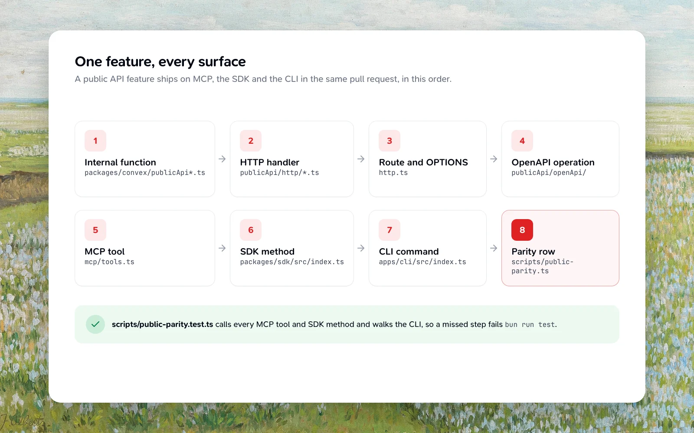

The rules that keep a new feature consistent across Teak's surfaces, search, deletion and deploys. Read this before adding a field, a table, an index, an API operation or a background step. `packages/convex/AGENTS.md` and the generated Convex guidelines (`packages/convex/_generated/ai/guidelines.md`) apply on top of it.



## One feature, every surface

A feature in the public API ships on MCP, the SDK and the CLI in the same pull request, in this order:

1. Internal function in `packages/convex/publicApi*.ts`.
2. Handler in `publicApi/http/*.ts`, dispatched by `executePublicApiOperation` (`publicApi/http/routes.ts`).
3. Route plus its `OPTIONS` in `http.ts`.
4. The operation in `publicApi/openApi/`.
5. The tool in `mcp/tools.ts`.
6. The method in `packages/sdk/src/index.ts`.
7. The command in `apps/cli/src/index.ts` and `library.ts`.
8. The row in `scripts/public-parity.ts`, which maps every OpenAPI operation to its MCP tool, SDK method and CLI command, or gives the reason a surface leaves it out.

`scripts/public-parity.test.ts` calls every MCP tool and SDK method, walks the CLI command tree and compares the card list filters, so a missed step fails the root `bun run test`. A new error code goes in `PUBLIC_API_ERROR_CODES` (`publicApi/http/shared.ts`) and the SDK's `ERROR_CODES`; the same test fails when the SDK doesn't know a code the API returns.

Update the [API](/docs/api), [MCP](/docs/mcp), [SDK](/docs/sdk) and [CLI](/docs/cli) docs with it (`apps/docs/AGENTS.md` maps each source to its page).

## Convex data

- Writes that change what search sees go through `patchCardWithSearchSync` or `scheduleCardSearchSync` (`card/searchSync.ts`).
- A new boolean flag is `v.optional(v.literal(true))`, never `true | false`, so `false` and missing can't disagree in an index.
- Stay backward compatible: new arguments are optional, and every client tolerates enum values it doesn't know. The native apps update on their own schedule. Code kept only for old clients or old data gets an entry in `.agents/sunset.md` saying when it can go.
- A new user table, per-card row or R2 key is removed by account deletion (`accountDeletionData.ts` `ancillaryPage`, per-card rows in `accountDeletion.ts` `deleteAccountDataHandler`), by card hard delete (`card/deleteCard.ts`, `card/trashCleanup.ts`) and by `cardStorageObjectKeys` (`storage/cardObjectKeys.ts`). Seed it in the "complete stages" test in `edge/accountDeletionWorkflow.test.ts`, which runs the Core Worker's account deletion workflow against the test database.
- Card processing runs in the Core Worker (`apps/core-worker/src/workflows/cardProcessing/run.ts`). Step names are durable history: never rename one, and add new steps after the existing ones. Every Convex write a step makes passes the run's `guard: { cardId, rev }`, and every function it calls is listed in `workflows/rpcAllowlist.ts`.
- Analytics events go in `shared/analytics.ts` first, with low-cardinality properties and never card content, URLs, file names, prompts or outputs.
- Values that are the same in every deployment are typed code with an optional environment override, not new configuration (see `scripts/build-metadata.ts`).

## Indexes and reads

- Add a new index beside the one it replaces, move every reader to it, and drop the old one in a separate pull request once the new code has run in production for a day.
- When a scan budget bounds a read, count every row the read touches. A `.filter()` on the query skips rows the loop never sees, so the budget stops capping the work. Check the field in the loop after charging the budget.
- Paginated public reads pass `maximumRowsRead` so a sparse filter can't read without limit.

## Backfills

A backfill is a hand-written, self-scheduling, paged internal mutation in `packages/convex/migration/` whose `dryRun` defaults to `true` (see `backfillUrlHost.ts`). It needs the owner's approval. Run the dry run, read its counts, then run the pages. Production runs are the owner's. Once the production run finishes, delete the backfill and its tests in the next pull request; git history keeps them.

## Deploys

- Core Worker changes deploy before the Convex and web changes that use them.
- `Backend Deploy` deploys Convex when `main` changes a backend path, after it waits for a compatible Core Worker. Vercel deploys the web app and the docs from `main`.

## Plans and limits

Every feature is free on every plan. The free plan's 200-card cap is the only limit; saving past it returns `400 CARD_LIMIT_REACHED`.

## UI

Use the shadcn new-york primitives in `apps/web/src/components/ui` and [Vadivam](https://vadivam.praveenjuge.com) icons from `vadivam-react`. Vadivam keeps Lucide's icon names, so when the shadcn CLI adds a component with `lucide-react` imports, switch them to `vadivam-react`. One primary action per surface; secondary actions go in menus. Use skeletons for loading lists, sentence-case copy, and undo toasts for destructive or bulk actions. Check every state (empty, loading, one item, many, very long names, error) in light and dark at 390, 768 and 1440 px.

Text people read in the web app and browser extension comes from the message catalogs, in every language in the same pull request ([Translating](/docs/translating)).

## Docs

A feature people can use updates its page in these docs and, once it ships, its month's [changelog](/changelog) entry (`apps/docs/AGENTS.md`).

<Visibility for="agents">

**Awkward data**

`devSeed:seedScenario` adds a pack of awkward cards to a dev or end-to-end account, from `packages/convex`:

```bash
bunx convex run devSeed:seedScenario '{"workosUserId":"<user>","scenario":"archive-mix"}'
```

Packs: `card-details`, `ordering`, `archive-mix`, `tags-2000`, `tags-case`, `folders-one`, `folders-500`, `card-in-50-folders`, `folders-ugly`, `search-qualifiers`, `search-qualifiers-1000`, `smart-folders`, `export-ugly`, `keyboard-mixed`, `shuffle-partial`, `palette-mixed`, `focus-notes`, `checklists`, `note-tables` (GFM tables in notes, including ones that stay literal), `search-operators` (400 cards and three smart folders where `-`, `OR` and parentheses each have their own answer), `hidden-mix`, `hidden-mix-1000`, `revisit-sizes`, `save-details`, `omnibox-titles`, `ocr-images`, `ocr-documents`, `ocr-links`, `url-variants` (link variants for the duplicate check, half from before `urlKey` and `savedAt`), `resave` (300 links over three years to save again, archived and trashed matches, one in three folders tagged `reading`, a `utm_source` variant), `resave-at-limit` (a free account at 200 of 200 with five links to save again), `paste-links` (a free account at 195 cards with ten links, two archived, that the composer's paste fixtures repeat), `done-states`, `done-states-images` (1,000 images and a marker link per page with no category, for an empty `is:todo`), `rich-sites` (links with Wikipedia, arXiv, Spotify, Apple Music and Open Library details, including a paper to Save PDF from), `ai-languages` (notes in seven languages, a mixed and a wordless note, and French and Portuguese links, processed for real; `scripts/ai-language-check.ts` scores their AI language) `page-archive-mix` (links' saved copies in every state: full, text-only, failed, still saving, from the extension, in Trash, and a podcast with a transcript, with stub copies in R2), `reader-mix` (links for the Read tab in every state: a long article with images, code and a wide table, news, research, a page that isn't an article, Arabic and Japanese articles, one cut at 512 KiB, one being prepared, one failed, and a podcast with both an article and a transcript), `reader-search-1000` (1,000 articles only their body text finds), `highlights-mix` (highlights on the `reader-mix` articles: the cap of 200, twelve with notes, a repeated quote, Arabic and Japanese, a merge, imported ones waiting for their article, and a highlighted podcast to refresh; seed `reader-mix` first) and `card-limit-199` (a free account one card under the limit). Large packs seed in pages: pass `"page": 0`, then 1, 2… until it reports `already_seeded`. A pack run twice adds nothing. `folders-500` fills the 500-folder cap, so run folder packs after it on another account. Add a pack when a feature needs data none of these cover.

A user-facing feature also adds or updates its recipe in `.agents/skills/verify-teak/features/` and is driven once in the running app.

</Visibility>
