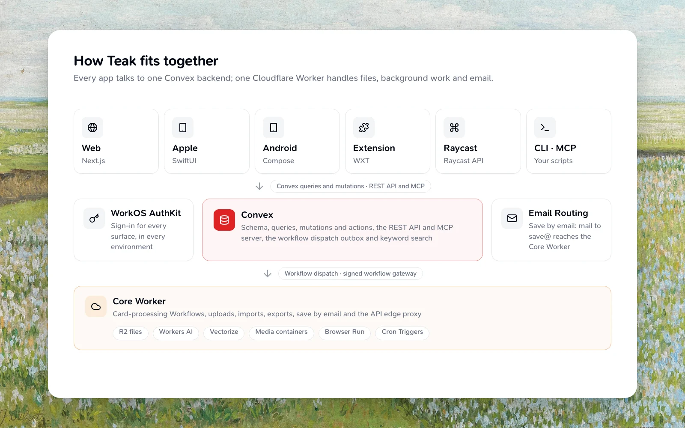

| `apps/core-worker` | File delivery, uploads, card processing, imports, exports, save by email and the API edge proxy | Cloudflare Workers | Cloudflare |---
title: Architecture
description: How Teak's apps, backend and Cloudflare Workers fit together, and the rules every change keeps
icon: network
related:
  - /docs/adding-a-feature
  - /docs/development
---

Teak is a Turborepo monorepo. Every app talks to one Convex backend; one Cloudflare Worker handles files, background work and email. This page is the map: where each piece lives, how a saved card moves through them, and the rules that hold everywhere.

## Apps

| Path | What it is | Built with | Runs on |
| --- | --- | --- | --- |
| `apps/web` | The web app at app.teakvault.com | Next.js | Vercel |
| `apps/docs` | teakvault.com: the website, these docs and the changelog | Blume | Vercel |
| `apps/apple` | The iPhone, iPad and Mac app, with its share and Safari extensions | SwiftUI | App Store |
| `apps/android` | The Android app | Kotlin, Jetpack Compose | Google Play |
| `apps/extension` | The Chrome and Firefox extension | WXT | Chrome Web Store, Firefox Add-ons |
| `apps/raycast` | The Raycast extension | Raycast API | Raycast Store |
| `apps/cli` | The `teak` command line, published as `teak-cli` | Bun, TypeScript | npm |
| `apps/core-worker` | File delivery, uploads, card processing, imports, exports, save by email and the API edge proxy | Cloudflare Workers | Cloudflare |

## Packages

| Path | What it is |
| --- | --- |
| `packages/convex` | The Convex backend: schema, queries, mutations and actions, the public REST API, the MCP server, and `shared/`, the pure helpers other surfaces import |
| `packages/files-protocol` | The contract between Convex and the Core Worker: operation shapes, signing and limits |
| `packages/sdk` | `teak-sdk`, the public TypeScript client ([SDK](/docs/sdk)). The CLI, extension, docs and end-to-end tests use it from source |
| `packages/i18n` | The message catalogs for the web app and extension ([Translating](/docs/translating)) |
| `packages/mcp-app` | The card view MCP clients such as Claude show for Teak's tools ([Card views](/docs/mcp#card-views)). `bun run build` writes it into `packages/convex/mcp/appHtml.generated.ts`, which the MCP server serves; a test fails when the two differ |
| `packages/tests` | The end-to-end suite ([Testing](/docs/testing#end-to-end-suite)) |

`plugins/teak` is Teak's Claude plugin: the MCP server, a skill and slash commands. The root `.claude-plugin/marketplace.json` lists it, so Claude Code can install it from this repository.

## How a saved card moves

1. **Save.** A client calls a Convex mutation (the apps) or the public API (the CLI, Raycast, MCP and your scripts). Every signed-in surface gets its Convex identity from a WorkOS AuthKit session; WorkOS is the only sign-in provider in every environment.
2. **Queue.** The mutation writes the card and, in the same transaction, a row in the workflow dispatch outbox (`queueCardProcessing` in `packages/convex/workflowDispatch.ts`). A flush hands due rows to the Core Worker, which starts a Cloudflare Workflow for each. A resend is safe: an instance that already exists counts as started.
3. **Process.** The card-processing Workflow (`apps/core-worker/src/workflows/cardProcessing/run.ts`) fetches link pages, renders thumbnails and previews, transcribes audio, reads text in images and asks Workers AI for tags and a summary. Each step reads and writes Convex through one signed endpoint, the workflow gateway.
4. **Show.** Each write lands on the card, and every client's live query updates. The card's `processingStatus` records each stage, so a client can show what's still running.

Every write a processing run makes carries the run's processing revision. Editing a card bumps the revision and stops the older run, so a stale run can never overwrite newer work; its write is refused and the run ends as skipped.

## Files, AI and search

- **Files** live in a private R2 bucket. Convex mints signed URLs, and the Core Worker checks them, streams the object, and handles range requests and caching. Convex holds no R2 or Workers AI credentials: every byte and AI call goes through the Worker.
- **Media** work runs in two Containers: a media renderer (ffmpeg and poppler, for video, audio and PDF) and a link fetcher that downloads remote images and media under the same SSRF rules Convex used. Link screenshots run on Browser Run.
- **Search by meaning** uses Workers AI embeddings stored in Vectorize, one namespace per user, alongside Convex's keyword search.
- **Background tasks** that used to be Convex crons run as the Worker's Cron Triggers; Convex keeps the table logic in internal functions the Worker calls.

## Public API and MCP

The REST API, the MCP server, the OpenAPI spec and the OAuth discovery documents are Convex HTTP routes. In production, `teakvault.com/api`, `/mcp` and the discovery documents reach Convex only through the Core Worker's edge proxy (`apps/core-worker/src/edge/apiProxy.ts`), which also rate-limits them. The docs site on Vercel has no rewrites for them. The [API](/docs/api), [MCP](/docs/mcp), [SDK](/docs/sdk) and [CLI](/docs/cli) offer the same operations, and a test keeps them in step ([Adding a Feature](/docs/adding-a-feature#one-feature-every-surface)).

## Save by email

Mail to `save@in.teakvault.com` arrives through Cloudflare Email Routing at the Core Worker's email handler (`apps/core-worker/src/email`), which checks the sender's DMARC result and posts a signed request to Convex. Convex finds the account and makes the cards; attachments go to the Core Worker's own signed upload URLs, so their bytes never pass through Convex.

## Card types

Teak has eight card types: text, link, image, video, audio, document, palette and quote. Every surface handles all eight, and tolerates values it doesn't know yet, because the native apps update on their own schedule.

## Rules every change keeps

- Client reads use the cached Convex query hooks; writes use Convex mutations or actions.
- Import backend APIs from `@teak/convex`, generated data types from `@teak/convex/_generated/dataModel`, and shared constants from `@teak/convex/shared/constants`.
- The web app owns its UI in `apps/web/src`. The browser extension keeps its own small copies of the button, wordmark and theme tokens. Pure helpers that several surfaces share (web, docs, extension, native ports) go in `packages/convex/shared`.
- The Apple and Android apps port the same pure logic (filters, card edits, Markdown blocks, date search) with the same test cases, so a behavior change on one is ported to the other.
- Card processing keeps its workflow retries, the processing-revision guard on every write, and a consistent `processingStatus`.
- Workflow step names are durable history: a step is never renamed, and new steps go after the existing ones.
- Every package moves in lockstep: one version across every manifest for each release.

[Adding a Feature](/docs/adding-a-feature) has the rules for fields, tables, indexes, API operations and backfills.
