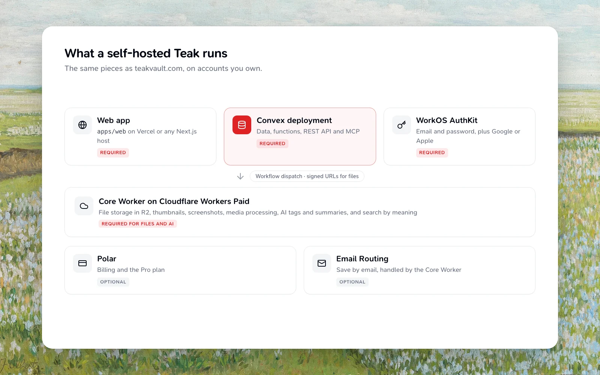

## What you'll need

- Git, Bun, and Node.js at the versions pinned in `package.json`
- A [Convex](https://convex.dev/) account
- A [WorkOS](https://workos.com/) account, for sign-in
- A Cloudflare account on Workers Paid, for files, AI, thumbnails, screenshots and media processing
- Optionally, [Polar](https://polar.sh/) to sell plans; otherwise turn billing off ([Billing](#billing-optional))

:::warning[Beta]
Self-hosting matches the hosted product, but you own uptime, secrets, and
billing integrations. Start with a local Convex deployment before pointing a
public domain at it.
:::

## Set up WorkOS

Create one WorkOS environment per deployment: a staging environment for local development and a separate production environment. Replace `<origin>` with the web app's origin (`http://localhost:3000` locally).

1. In AuthKit, enable email and password sign-in. Social sign-in, such as Google or Apple, is set up in WorkOS alone; Teak needs no settings for it. WorkOS sends the sign-in, verification and password reset emails.
2. Under Redirects, add `<origin>/callback` as a redirect URI, set the sign-in endpoint (initiate login URL) to `<origin>/sign-in`, and set the sign-out redirect to `<origin>/sign-in`. Add `<origin>` as an allowed CORS origin.
3. Add a JWT template so session tokens carry the claims Teak reads: the address, its verification and the name. The backend requires `email_verified: true`:

   ```json
   {"email": {{ user.email }}, "email_verified": {{ user.email_verified }}, "name": {{ user.name }}, "first_name": {{ user.first_name }}, "last_name": {{ user.last_name }}}
   ```

4. From API Keys, copy the client ID and API key into `WORKOS_CLIENT_ID` and `WORKOS_API_KEY`.

A new user's Teak account is created at their first sign-in, from the signed session's claims, and each later sign-in brings its address, verification and name up to date. Teak needs no WorkOS webhook.

`convex.json` declares AuthKit redirect URIs and CORS origins under `authKit.dev` and `authKit.prod`, and Convex applies them to the deployment's WorkOS environment. Teak's own origins are listed there, so edit `authKit.prod` to your domain before deploying.

The iPhone, iPad, Mac, and Android apps sign in through AuthKit with PKCE and the same `WORKOS_CLIENT_ID` as the web app, which they read from the deployment. Their redirect URI, `teak://auth/callback`, is already in `convex.json`.

### Use the WorkOS CLI

The [WorkOS CLI](https://www.npmjs.com/package/workos) can set the sign-out redirect. Sign in with `workos auth login` and select the environment first:

```bash
# Sign-out redirect (step 2)
workos authkit logout-uris set --uri <origin>/sign-in --default <origin>/sign-in
```

`logout-uris set` replaces the environment's whole list of sign-out URIs.

### Connect: CLI, browser extensions, Raycast, and MCP

The CLI, browser extensions, Raycast, and MCP clients sign in through WorkOS Connect, which needs a few more settings.

1. Turn on Client ID Metadata Document (CIMD) support, and dynamic client registration for MCP clients that don't support CIMD yet.
2. Add the resource indicators `<origin>/api` and `<origin>/mcp`. These are the deployment's token audiences, and Teak rejects any other. `<origin>` is `WORKOS_RESOURCE_ORIGIN`, an HTTPS origin with no path or trailing slash (default `https://teakvault.com`). Set it to your public origin, normally the same as `PUBLIC_ORIGIN`, so the MCP resource matches the URL MCP clients connect to.
3. Create one public OAuth application for each first-party surface, and set its client ID on the Convex deployment:

   | Surface | Convex variable | Redirect URIs |
   | --- | --- | --- |
   | CLI | `WORKOS_CONNECT_CLI_CLIENT_ID` | `http://127.0.0.1:14210/oauth/callback`, `http://127.0.0.1:24210/oauth/callback` |
   | Raycast | `WORKOS_CONNECT_RAYCAST_CLIENT_ID` | `https://raycast.com/redirect?packageName=Extension` |
   | Chrome extension | `WORKOS_CONNECT_CHROME_CLIENT_ID` | `https://<extension-id>.chromiumapp.org/oauth/callback` |
   | Firefox extension | `WORKOS_CONNECT_FIREFOX_CLIENT_ID` | `https://<hash>.extensions.allizom.org/oauth/callback`, from `browser.identity.getRedirectURL()` for the add-on ID |

4. Set `WORKOS_AUTHKIT_DOMAIN` to the environment's AuthKit domain, an HTTPS origin such as `https://your-domain.authkit.app` with no path or port.

Sign-in discovery needs `WORKOS_AUTHKIT_DOMAIN` and all four client IDs. If any of them is missing or malformed, discovery fails and none of these clients can sign in, so set all four even if you only use one.

## Quickstart (local)

Teak's `bun run setup`, `bun run dev` and `bun run doctor` work only against Teak's own development deployment. On your own deployment, run Convex and the web app directly.

<Steps>
  <Step title="Clone and install">
    ```bash
    git clone https://github.com/praveenjuge/teak.git
    cd teak
    bun install
    ```
  </Step>
  <Step title="Create your Convex deployment">
    From `packages/convex`, sign in to your own Convex account and start a development deployment:

    ```bash
    cd packages/convex
    bunx convex login
    bunx convex dev
    ```

    Choose to create a new project. `convex dev` pushes the backend, keeps watching for changes, records the deployment in `packages/convex/.env.local`, and prints its `CONVEX_URL` and `CONVEX_SITE_URL` (also under Settings → Deployment in the Convex dashboard).
  </Step>
  <Step title="Configure the backend">
    Set `SITE_URL` (`http://localhost:3000` locally), your WorkOS staging values from [Set up WorkOS](#set-up-workos), and any features you want. Run these from `packages/convex`:

    ```bash
    bunx convex env set SITE_URL http://localhost:3000

    # Sign-in
    bunx convex env set WORKOS_CLIENT_ID client_...
    bunx convex env set WORKOS_API_KEY

    # Optional: files and AI card processing, through your Core Worker
    bunx convex env set FILES_BASE https://files.yourdomain.com
    bunx convex env set FILES_SIGNING_SECRET
    bunx convex env set WORKFLOW_RPC_SECRET
    ```

    Leaving the value off makes `convex env set` prompt for it, which keeps secrets out of your shell history. [Detailed Environment Reference](#detailed-environment-reference) lists every variable.
  </Step>
  <Step title="Start the web app">
    Write `apps/web/.env.local` with the [web values](#web-appswebenvlocal), then:

    ```bash
    bun run --cwd apps/web dev
    ```
  </Step>
</Steps>

## Production basics

<Steps>
  <Step title="Designate the administrator">
    Sign up the intended administrator account first. Then pause new sign-ups and grant its stored admin role from `packages/convex`:

    ```bash
    bunx convex run --prod admin:setSignupsPaused '{"paused":true}'
    bunx convex run --prod admin:seedAdmin '{"email":"owner@example.com"}'
    ```

    Use your account's email; the command refuses unless exactly one active account has it. The admin role stays with the account through email changes. While sign-ups are paused, a new person can still create a WorkOS account, but Teak shows them a "sign-ups are paused" screen and creates no Teak account. To reopen sign-ups, run `admin:setSignupsPaused` with `'{"paused":false}'`.
  </Step>
  <Step title="Connect the production WorkOS environment">
    Set up a separate production environment as in [Set up WorkOS](#set-up-workos), using your public origin. Set its `WORKOS_*` values on the production Convex deployment, and set `SITE_URL` there to your web app's public origin, such as `https://app.yourdomain.com`.
  </Step>
  <Step title="Deploy the Core Worker">
    Create its queues and vector index, write your values to `apps/core-worker/self-host/.env` and its secrets to `self-host/.env.secrets`, then deploy from `apps/core-worker`, as described in [Core Worker](#core-worker):

    ```bash
    bun run deploy:self-host -- --with-secrets
    ```

    Later deploys are `bun run deploy:self-host`. On the Convex deployment, set `FILES_BASE` to the Worker's public origin, the same `FILES_SIGNING_SECRET`, and the derived `WORKFLOW_RPC_SECRET`.
  </Step>
  <Step title="Build and host the web app">
    Build `apps/web` with the [web values](#web-appswebenvlocal) for production: your production `NEXT_PUBLIC_CONVEX_URL` and `NEXT_PUBLIC_CONVEX_SITE_URL`, the same `WORKOS_CLIENT_ID`, its own `WORKOS_COOKIE_PASSWORD`, `NEXT_PUBLIC_WORKOS_REDIRECT_URI` set to `https://app.yourdomain.com/callback`, and `NEXT_PUBLIC_FILES_BASE`. Host it on any Next.js host, or run it yourself:

    ```bash
    bun run --cwd apps/web build
    bun run --cwd apps/web start
    ```
  </Step>
  <Step title="Turn billing off, or add it">
    Set `BILLING_DISABLED=true` on the Convex deployment to give every account Pro with no card limit, or set the `POLAR_*` values to sell plans with your [Polar](https://polar.sh/) account. See [Billing](#billing-optional).
  </Step>
</Steps>

## Detailed Environment Reference

Set these before running locally or deploying.

### Backend (Convex deployment)

Set these on the Convex deployment with `bunx convex env set` from `packages/convex`, or in the Convex dashboard:

```bash
SITE_URL=http://localhost:3000
PUBLIC_ORIGIN=https://yourdomain.com
WORKOS_CLIENT_ID=client_...
WORKOS_API_KEY=sk_test_...
WORKOS_AUTHKIT_DOMAIN=https://your-domain.authkit.app   # Connect sign-in: CLI, extensions, Raycast, MCP
WORKOS_RESOURCE_ORIGIN=https://yourdomain.com # Optional: token audiences <origin>/api and <origin>/mcp (default https://teakvault.com)
WORKOS_CONNECT_CLI_CLIENT_ID=client_...      # Plus the RAYCAST, CHROME, and FIREFOX client IDs
FILES_BASE=https://files.yourdomain.com
FILES_SIGNING_SECRET=shared-secret
WORKFLOW_RPC_SECRET=derived-secret           # Derived from the Core Worker's WORKFLOW_RPC_ROOT_SECRET
EMAIL_INBOUND_SIGNING_SECRET=secret          # Optional: Save by email
INBOUND_EMAIL_DOMAIN=in.yourdomain.com       # Optional: Save by email (default in.teakvault.com)
BILLING_DISABLED=true                        # Optional: no plans; every account gets Pro (see Billing)
POLAR_ACCESS_TOKEN=token
POLAR_ORGANIZATION_TOKEN=token
POLAR_SERVER=sandbox
POLAR_WEBHOOK_SECRET=secret
```

`SITE_URL`, `WORKOS_CLIENT_ID`, and `WORKOS_API_KEY` are required; add the rest for the features you want. `SITE_URL` is your web app's origin: card links the API and MCP return (`appUrl`, and `settingsUrl` from `GET /v1/me`) open it. The `WORKOS_*` values come from [Set up WorkOS](#set-up-workos), and `FILES_BASE`, `FILES_SIGNING_SECRET` and `WORKFLOW_RPC_SECRET` from the [Core Worker](#core-worker).

### Core Worker

The Core Worker handles every file byte, AI call and background job ([Architecture](/docs/architecture#files-ai-and-search)); Convex holds no R2 or Workers AI credentials. It binds your R2 bucket, Cloudflare Images, Workers AI, Browser Run (link screenshots) and two Containers. Self-hosted deployments use `apps/core-worker/self-host/wrangler.jsonc`, which names nothing of Teak's own account, so you never edit it and updates pull cleanly. `apps/core-worker/wrangler.jsonc` is Teak's own production Worker; don't deploy it.

`bun run deploy:self-host`, from `apps/core-worker`, reads your values from `self-host/.env` and runs `wrangler deploy` with a copy of that config, `self-host/wrangler.deploy.jsonc`, so the resource IDs Wrangler writes back stay out of the committed file. Arguments after `--` go to Wrangler, so `bun run deploy:self-host -- --dry-run` checks your values and the bundle without deploying. The `.env` files and the copy are ignored by git.

Deploy it on Workers Paid. Exports stream every file into one ZIP in a single request, which needs the raised `cpu_ms` and `subrequests` limits in the config (Workers Free allows 10 ms of CPU per request). Paid also includes 10 browser hours a month of Browser Run, and Cloudflare Containers, which Workers Free does not offer.

The media renderer runs ffmpeg and poppler in a Container built from `apps/core-worker/container/Dockerfile`. It makes video thumbnails and hover previews, audio waveforms, PDF thumbnails and PDF text, and converts audio for transcription. `wrangler deploy` builds the image, so the machine or CI runner that deploys needs Docker. The Container uses the `basic` instance type (1/4 vCPU, 1 GiB memory) with up to 4 instances (`max_instances`; keep `MEDIA_RENDERER_INSTANCES` in `vars` equal to it). Workers Paid includes 375 vCPU-minutes and 25 GiB-hours of Containers a month, enough for tens of thousands of media jobs. Each instance takes one job at a time, has no internet access, and reads only the file the Worker sends it, up to 100 MB. When the renderer is busy, Teak retries with backoff.

The link fetcher, a second Container built from `apps/core-worker/fetcher/Dockerfile`, downloads remote preview images and media straight into R2 under the same SSRF rules Convex uses.

#### Resources to create

The first `bun run deploy:self-host` creates the R2 bucket (`teak-files`), both KV namespaces, the Workflows, Durable Objects, Containers and the Analytics Engine dataset, and later deploys keep them bound. Create these yourself before it:

- **Queues:**

  ```bash
  for queue in teak-object-deletions teak-object-deletions-dlq teak-ai-backfill teak-r2-events; do
    bunx wrangler queues create "$queue"
  done
  ```

- **A Vectorize index** for search by meaning, 768 dimensions and cosine, with a `type` metadata index created before its first vector:

  ```bash
  bunx wrangler vectorize create teak-cards-0 --dimensions=768 --metric=cosine
  bunx wrangler vectorize create-metadata-index teak-cards-0 --property-name=type --type=string
  ```

After the first deploy, add the bucket's event notification, which sends new objects under `users/` to the `teak-r2-events` queue so abandoned uploads are deleted after a day:

```bash
bunx wrangler r2 bucket notification create teak-files --event-type object-create --queue teak-r2-events --prefix users/
```

#### Vars

Copy `apps/core-worker/self-host/example.env` to `self-host/.env` and fill it in. The deploy script checks every value, refuses keys it doesn't know, and passes them to Wrangler as vars:

| Key | Value |
| --- | --- |
| `CONVEX_SITE_URLS` | Required. Your deployment's `CONVEX_SITE_URL`. The Worker serves only the deployments listed here |
| `FILES_PUBLIC_ORIGIN` | Required. The Worker's public origin, the same as `FILES_BASE`. A custom domain such as `https://files.yourdomain.com` is attached on deploy (its zone must be on Cloudflare); before you have one, use the Worker's `https://teak-core-worker.<subdomain>.workers.dev` origin |
| `API_PUBLIC_HOST` | Optional. Your public host, such as `yourdomain.com`, for the [API and MCP edge proxy](#public-api-and-mcp). The deploy adds its routes |
| `API_WORKOS_ISSUER` | Your `WORKOS_AUTHKIT_DOMAIN`. Required with `API_PUBLIC_HOST` |
| `API_UPSTREAM_ORIGIN` | Optional with `API_PUBLIC_HOST`; defaults to the first `CONVEX_SITE_URLS` entry |
| `INBOUND_EMAIL_DOMAIN` | Optional. The [Save by email](#save-by-email-optional) subdomain |
| `ANALYTICS_ACCOUNT_ID` | Optional. Your Cloudflare account ID, for the hourly AI usage rollup |
| `POSTHOG_PROJECT_TOKEN` | Optional. Your own PostHog project token; unset sends nothing |
| `AI_GATEWAY_ID` | Optional. The [AI Gateway](https://developers.cloudflare.com/ai-gateway/) Workers AI calls go through. Unset uses your account's `default` gateway, which AI Gateway creates on the first call; a gateway with any other name must exist before you deploy |

The Cron Trigger schedules in `triggers.crons` must equal the Cloudflare schedules in `packages/convex/cronSchedules.ts`; a Convex test checks them.

#### Secrets

A Worker that doesn't exist yet can't take `wrangler secret put`, so put its secrets in `self-host/.env.secrets` and run the first deploy with `bun run deploy:self-host -- --with-secrets`, which uploads them with it. The deploy fails while any of the three required ones is missing:

```bash
FILES_SIGNING_SECRET=shared-secret           # Required. Must match the Convex value
WORKFLOW_RPC_ROOT_SECRET=root-secret         # Required. Worker only; never copy it to Convex
EMAIL_INBOUND_SIGNING_SECRET=secret          # Required. Must match the Convex value if you use Save by email
ANALYTICS_API_TOKEN=token                    # Optional. Account Analytics: Read, for the AI usage rollup
```

Generate each with `openssl rand -hex 32`. Deploys without `--with-secrets` keep what the Worker has, and each deploy with it sets every secret in the file again, so delete the file after the first deploy. To change one later, run `bunx wrangler secret put <NAME> --config self-host/wrangler.jsonc` from `apps/core-worker`.

Each Convex deployment the Worker serves holds its own `WORKFLOW_RPC_SECRET`, derived from the root secret and the deployment's origin. Derive it and set it on the deployment:

```bash
WORKFLOW_RPC_ROOT_SECRET=… bun scripts/cloudflare/workflow-rpc-secret.ts https://<deployment>.convex.site
bunx convex env set WORKFLOW_RPC_SECRET <output>   # from packages/convex
```

Until a deployment has it, its background work stays queued.

### Save by email (optional)

Save by email runs in the Core Worker (`apps/core-worker/src/email`) and needs Cloudflare Email Routing on a subdomain of a domain on Cloudflare, such as `in.yourdomain.com`.

1. On the Convex deployment, set `EMAIL_INBOUND_SIGNING_SECRET` to the Worker's [secret](#secrets) of the same name, and `INBOUND_EMAIL_DOMAIN` to your subdomain.
2. In `apps/core-worker/self-host/.env`, set `INBOUND_EMAIL_DOMAIN` to the same subdomain, then run `bun run deploy:self-host` from `apps/core-worker`. Mail is posted to the first deployment in `CONVEX_SITE_URLS`.

3. In the Cloudflare dashboard, open Email Routing for your domain and add the subdomain under **Settings → Subdomains**; Cloudflare adds its MX and SPF records. Catch-all rules work only on the apex domain, so add a literal routing rule for `save@<subdomain>` with the action **Send to a Worker** and your Core Worker. Turn on **Subaddressing**, so `save+anything@` reaches the same rule.

[Save by email](/docs/features#save-by-email) covers what mail is accepted and what becomes a card.

### Web (`apps/web/.env.local`)

```bash
NEXT_PUBLIC_CONVEX_URL=https://deployment.convex.cloud
NEXT_PUBLIC_CONVEX_SITE_URL=https://deployment.convex.site
WORKOS_CLIENT_ID=client_...                  # Same as the Convex deployment
WORKOS_COOKIE_PASSWORD=...                   # At least 32 random characters: openssl rand -base64 32
NEXT_PUBLIC_WORKOS_REDIRECT_URI=http://localhost:3000/callback
NEXT_PUBLIC_FILES_BASE=https://files.yourdomain.com # Same as FILES_BASE, for the Content-Security-Policy
```

The Content-Security-Policy always allows Teak's own file origins; `NEXT_PUBLIC_FILES_BASE` adds yours at build time.

### Browser Extension (`apps/extension`)

The extension reads the deployment URLs with the `VITE_PUBLIC_` prefix:

```bash
VITE_PUBLIC_CONVEX_URL=https://deployment.convex.cloud
VITE_PUBLIC_CONVEX_SITE_URL=https://deployment.convex.site
```

### Public API and MCP

Set `PUBLIC_ORIGIN` on the Convex deployment to your public origin (`https://yourdomain.com`) to serve `/api` and `/mcp` yourself; unset, Teak's production URLs are advertised.

Convex serves the REST API at `/api/v1`, the MCP endpoint at `/mcp`, plus `/healthz`, `/openapi.json`, and OAuth protected-resource metadata. Teak's own edge proxy forwards `https://teakvault.com/api`, `{{mcp-url}}` and the discovery documents to them and rate-limits them ([Architecture](/docs/architecture#public-api-and-mcp)). To do the same, set `API_PUBLIC_HOST` and `API_WORKOS_ISSUER` in your Core Worker's `self-host/.env`; `bun run deploy:self-host` adds zone routes for `/api*`, `/mcp*`, `/.well-known/oauth-protected-resource*` and `/.well-known/teak-oauth-clients.json*` on that host. Or configure your own reverse proxy to route `/api` (to `/v1`) and `/mcp` to the Convex deployment's `.convex.site` domain. The protected-resource metadata advertises your `WORKOS_AUTHKIT_DOMAIN` as the OAuth issuer.

### Billing (optional)

Teak's free plan stops at 200 cards, and Pro is sold through [Polar](https://polar.sh/). A self-hosted Teak usually sells nothing, so turn billing off on the Convex deployment, from `packages/convex`:

```bash
bunx convex env set --prod BILLING_DISABLED true
```

With billing off, every account has Pro: no card limit in the web app, the apps, the browser extension, the API, the CLI or MCP (`GET /v1/me` reports `plan: "pro"` and no `cardLimit`). The web app hides **Plan** from Settings, and checkout and the billing portal are refused. No Polar keys are needed. Remove the variable to turn billing back on.

To sell plans instead, leave `BILLING_DISABLED` unset and set the `POLAR_*` variables from [Polar](https://polar.sh/).

### Telemetry (optional)

A self-hosted Teak sends no analytics or error reports, to Teak or anyone else, until you give it your own PostHog project token. Each part reports separately, and the project must be on PostHog's US Cloud:

| Part | Set | Where |
| --- | --- | --- |
| Convex backend | `POSTHOG_PROJECT_TOKEN`, `POSTHOG_PROJECT_ID` (the project's numeric ID, from its settings), and `POSTHOG_PERSON_DELETION_API_KEY` (a personal API key with `person:write` on that project) so deleting an account also deletes its analytics. Without the deletion key, account deletions stop at their last stage and retry until it's set | Convex env |
| Core Worker | `POSTHOG_PROJECT_TOKEN` | `self-host/.env` |
| Web app | `NEXT_PUBLIC_POSTHOG_PROJECT_TOKEN`, and `TEAK_ANALYTICS_ENABLED=true` unless it runs on Vercel | The web app's environment, at build time and at runtime |

On Vercel the web app reports only from Production, so previews send nothing; elsewhere it reports only while `TEAK_ANALYTICS_ENABLED` is `true`. The browser's reporting is fixed when you build, so changing either value means building and deploying again; the server's error reports read `TEAK_ANALYTICS_ENABLED` when the app starts. Leave a part's token unset and that part sends nothing.
