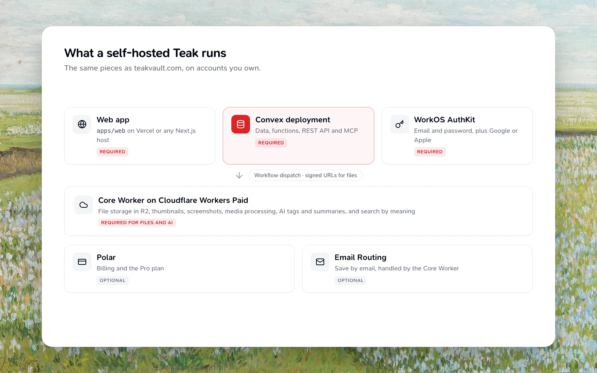

## What you'll need

- Git, Bun, and Node.js at the versions pinned in `package.json` (see the [Development guide](/docs/development))
- A [WorkOS](https://workos.com/) account. Teak signs in with WorkOS AuthKit only.
- Access to secrets for the features you want: Cloudflare R2 and Workers on Workers Paid (file storage, AI, thumbnails, screenshots and media processing), Polar (billing)

:::warning[Beta]
Self-hosting matches the hosted product, but you own uptime, secrets, and
billing integrations. Start with a local Convex deployment before pointing a
public domain at it.
:::

## Set up WorkOS

Create one WorkOS environment per deployment: a staging environment for local development and a separate production environment. Replace `<origin>` with the web app's origin (`http://localhost:3000` locally) and `<convex-site>` with the deployment's `CONVEX_SITE_URL`.

1. In AuthKit, enable email and password sign-in. Add Google or Apple there too if you want them; Teak needs no extra settings for social sign-in.
2. Under Redirects, add `<origin>/callback` as a redirect URI, set the sign-in endpoint (initiate login URL) to `<origin>/sign-in`, and set the sign-out redirect to `<origin>/sign-in`. Add `<origin>` as an allowed CORS origin.
3. Add a JWT template so session tokens carry the claims Teak checks. The backend requires `email_verified: true`:

   ```json
   {"email": {{ user.email }}, "email_verified": {{ user.email_verified }}}
   ```

4. Add a webhook endpoint at `<convex-site>/workos/webhook` for the `user.created`, `user.updated`, and `user.deleted` events. Copy its signing secret into `WORKOS_WEBHOOK_SECRET`.
5. From API Keys, copy the client ID and API key into `WORKOS_CLIENT_ID` and `WORKOS_API_KEY`, and note the environment ID for `WORKOS_ENVIRONMENT_ID`.

The webhook route exists only when `WORKOS_ENVIRONMENT_ID` is set on the Convex deployment. A new user's Teak account is created at their first sign-in, from the signed session; the webhook keeps their address and verification in sync afterwards and records deleted WorkOS users.

`convex.json` declares AuthKit redirect URIs and CORS origins under `authKit.dev` and `authKit.prod`, and Convex applies them to the deployment's WorkOS environment. Teak's own origins are listed there, so edit `authKit.prod` to your domain before deploying.

The iPhone, iPad, Mac, and Android apps sign in through AuthKit with PKCE and the same `WORKOS_CLIENT_ID` as the web app, which they read from the deployment. Their redirect URI, `teak://auth/callback`, is already in `convex.json`.

### Use the WorkOS CLI

The [WorkOS CLI](https://www.npmjs.com/package/workos) can set two of the steps above. Sign in with `workos auth login` and select the environment first:

```bash
# Sign-out redirect (step 2)
workos authkit logout-uris set --uri <origin>/sign-in --default <origin>/sign-in

# Webhook (step 4); the signing secret is shown only in the WorkOS dashboard
workos webhook create --url <convex-site>/workos/webhook \
  --events user.created,user.updated,user.deleted
```

`logout-uris set` replaces the environment's whole list of sign-out URIs.

### Connect: CLI, browser extensions, Raycast, and MCP

The CLI, browser extensions, Raycast, and MCP clients sign in through WorkOS Connect. They need a few more settings.

1. Turn on Client ID Metadata Document (CIMD) support, and dynamic client registration for MCP clients that don't support CIMD yet.
2. Add the resource indicators `<origin>/api` and `<origin>/mcp`. These are the deployment's token audiences, and Teak rejects any other audience. `<origin>` is `WORKOS_RESOURCE_ORIGIN`, an HTTPS origin with no path or trailing slash. Unset, it is `https://teakvault.com`. Set it to your public origin, normally the same as `PUBLIC_ORIGIN`, so that the MCP resource matches the URL that MCP clients connect to. Clients that require the resource to match the server URL reject any other value.
3. Create one public OAuth application for each first-party surface, and set its client ID on the Convex deployment:

   | Surface | Convex variable | Redirect URIs |
   | --- | --- | --- |
   | CLI | `WORKOS_CONNECT_CLI_CLIENT_ID` | `http://127.0.0.1:14210/oauth/callback`, `http://127.0.0.1:24210/oauth/callback` |
   | Raycast | `WORKOS_CONNECT_RAYCAST_CLIENT_ID` | `https://raycast.com/redirect?packageName=Extension` |
   | Chrome extension | `WORKOS_CONNECT_CHROME_CLIENT_ID` | `https://<extension-id>.chromiumapp.org/oauth/callback` |
   | Firefox extension | `WORKOS_CONNECT_FIREFOX_CLIENT_ID` | `https://<hash>.extensions.allizom.org/oauth/callback`, from `browser.identity.getRedirectURL()` for the add-on ID. Teak doesn't publish a Firefox build, but discovery still needs this ID. |

4. Set `WORKOS_AUTHKIT_DOMAIN` to the environment's AuthKit domain, an HTTPS origin such as `https://your-domain.authkit.app` with no path or port.

Sign-in discovery needs `WORKOS_AUTHKIT_DOMAIN` and all four client IDs. If any of them is missing or malformed, discovery fails and none of these clients can sign in, so set all four even if you only use one.

## Quickstart (local)

Teak's own `bun run setup`, `bun run dev` and `bun run doctor` work only against Teak's shared development deployment and refuse any other (see the [Development guide](/docs/development)). On your own deployment, run Convex and the web app directly.

<Steps>
  <Step title="Clone and install">
    ```bash
    git clone https://github.com/praveenjuge/teak.git
    cd teak
    bun install
    ```
  </Step>
  <Step title="Create your Convex deployment">
    From `packages/convex`, sign in to your own Convex account and start a development deployment:

    ```bash
    cd packages/convex
    bunx convex login
    bunx convex dev
    ```

    Choose to create a new project. `convex dev` pushes the backend, keeps watching for changes, and records the deployment in `packages/convex/.env.local`. It prints the deployment's `CONVEX_URL` and `CONVEX_SITE_URL`.
  </Step>
  <Step title="Configure the backend">
    Set `SITE_URL` (`http://localhost:3000` locally), your WorkOS staging values from [Set up WorkOS](#set-up-workos), and any features you want. Run these from `packages/convex`:

    ```bash
    bunx convex env set SITE_URL http://localhost:3000

    # Sign-in: client and webhook
    bunx convex env set WORKOS_CLIENT_ID client_...
    bunx convex env set WORKOS_API_KEY
    bunx convex env set WORKOS_ENVIRONMENT_ID environment_...
    bunx convex env set WORKOS_WEBHOOK_SECRET

    # Optional: files and AI card processing, through your Core Worker
    bunx convex env set FILES_BASE https://files.yourdomain.com
    bunx convex env set FILES_SIGNING_SECRET
    bunx convex env set WORKFLOW_RPC_SECRET
    ```

    Leaving the value off makes `convex env set` prompt for it, which keeps secrets out of your shell history. See [Detailed Environment Reference](#detailed-environment-reference) for the full variable list.
  </Step>
  <Step title="Start the web app">
    Write `apps/web/.env.local` with the web values in [Detailed Environment Reference](#detailed-environment-reference), including a `WORKOS_COOKIE_PASSWORD` of at least 32 random characters, then:

    ```bash
    bun run --cwd apps/web dev
    ```
  </Step>
</Steps>

## Production basics

<Steps>
  <Step title="Designate the administrator">
    Sign up the intended administrator account first. Then pause new sign-ups and grant its stored admin role from `packages/convex`:

    ```bash
    bunx convex run --prod admin:setSignupsPaused '{"paused":true}'
    bunx convex run --prod admin:seedAdmin '{"email":"owner@example.com"}'
    ```

    Replace the example email with your existing account. The command requires exactly one active account with that email and refuses ambiguous ones. Admin access follows the stored role through email changes; account creation order never grants access. To reopen sign-ups, run `admin:setSignupsPaused` again with `'{"paused":false}'`. While sign-ups are paused, a new person can still create a WorkOS account, but Teak shows them a "sign-ups are paused" screen and creates no Teak account until sign-ups reopen.
  </Step>
  <Step title="Update SITE_URL">
    Update `SITE_URL` in Convex to your public domain (e.g., `https://app.yourdomain.com`).
  </Step>
  <Step title="Connect the production WorkOS environment">
    Set up a separate production environment as in [Set up WorkOS](#set-up-workos), using your public origin. Set its `WORKOS_*` values on the production Convex deployment, and give the web host the same `WORKOS_CLIENT_ID` plus its own `WORKOS_COOKIE_PASSWORD` and `NEXT_PUBLIC_WORKOS_REDIRECT_URI` (`https://app.yourdomain.com/callback`).
  </Step>
  <Step title="Point clients at production">
    Update `CONVEX_SITE_URL` and `CONVEX_URL` in your client env files to point to your production deployment.
  </Step>
  <Step title="Deploy the Core Worker">
    Uploads, downloads, thumbnails, and exports all go through the Core Worker. In `apps/core-worker/wrangler.jsonc`, set `bucket_name` to your R2 bucket and the route `pattern` to your files domain. Then, from `apps/core-worker`:

    ```bash
    bunx wrangler secret put FILES_SIGNING_SECRET
    bun run deploy
    ```

    Use the same `FILES_SIGNING_SECRET` on the Convex deployment, set `FILES_BASE` there to the worker's origin, and set `NEXT_PUBLIC_FILES_BASE` to the same origin when you build the web app.
  </Step>
  <Step title="Host the web app">
    Point your domain's `SITE_URL` to wherever you are hosting the Next.js app.
  </Step>
  <Step title="Add optional services">
    Add billing (Polar) keys to Convex env if needed. AI, thumbnails, screenshots, and audio and video processing run in the Core Worker.
  </Step>
  <Step title="Build and start">
    ```bash
    bun run build
    bun run start
    ```
  </Step>
</Steps>

## Detailed Environment Reference

Set these before running locally or deploying.

### Backend (Convex deployment)

Set these on the Convex deployment with `bunx convex env set` from `packages/convex`, or in the Convex dashboard:

```bash
SITE_URL=http://localhost:3000
PUBLIC_ORIGIN=https://yourdomain.com
WORKOS_CLIENT_ID=client_...
WORKOS_API_KEY=sk_test_...
WORKOS_ENVIRONMENT_ID=environment_...
WORKOS_WEBHOOK_SECRET=secret
WORKOS_AUTHKIT_DOMAIN=https://your-domain.authkit.app   # Connect sign-in: CLI, extensions, Raycast, MCP
WORKOS_RESOURCE_ORIGIN=https://yourdomain.com # Optional: token audiences <origin>/api and <origin>/mcp (default https://teakvault.com)
WORKOS_CONNECT_CLI_CLIENT_ID=client_...      # Plus the RAYCAST, CHROME, and FIREFOX client IDs
FILES_BASE=https://files.yourdomain.com
FILES_SIGNING_SECRET=shared-secret
WORKFLOW_RPC_SECRET=derived-secret           # Derived from the Core Worker's WORKFLOW_RPC_ROOT_SECRET
EMAIL_INBOUND_SIGNING_SECRET=secret          # Optional: Save by email
INBOUND_EMAIL_DOMAIN=in.yourdomain.com       # Optional: Save by email (default in.teakvault.com)
POLAR_ACCESS_TOKEN=token
POLAR_ORGANIZATION_TOKEN=token
POLAR_SERVER=sandbox
POLAR_WEBHOOK_SECRET=secret
```

`SITE_URL`, `WORKOS_CLIENT_ID`, and `WORKOS_API_KEY` are required; set `WORKOS_ENVIRONMENT_ID` and `WORKOS_WEBHOOK_SECRET` too, so address changes and deleted WorkOS users reach Teak. Grant admin access through the stored role as described in [Production basics](#production-basics). Add the rest for the features you want. See [Where to get the values](#where-to-get-the-values) for sources.

### Core Worker (`apps/core-worker/.dev.vars`, wrangler secrets)

The Core Worker owns all file-byte operations and binds to your R2 bucket plus Cloudflare Images, Workers AI, Browser Run (link screenshots), and a media renderer Container, all declared in `wrangler.jsonc`. Set `bucket_name` to your own bucket and the route `pattern` to your files domain.

Deploy it on Workers Paid. Exports stream every file into one ZIP in a single request, which needs the raised `cpu_ms` and `subrequests` limits in `wrangler.jsonc` (Workers Free allows 10 ms of CPU per request). Paid also includes 10 browser hours a month of Browser Run, and Cloudflare Containers, which Workers Free does not offer.

The media renderer runs ffmpeg and poppler in a Container built from `apps/core-worker/container/Dockerfile`. It makes video thumbnails and hover previews, audio waveforms, PDF thumbnails and PDF text, and converts audio for transcription. `wrangler deploy` builds the image, so the machine or CI runner that deploys needs Docker. The Container uses the `basic` instance type (1/4 vCPU, 1 GiB memory) with up to 4 instances (`max_instances`; keep `MEDIA_RENDERER_INSTANCES` in `vars` equal to it). Workers Paid includes 375 vCPU-minutes and 25 GiB-hours of Containers a month, enough for tens of thousands of media jobs. Each instance takes one job at a time, has no internet access, and reads only the file the Worker sends it, up to 100 MB. When the renderer is busy, Teak retries with backoff.

The link fetcher, a second Container built from `apps/core-worker/fetcher/Dockerfile`, downloads remote preview images and media straight into R2 under the same SSRF rules Convex uses. The Worker also runs Teak's background work: card processing, imports, exports and account deletion as Cloudflare Workflows, plus Queues and Cron Triggers.

#### Resources to create

`wrangler deploy` creates the Workflows, Durable Objects, Containers and the Analytics Engine dataset. Create these yourself first, and put your names and IDs in `wrangler.jsonc`:

- **An R2 bucket** (`r2_buckets`), with an event notification that sends new objects under `users/` to the `teak-r2-events` queue, so abandoned uploads are deleted after a day:

  ```bash
  bunx wrangler r2 bucket notification create <bucket> --event-type object-create --queue teak-r2-events --prefix users/
  ```

- **Queues:** `teak-object-deletions`, `teak-object-deletions-dlq`, `teak-ai-backfill` and `teak-r2-events`.
- **KV namespaces** for the `EDGE_IDENTITY` and `LINK_PAGE_CACHE` bindings.
- **A Vectorize index** for search by meaning, 768 dimensions and cosine, with a `type` metadata index created before its first vector:

  ```bash
  bunx wrangler vectorize create teak-cards-0 --dimensions=768 --metric=cosine
  bunx wrangler vectorize create-metadata-index teak-cards-0 --property-name=type --type=string
  ```

- **An AI Gateway** named by the `AI_GATEWAY_ID` var. It must exist before a deploy that names it.

#### Vars

Change these in `wrangler.jsonc`'s `vars`:

| Var | Value |
| --- | --- |
| `CONVEX_SITE_URLS` | Your deployment's `CONVEX_SITE_URL`. The Worker serves only the deployments listed here |
| `FILES_PUBLIC_ORIGIN` | The Worker's public origin, the same as `FILES_BASE` |
| `API_PUBLIC_HOST`, `API_UPSTREAM_ORIGIN` | Your public host and your deployment's `CONVEX_SITE_URL`, for the [API and MCP edge proxy](#public-api-and-mcp). Remove both to proxy nothing |
| `API_WORKOS_ISSUER` | Your `WORKOS_AUTHKIT_DOMAIN` |
| `ANALYTICS_ACCOUNT_ID` | Your Cloudflare account ID, for the hourly AI usage rollup |
| `POSTHOG_PROJECT_TOKEN` | Your own PostHog project token, or remove it to send nothing |

The Cron Trigger schedules in `triggers.crons` must equal the Cloudflare schedules in `packages/convex/cronSchedules.ts`; a Convex test checks them.

#### Secrets

Put each with `bunx wrangler secret put <NAME>` from `apps/core-worker`. `wrangler deploy` fails while either required one is missing.

```bash
FILES_SIGNING_SECRET=shared-secret           # Required. Must match the Convex value
WORKFLOW_RPC_ROOT_SECRET=root-secret         # Required. Worker only; never copy it to Convex
ANALYTICS_API_TOKEN=token                    # Optional. Account Analytics: Read, for the AI usage rollup
```

Each Convex deployment the Worker serves holds its own `WORKFLOW_RPC_SECRET`, derived from the root secret and the deployment's origin. Derive it and set it on the deployment:

```bash
WORKFLOW_RPC_ROOT_SECRET=… bun scripts/workflow-rpc-secret.ts https://<deployment>.convex.site
bunx convex env set WORKFLOW_RPC_SECRET <output>   # from packages/convex
```

Until a deployment has it, its background work stays queued.

Deploy it as described in [Production basics](#production-basics), then point `FILES_BASE` in the backend env at the worker's public origin.

### Save by email (optional)

Save by email runs in the Core Worker (`apps/core-worker/src/email`) and needs Cloudflare Email Routing on a subdomain of a domain on Cloudflare, such as `in.yourdomain.com`.

1. Generate a signing secret (`openssl rand -hex 32`). Set it on the Convex deployment as `EMAIL_INBOUND_SIGNING_SECRET`, and set `INBOUND_EMAIL_DOMAIN` there to your subdomain.
2. In `apps/core-worker/wrangler.jsonc`, set `INBOUND_EMAIL_DOMAIN` to the same subdomain; mail is posted to the first deployment in `CONVEX_SITE_URLS`. Then, from `apps/core-worker`, put the same secret and deploy:

   ```bash
   bunx wrangler secret put EMAIL_INBOUND_SIGNING_SECRET
   bun run deploy
   ```

3. In the Cloudflare dashboard, open Email Routing for your domain and add the subdomain under **Settings → Subdomains**; Cloudflare adds its MX and SPF records. Catch-all rules work only on the apex domain, so add a literal routing rule for `save@<subdomain>` with the action **Send to a Worker** and your Core Worker. Turn on **Subaddressing**, so `save+anything@` reaches the same rule.

Mail is accepted only from an account's sign-in address and only when it passes DMARC; see [Save by email](/docs/features#save-by-email) for what becomes a card.

### Web (`apps/web/.env.local`)

```bash
CONVEX_DEPLOY_KEY=
NEXT_PUBLIC_CONVEX_URL=https://deployment.convex.cloud
NEXT_PUBLIC_CONVEX_SITE_URL=https://deployment.convex.site
WORKOS_CLIENT_ID=client_...                  # Same as the Convex deployment
WORKOS_COOKIE_PASSWORD=at-least-32-random-characters
NEXT_PUBLIC_WORKOS_REDIRECT_URI=http://localhost:3000/callback
NEXT_PUBLIC_FILES_BASE=https://files.yourdomain.com            # Mirror of FILES_BASE for the CSP
TEAK_DEV_APP_URL=http://localhost:3000   # Optional local override
```

The web Content-Security-Policy always allows the canonical file origins
(`https://files.teakvault.com` and the R2 storage origin). If you serve files
from custom origins, mirror the backend `FILES_BASE` into
`NEXT_PUBLIC_FILES_BASE` at web build time.

### Browser Extension (`apps/extension`)

The extension reads the deployment URLs with the `VITE_PUBLIC_` prefix:

```bash
VITE_PUBLIC_CONVEX_URL=https://deployment.convex.cloud
VITE_PUBLIC_CONVEX_SITE_URL=https://deployment.convex.site
TEAK_DEV_APP_URL=http://localhost:3000   # Optional local override
```

### Public API and MCP

```bash
PUBLIC_ORIGIN=https://yourdomain.com            # Required to expose self-hosted /api and /mcp (else production URLs are advertised)
TEAK_DEV_API_URL=https://deployment.convex.site # Optional local override
```

Convex serves the REST API at `/api/v1`, the MCP endpoint at `/mcp`, plus `/healthz`, `/openapi.json`, and OAuth protected-resource metadata. In production, the Core Worker's edge proxy forwards `https://teakvault.com/api`, `{{mcp-url}}` and the discovery documents to them and rate-limits them. To do the same, set `API_PUBLIC_HOST` and `API_UPSTREAM_ORIGIN` on your Core Worker and add zone routes for `/api*`, `/mcp*`, `/.well-known/oauth-protected-resource*` and `/.well-known/teak-oauth-clients.json*` on your domain, as `apps/core-worker/wrangler.jsonc` does. Or configure your own reverse proxy to route `/api` (to `/v1`) and `/mcp` to the Convex deployment's `.convex.site` domain. The protected-resource metadata advertises your `WORKOS_AUTHKIT_DOMAIN` as the OAuth issuer.

## Where to get the values

- **Convex URLs**: Run `bunx convex dev`. It prints both `CONVEX_URL` (for the client) and `CONVEX_SITE_URL` (for the site/auth endpoint). You can also find these in the Convex Dashboard under "Settings" -> "Deployment".
- **Sign-in**:
  - `WORKOS_*`: From your WorkOS environment, as described in [Set up WorkOS](#set-up-workos). `WORKOS_AUTHKIT_DOMAIN` is the AuthKit domain shown in the WorkOS dashboard. Sign-in, verification, and password reset emails come from WorkOS.
  - `WORKOS_COOKIE_PASSWORD`: Generate at least 32 random characters (e.g., via `openssl rand -base64 32`). Setup generates one locally.
  - `SITE_URL`: This is the URL where your Next.js app is running. Locally, it's `http://localhost:3000`. Card links the API and MCP return (`appUrl`, and `settingsUrl` from `GET /v1/me`) open this origin.
- **Optional Features**:
  - `FILES_BASE` + `FILES_SIGNING_SECRET`: Deploy the Core Worker (see its section above) with a private R2 bucket bound to it; card uploads, downloads, imports, exports, thumbnails, and AI analysis all flow through it. Convex needs no R2 or Workers AI credentials of its own.
  - `POLAR_*`: Get from [Polar](https://polar.sh/) if you want to use the built-in billing system.
