## Card types

Teak has eight card types. Each gets automatic processing and a rich preview.

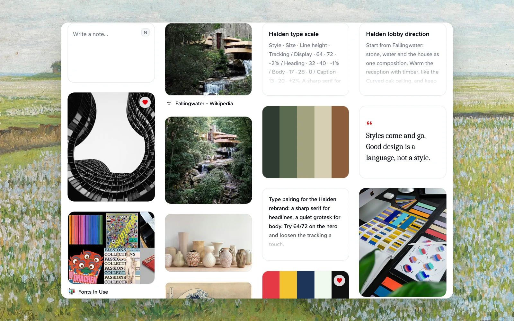

| Type | What you save | What Teak adds |
| --- | --- | --- |
| **Text** | Notes, decisions, feedback | Full-text search |
| **Link** | Articles, Dribbble shots, tools | Details, screenshot, a saved copy of the page |
| **Image** | Screenshots, mockups, photos | Color palette, the words in the image |
| **Video** | Tutorials, animations, clips | Inline player, thumbnail, colors, transcript |
| **Audio** | Voice memos, recordings | Transcript |
| **Document** | PDFs, Office files, source code, Markdown, ZIP and design files | Preview, file facts, searchable text |
| **Palette** | Color swatches | Hex value per color |
| **Quote** | Highlighted passages | Source context |

When you save text, Teak picks the type: a quotation with who said it becomes a quote even without quote marks, a list of colors becomes a palette, and code or dialogue that only looks like one stays a note.

Open a palette to change its colors. **Add color** takes a color from the picker or a hex code, and each swatch's **×** (or right-click **Remove color**) takes one out, with **Undo**. A palette holds 1 to 12 colors. Click a swatch to copy its hex code.

:::note[Upload limits]
Files (images, video, audio, documents, source files, Markdown, ZIP archives and design files) can be up to 100 MB. `.md` and `.markdown` files become editable notes, up to 512 KiB of UTF-8 text. [Teak archive imports](/docs/import#limits) have their own limits.
:::

## Saving

Save from the web app, the [browser extensions](/docs/extension), the [Mac](/docs/mac), [iPhone and iPad](/docs/mobile) and [Android](/docs/android) apps, [Raycast](/docs/raycast), the [CLI](/docs/cli), [email](#save-by-email), the [API](/docs/api) or [MCP](/docs/mcp).

### Saving links

Paste a link on the home page to save it as a link card. Paste a list of links, one per line, and Teak saves each as its own card (up to 100 at a time).

### Saving something again

Saving a link you already have doesn't make a second card, wherever you save it. Teak moves that card to the top of your library and brings it back from Archive if it was there. Two addresses count as the same link when they differ only by `http` or `https`, `www.`, a trailing slash, a `#fragment` or tracking parameters (`utm_*`, `fbclid`, `gclid`).

- Only a link saved on its own counts. A link with words around it, a note or a file is saved as a new card.
- Tags and notes sent with it aren't added to the card you already have. Add them to that card instead.
- A card in Trash doesn't count: saving its link again makes a new card.
- The card's **Details** keep **Added**, the date you first saved it, and show **Saved again** with the last time you saved it.

### Saving while offline or when a save fails

If you lose your connection, Teak says so. A note you save meanwhile appears at once and is saved when you're back online. If a voice recording can't be saved, it stays in the recording window so you can try again or download it.

### Save by email

Turn on **Settings → Integrations → Save by email**, then send or forward anything to `save@in.teakvault.com` from the email address you sign in to Teak with.

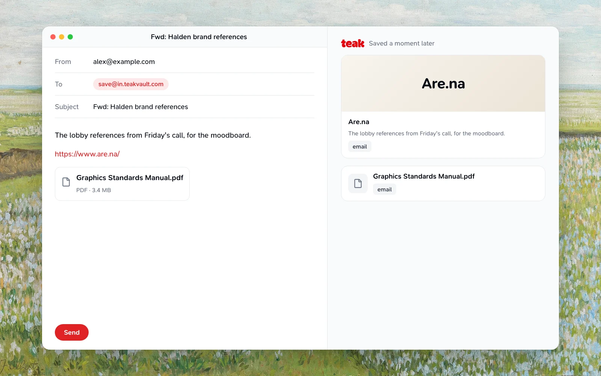

- An email that's just a link, with at most a sentence or two, becomes a link card, and the sentence becomes its note. Anything else becomes a note headed with the subject. Tracking images, redirect wrappers and "Fwd:" headers are removed.
- Attachments become their own cards, with the same formats as uploads, up to about 18 MB per email.
- Every card is tagged `email`.
- Mail from any other address, or that fails its domain's sender checks (DMARC), is refused. Forwarding from a work account only works if that's the address you sign in with.
- Mail past 60 emails an hour, or once a free account has 200 cards, is dropped without a reply.

## Reading

### Saved copies of pages

Teak keeps a private copy of every link you save, so the page outlives the site. The copy is one file with the page's text, styles, fonts and images, up to 20 MB. Video, audio and scripts aren't kept, and a page too large to keep whole is kept as text only. If a saved page disappears, opening it shows Teak's copy.

- Saving from the Chrome or Firefox extension keeps the page as you saw it, including pages you're signed in to. Passwords, payment card numbers and one-time codes are left out.
- The card's **Details** show **Archived copy** with its size, **Text only**, **Saving a copy…**, or **Couldn't save a copy** with the reason.
- [Refresh details](#refresh-details) saves a new copy, unless the link has [highlights](#highlights).

### Read

On the web, a link card with an article in its saved copy shows **Preview · Read** above it. **Read** shows the article's text and images in one clean layout, with the site, author and reading time above it and **Open original ↗** below. Press `R` to switch.

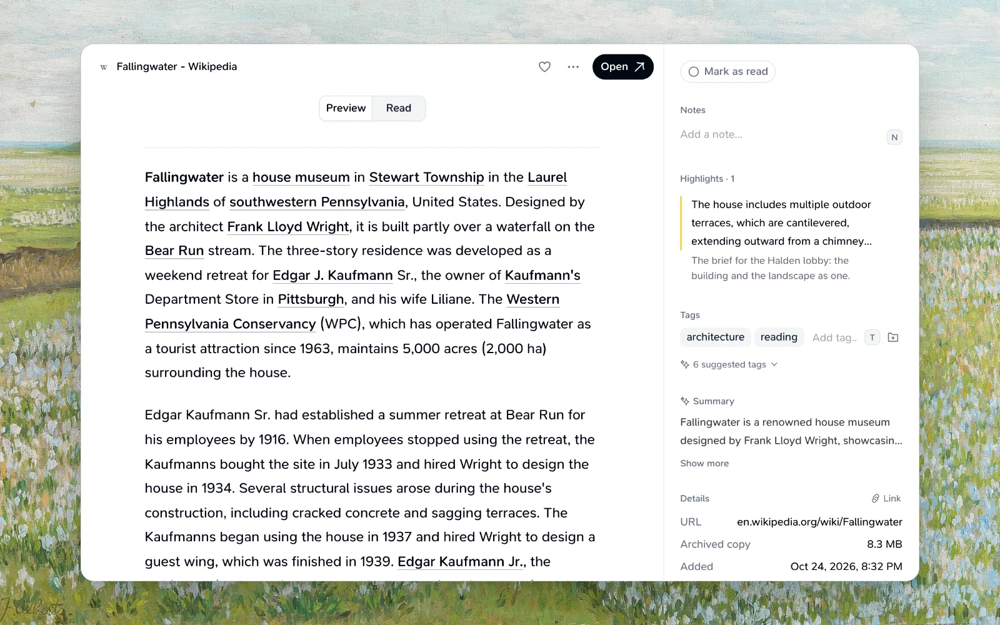

- Articles, news and research open on **Read**; other links open on **Preview**.
- A page counts as an article when its main text has at least 120 words (300 when the page doesn't look like an article, such as a shop or a home page).
- A wiki article opens on its text, with the fact box's picture on top and its facts as a short list after the opening paragraphs.
- While the article is prepared, **Read** says **Preparing the article…**. If it fails, **Try again** refreshes the card.
- Search finds links by words in their article, and the summary of a long article is written from the article.
- The API, MCP, SDK and CLI return a link's article as Markdown ([Read a card's text](/docs/api#read-a-cards-text)).

### Highlights

In **Read**, select some text and choose **Highlight**, or press `H`. On a phone or tablet, **Highlight** appears in a bar at the bottom.

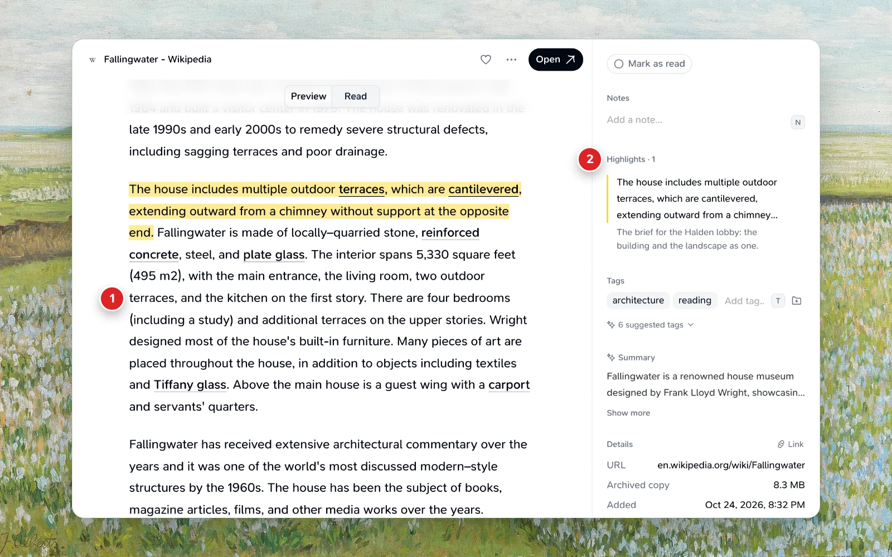

1. The highlighted passage, painted in **Read**.
2. **Highlights · 1** in the card's details, with the highlight's note. Click it to jump to the passage.

- Click a highlight to add a note (up to 2,000 characters) or to **Remove highlight**, with **Undo**.
- A highlight that overlaps another joins it, keeping the older note. A highlight can be up to 5,000 characters, and a card can have up to 200.
- A highlight Teak can't find in the saved article says **Not found in the saved article**; you can still remove it.
- A highlighted link keeps its saved copy and article: refreshing it or saving it again keeps them, and its URL can't be changed until the highlights are removed.
- Highlights from [Instapaper, Omnivore and Raindrop.io imports](/docs/import) say **Waiting for the article…** until Teak has prepared it.
- Highlights aren't searched. They're in your [export](/docs/export), and the [API](/docs/api#highlights), MCP, SDK and CLI can list, add, note and remove them.

Read and highlights are on the web only; the Mac, iPhone, iPad and Android apps don't show them yet.

## Your library

### Sidebar

On the web, the sidebar holds:

- **New**, under the Teak logo: a note or link (`N`), file uploads (`U`), or an audio recording.
- **Everything**, **Favorites** and **Tags**, then your folders (with their color and card count; smart folders show a search icon), then **Archive**, **Trash** and **Settings**. Each is a page you can bookmark or share. Drag a card onto a folder to add it.

Every page has the same header: its name on the left, the search box in the middle, and its buttons, such as **View**, on the right. **View** narrows the page to card types (pick several to combine them), changes the order, switches between **Comfortable** and **Compact** cards (Compact fits up to seven columns), and saves the search as a smart folder. Selecting cards swaps the header for the selection's actions.

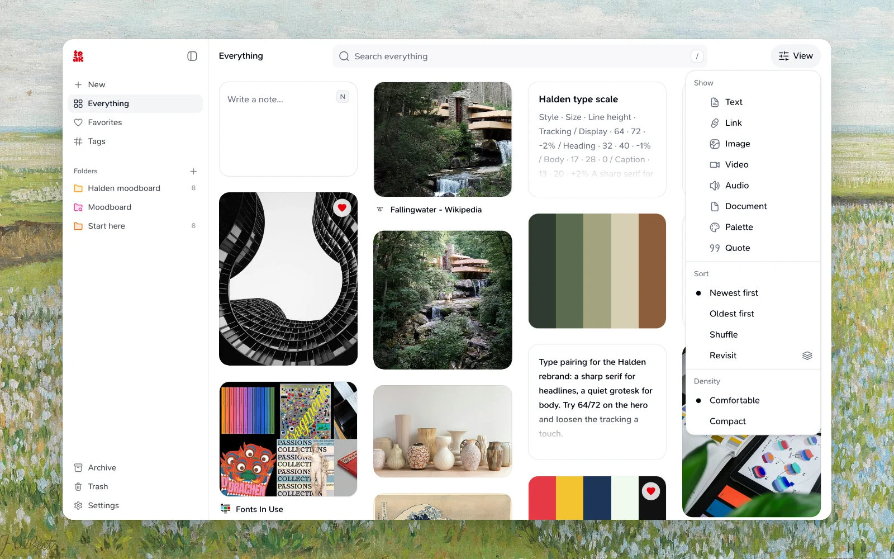

Drag the sidebar's edge to resize it (double-click to reset), or collapse it to icons with the button at its top (`⌘B`, `Ctrl+B` on Windows and Linux). Teak remembers both on each device. On a phone, the sidebar opens as a drawer from the header, and **+** adds a note or link, uploads files or records audio.

### Grid

Cards show in a masonry grid. Notes, quotes, links, palettes, voice memos and documents are tiles of one size; photos and videos keep their own shape. A note shows its first line as a heading, a quote is set large or small to fit, and a link shows its picture with its site's icon and title under it (a link without a picture shows its title on the tile instead). A price, a video's or recording's length, and a document's file type sit in the tile's bottom corner. Rest the pointer on a card to open its link, favorite it, or open **More** (`⋯`); on touch screens the **⋯** menu always shows.

Click a card to open it. The details beside it show where it's from and its type (click the type to see every card of that type), its title (click a link's title to rename it), and one main button: **Open** for a link or **Download** for a file. Next to it are **Favorite**, the [done button](#read-watch-and-buy) for a link, **Copy**, **Folder** and **More** (`⋯`): Save PDF, More like this, Refresh details, Pin to top, Archive and Move to Trash. These stay pinned while you scroll.

Below them come the card's notes, folders, tags, summary, colors and **Details**, all editable in place. Notes save as you type, and a tag is added when you press `Enter`. Tags Teak added fold under **suggested tags**: **Keep** one to make it your own, or **Remove** it. **Details** shows when you added the card, when you saved it again, and its size; to change a link's address, click the pencil beside its **URL**.

Use the arrows beside the card, or `←` and `→`, to step through cards in the grid's order. On a phone the card opens as a sheet, with its actions in a bar along the bottom. A card in Trash shows **Restore** and **Delete forever** instead of its buttons.

To act on many cards, click the circle in a card's corner (or right-click it and choose **Select**), then click more. The bar at the top archives them, and **More** favorites them, adds them to a folder, adds or removes tags, copies their links or moves them to Trash. In Archive the main action is **Unarchive**; in Trash, **Restore**. Archive, Unarchive and Move to Trash offer **Undo**, and cards that couldn't be changed stay selected with **Retry**.

#### Pinned cards

Pin up to 12 cards to keep them at the top of **Everything**: choose **Pin to top** from a card's menu, or press `P`. Pinned cards sit in a **Pinned** row above the grid, newest pin first. Drag to reorder them (on a touch screen, hold first), or focus one and press `Alt` with `←` or `→`. Pinning a 13th card is refused; unpin one first.

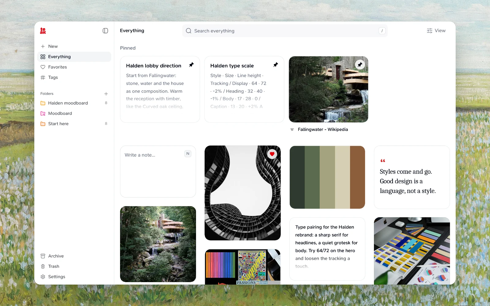

- The row shows only on **Everything** with no search or filter and the **Newest** order. Elsewhere a pinned card stays where it ranks, with a pin in its corner.
- Search `is:pinned` to list them.
- Archiving a card or moving it to Trash unpins it; **Undo** on that toast pins it again in its old place. Favorites and pins are separate.
- Pin on the web, or with `PATCH /v1/cards/:cardId/pin` and `isPinned: true` in the [API](/docs/api#pinned-cards), MCP, SDK or CLI. The Mac, iPhone, iPad and Android apps can search `is:pinned` but don't pin or show the row.

## Notes

Notes are written in Markdown. In a checklist, ticked items move below the open ones, and unticking one moves it back (on the web, `⌘Z` undoes the move). Every app shows checkboxes you can tick.

### Link cards

Type `[[` in a note on the web, and Teak offers up to 8 of your cards that match what you type next (your newest cards when you haven't typed yet). Pick one with the arrow keys and `Enter`, or click it. A card tagged `secret` or `hidden` is offered only when you type that tag, such as `[[diary #secret`.

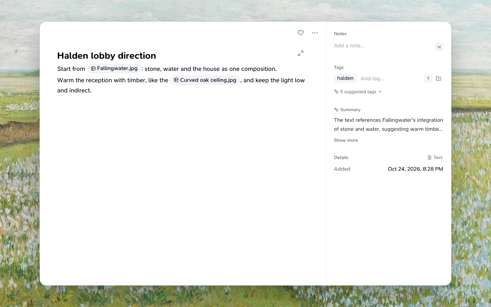

- The link shows as a pill with the card's type and current title. Click it, or select it and press `Enter`, to open the card.
- A link to a card in Trash, a deleted card or a card that isn't yours shows as **Missing card**. Restoring the card from Trash brings the link back. Links inside code stay plain text.
- A card that notes link to shows **Linked from** in its details, with up to 50 of those notes, most recently updated first. Notes in Trash or tagged `secret` or `hidden` aren't listed.
- Card tiles show a link as its title, and search finds a note by a linked card's title (the title when you linked it).
- On Mac, iPhone and iPad, and in exports, the API, MCP and the CLI, a link is written `[[Title|teak:<card-id>]]`.

### Tables in notes

In a note on the web, type `/table` to add a table. `Tab` moves to the next cell (and adds a row from the last one), `Shift+Tab` moves back, and `Enter` moves down. Point at the table, or press `Alt+F10` in a cell, for the **⋯** menu that adds or deletes rows and columns, or deletes the table.

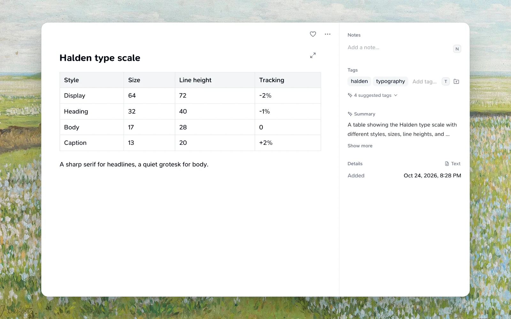

A cell holds one line of text with bold, italic, code and links (not `[[` card links), up to 20 columns and 200 rows. Tables are saved as Markdown. A pasted Markdown table becomes a table too, unless it aligns its columns or sits in a quote or list. The other apps show tables but can't edit them.

### Focus mode

Press `⌘E` (`Ctrl+E` on Windows and Linux), or click the expand button at the top right of a note, to write with only your note on screen. The **Close** and **Save** bar fades while you type, and the word count appears when you pause. Press `Esc` or `⌘E` to leave; your edits stay.

## Search and organization

### Smart search

Search finds cards by meaning, not just exact words: `cozy reading nook` finds a photo of an armchair by a window with books, a misspelled `typograhpy` still finds your type notes, and a search in another language finds cards saved in English. Cards that match your words appear first, and cards related by meaning join them a moment later. Above the results, Teak says how many of each it found; **Hide related** leaves out the second group.

Search covers titles, descriptions, tags, notes, transcripts, the text inside files, and the words in images:

- **Documents:** the text of PDFs, Word and PowerPoint files, and text and code files. For a long document, search covers its first 32 KB of text (roughly 5,000 words). Teak keeps the text of the first 500 pages, and the API, MCP and CLI return all of it. A scanned PDF without a text layer is read from its first 3 pages.
- **Audio and video:** the speech, transcribed. For links, a Vimeo video's captions, and a podcast episode whose page links to its audio (up to 100 MB), become the card's transcript.
- **Images:** the words in images and video thumbnails, such as a receipt's invoice number or a screenshot of code. Teak uses them only for search.

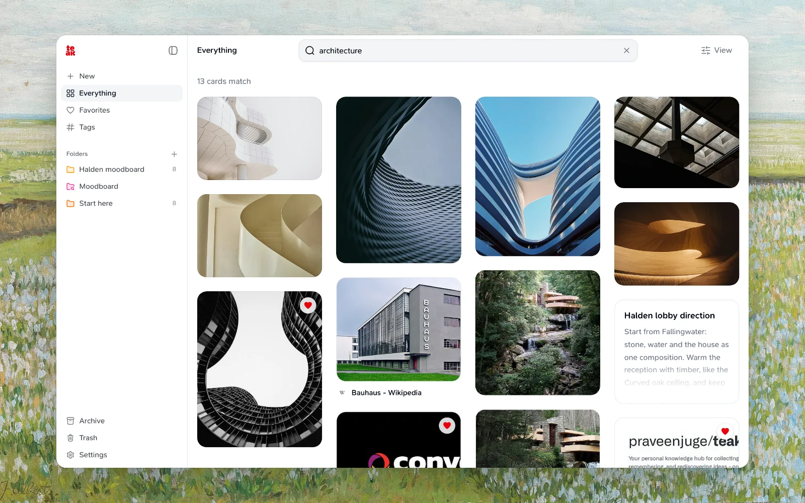

| Token | Examples | Effect |
| --- | --- | --- |
| **Color name** | `red`, `blue`, `teal` | Dominant palette color |
| **Hex color** | `#FF5733`, `#3B82F6` | Exact color match. Use `tag:fff` for a tag that looks like a color |
| **Visual style** | `minimal`, `dark`, `cinematic`, `typographic`, `3d`, `hand-drawn` | Images and videos with that look |
| **Date** | `today`, `this week`, `january`, `last year` | Date saved (or saved again) |
| **Quick view** | `favorites` / `fav`, `archive`, `trash` / `bin` / `deleted` | Opens that page; type it again to go back to Everything |
| **Tag** | `tag:design`, `#design`, `tag:"web design"` | Cards with that tag, ignoring case |
| **Type** | `type:link`, `type:images`, `type:notes`, `type:pdf` | Cards of that type. Everyday words work too: `note`, `pdf`, `doc`, `photo`, `picture`, `color`, `voice`, `memo`, `url`, `bookmark`, `movie` |
| **State** | `is:fav`, `is:archived`, `is:pinned` | Only favorites, archived or pinned cards |
| **Done** | `is:done`, `is:todo` | Links you [marked done](#read-watch-and-buy), or the ones you haven't |
| **Site** | `site:github.com` | Links from that website, and text saved from its pages. `www.` and case don't matter; subdomains aren't included |
| **Folder** | `folder:Inbox`, `folder:"Reading list"` | Cards in that folder (not a smart folder) |
| **Price** | `price:<100`, `price:>=10`, `price:=0` | Product links by price, whatever the currency |
| **Text in image** | `text:4411`, `text:"total due"` | Images, videos, links and scanned PDFs whose own words contain that text, ignoring case and line breaks |
| **Phrase** | `"design system"` | Those words together, in that order, including inside documents |
| **Similar** | `like:<card id>` | Cards closest in meaning to that card ([Find similar](#find-similar)) |
| **Mood** | `mood:"moody brutalist"` | Images whose look matches ([Search images by mood](#search-images-by-mood)) |
| **Exclude** | `-figma`, `-"brand guide"`, `-tag:old`, `-is:archived` | Leaves out cards that match. Works before anything except `like:` and `mood:` |
| **Either** | `tag:fonts OR tag:type` | Cards that match either side. `OR` must be uppercase |
| **Group** | `(site:github.com OR site:gitlab.com) -is:archived` | Parentheses decide what `OR` and `-` apply to |
| **Keyword** | anything else | Full-text match |

Filters combine. Tags, folders, image text and prices must all match, so `price:>20 price:<100` is a range; several types or sites match any of them. A space joins what must all match, and `OR` joins the sides around it, so `design -figma OR sketch` means `(design -figma) OR sketch`. A `-` inside a word, as in `to-do`, is part of the word. A filter Teak doesn't know, like `type:banana`, is searched as text, and a folder you don't have shows **No folder named …**.

```
minimal dark
feedback this week
site:github.com tag:design "design system"
#inspo -type:image
tag:fonts OR tag:type
```

As you type, the search box suggests filters, your tags and folders, and the sites you save most. Pick one and it becomes a removable pill; **Backspace** in an empty box removes the last one. **Enter** turns a date at the start or end of your search into a pill, so `kestrel last week` searches "kestrel" among cards saved last week. When nothing matches, Teak suggests a spelling from your own tags, folders and titles and lets you drop one filter at a time, and a search of only words can become a note with **Save as a note**. In Favorites, Archive, Trash or a folder, **Search everything** runs the same search across your whole library.

The Mac, iPhone, iPad and Android apps support the same search syntax and find the same cards.

#### Find similar

Choose **More like this** from a card's **⋯** menu to see the cards closest to it in meaning, of any type. The search box shows a **Similar to** pill; add filters to narrow it, or save it as a smart folder. A card saved a moment ago may need a few seconds before its similar cards show up.

#### Search images by mood

`mood:"moody brutalist"` lists images whose look matches the words: their description, tags, visual style and any text in them. It reads only images, so `mood:` with `type:link` finds nothing.

### Sort and share a search

Cards are ordered by the date you saved them, newest first ([saving a link again](#saving-something-again) moves it to the top), and imported bookmarks keep their original dates. A search with words starts in **Best match**. Change the order in the **View** menu: **Newest first**, **Oldest first**, **Shuffle** or **Revisit**.

- **Shuffle** shows your cards in a random order that stays put while you scroll. **Reshuffle** (the dice beside **View**) picks a new one; Back returns to the previous. A tag or folder with more than 2,000 cards shuffles its newest 2,000.
- **Revisit** shows 20 random cards from what's on screen, one at a time. Press `←` or `A` to archive a card and `→` or `K` to keep it (or swipe on a touch screen); `Space` opens it, `Z` takes back the last archive, and `Esc` leaves. **Revisit 20 more** continues the same shuffle, and **Start over** reshuffles. It isn't offered in Archive or Trash.

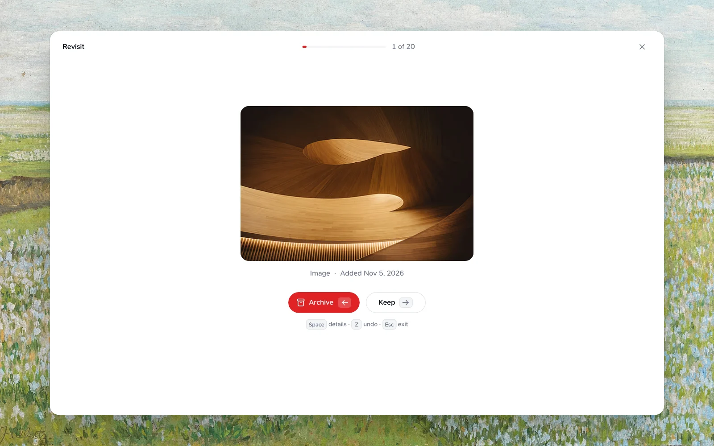

Your search, order and card types stay in the address bar, so reloading, Back and Forward, and links you share bring back the same view. A very broad search is sorted within its 400 best matches; add a type, date or more words to narrow it.

### Folders

Folders group cards by project, trip or anything else. A card can be in several folders, and removing it from a folder never deletes it.

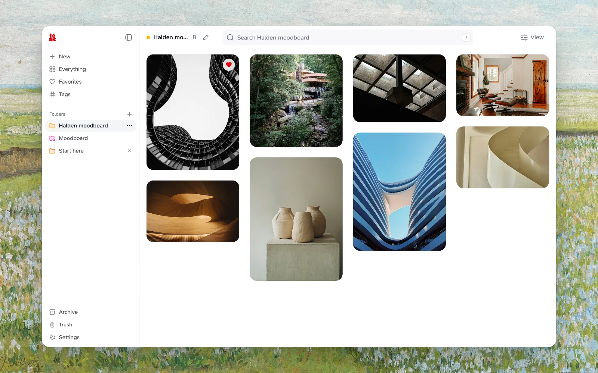

- **Create:** click **+** next to **Folders** in the sidebar, type a name and press `Enter`. Names are unique ignoring case. Typing a new name in **Add to folder…** creates one too.
- **Add cards:** drag cards onto a folder, choose **Add to folder…** from a card's menu, or select cards and use **More › Add to folder…**. Inside a folder, **Add cards** picks more.
- **Move or remove:** inside a folder, a card's menu has **Remove from this folder**, and a selection has **Move to folder…**.
- **Rename, recolor or delete:** right-click a folder in the sidebar or use its **…** menu. Deleting a folder keeps its cards, and **Undo** brings it back for a few seconds.

Archived and trashed cards stay out of a folder and its count. You can have up to 500 folders, smart folders included, and a card can be in up to 50. Folders are also in the [API](/docs/api#folders), [CLI](/docs/cli) and [MCP](/docs/mcp).

#### Smart folders

A smart folder saves a search, so it fills itself with every card that matches, including cards you save later. Search for what you want, open **View** and choose **Save as smart folder…**. It keeps the search's filters, card types and the page you're on (Favorites, Archive or a folder), but not colors, styles or dates.

Smart folders show a search icon. Their search shows as faded pills, and anything you type narrows it. Edit it with the pencil beside the name. You can't add cards by hand. For example, `folder:"Reading list" is:fav` shows your favorite cards in Reading list, and follows that folder if you rename it.

#### Folder rules

A folder can tag and collect cards for you. Choose **Edit…** from a folder's menu, or the pencil beside its name, then **Add a rule**:

- **Add these tags:** every card put in the folder gets these tags, however it's added (up to 10).
- **Auto-file cards that match:** a search, such as `tag:typography` or `site:figma.com type:link`. Matching cards are filed in the folder, with its tags, once Teak has processed them. `like:` and `mood:` can't be used.

Saving a rule also applies it to the cards you already have (archived ones included, not Trash) and says how many it updated, with **Undo**. **Undo last run** stays in the folder's Edit dialog for a day. Rules only add: a card you take out of the folder, or a tag you remove, stays out. Up to 50 folders can have rules, and smart folders can't. Rules are also in the [API](/docs/api#folder-rules), [CLI](/docs/cli) and [MCP](/docs/mcp).

### Tags and filters

Teak tags cards automatically, and you can add your own. Filter by type from **View**, by tag from the **Tags** page, or by anything else in the search box. Active filters show as pills in the search box, and **×** clears them all.

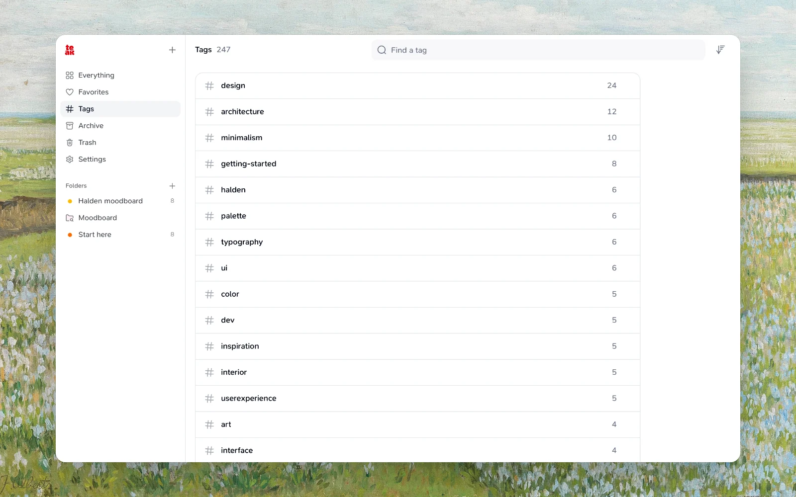

**Tags** in the sidebar lists every tag with how many cards outside Archive and Trash carry it. Tags match ignoring case, so `Design` and `design` are one tag. Click a tag to see its cards. A tag's **⋯** menu changes it on every card, including archived and trashed cards and tags Teak added:

- **Rename…** gives it a new name, or merges it into a tag that already has that name.
- **Merge into…** replaces it with another tag.
- **Delete…** removes it from every card. The cards are kept.

Changes run in the background, one at a time. Merges and deletes can't be undone, so Teak asks first.

### Archive

Archive a card to keep it out of your library without deleting it: right-click it, or open it and choose **Archive**. Archived cards stay out of search, Favorites, folders and tag counts, but count toward your card limit. Open **Archive** in the sidebar and choose **Unarchive** to bring one back.

### Trash

Deleted cards go to Trash, where you can restore them or delete them forever. Cards left in Trash are deleted after 30 days. **Empty Trash**, at the top of Trash, deletes everything in it at once, after confirming. A card moved to Trash from Archive goes back to Archive when restored.

### Hidden cards

Tag a card `secret` or `hidden` to hide it from your library, Favorites, Archive, Trash, folders, search and Shuffle, on every app and in the API. To see hidden cards, search for the tag: `#secret` or `tag:hidden` (searching the word `secret` doesn't). A smart folder whose search names the tag shows them too. Remove the tag to bring a card back. Tags Teak adds never hide a card, and hidden cards still count toward your card limit.

### Read, watch and buy

Mark a link done when you've finished with it: open it and click the done button beside **Favorite**, or press `D`. It says **Mark as read** for articles, news, books and papers, **Mark as watched** for films and shows, **Mark as listened** for podcasts and music, **Mark as bought** for products, **Mark as cooked** for recipes, **Mark as played** for games, and **Mark as done** for anything else. The link's tile shows a check.

Search `is:todo` for what's left (articles, news, books, films, shows, podcasts, music, products, recipes, courses, events, apps and games you haven't marked done) and `is:done` for what you've finished. Both work in smart folders, so `is:todo folder:"Reading list"` is what's left to read there. Only links can be marked done.

## Keyboard shortcuts

On the web you can use Teak without a mouse. Press `?` to see every shortcut; menus, tooltips and the sidebar show them too. Shortcuts don't fire while you type in a field. On Windows and Linux, use `Ctrl` for `⌘`.

With a card focused in the grid (the grid is one Tab stop):

| Keys | Action |
| --- | --- |
| Arrow keys, `J` / `K` | Move between cards |
| `Enter` | Open the card |
| `F` | Favorite or unfavorite |
| `P` | Pin or unpin |
| `Alt` `←` / `Alt` `→` | Move a pinned card in the Pinned row |
| `T` | Add tags |
| `E` | Archive or unarchive |
| `Delete` (`⌫` on a Mac) | Move to Trash |
| `X` | Select or deselect |
| `⌘C` | Copy the note's text, the link or the image |
| `Esc` | Clear the selection |

With cards selected, `F`, `T`, `E` and `Delete` act on all of them.

With a card open:

| Keys | Action |
| --- | --- |
| `←` / `→` (or `K` / `J`) | Previous or next card |
| `F`, `P`, `T`, `E`, `Delete` | As in the grid |
| `N` | Write a note |
| `O` or `⌘Enter` | Open the link, or download the file |
| `C` | Copy the text, link or image |
| `D` | Mark a link done |
| `R` | Switch between **Preview** and **Read** |
| `H` | Highlight the selected text in **Read** |
| `⌘E` | Focus mode |
| `Esc` | Close the card |

Anywhere:

| Keys | Action |
| --- | --- |
| `/` | Search |
| `N` | New note |
| `U` | Upload files |
| `G` then `E`, `F`, `A`, `T`, `L` or `S` | Go to Everything, Favorites, Archive, Trash, Tags or Settings |
| `Alt` `T` (`⌥` `T` on a Mac) | Focus notifications, for example to **Undo** |
| `⌘K` | Command palette |
| `?` | Show shortcuts |

### Command palette

Press `⌘K` on any page, type to filter, and press `Enter`:

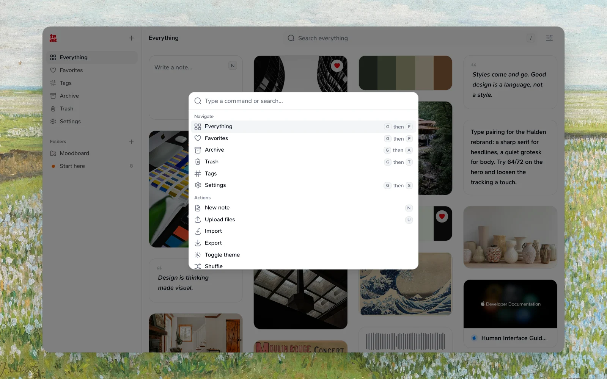

- **Go to** any page, Settings page, folder or smart folder.
- **Find a card:** after two characters, it lists up to 8 matching cards (search filters work). **Search all** shows every match.
- **Run an action:** New note, Upload files, Import, Export, Toggle theme, Shuffle, Keyboard shortcuts, Sign out, and Empty Trash while Trash is open.

## AI enrichment

Teak processes every card after you save it:

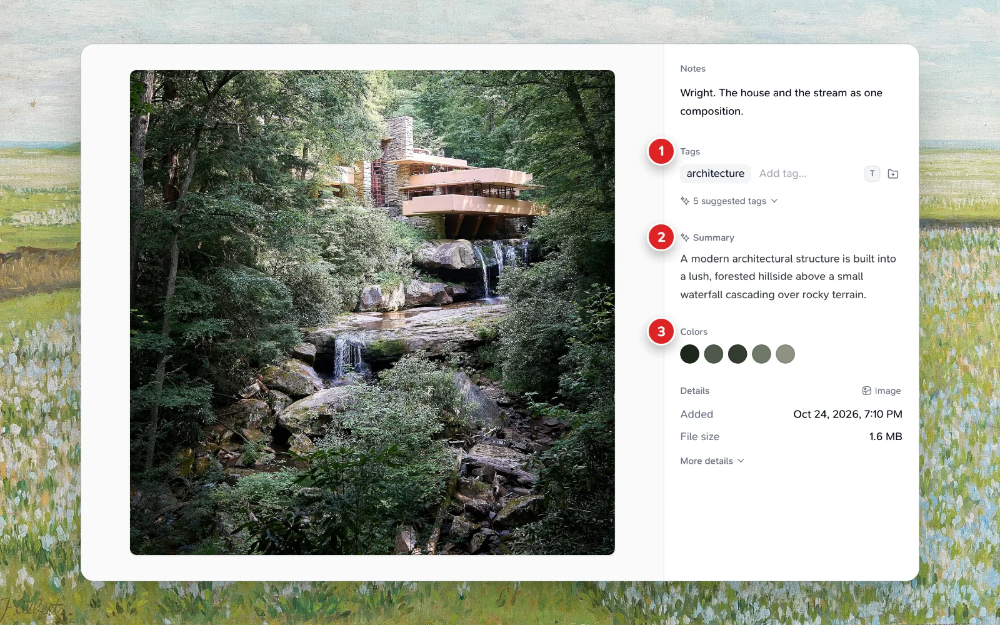

| Feature | What it does |
| --- | --- |
| **Tags** | Adds tags for what it sees, beside yours |
| **Summary** | Writes a short description so you can scan without opening the card |
| **Category** | Sorts links into article, news, book, movie, TV, podcast, music, product, recipe, course, research, event, software, design, place, typeface, social post, app, game or code repository |
| **Colors** | Pulls dominant colors from images, for color search |
| **Transcripts** | Turns speech in audio, video, Vimeo captions and podcast episodes into searchable text |
| **Text in images** | Reads words in images, thumbnails, link screenshots and scanned PDFs, for search |
| **Thumbnails** | Makes previews for video and documents |

Summaries and tags are written in the language of what you save: a Japanese article gets a Japanese summary and Japanese tags. When something mixes languages, its main language wins. Items with no text, such as a photo without words, get English tags. Visual styles such as `minimal` stay in English so `mood:` works everywhere. Your own tags are never changed.

### Refresh details

If a summary or tags miss the mark, or a link's preview is out of date, choose **Refresh details** from the card's **More** menu or right-click it. Teak processes the card again: it reads the link's page again (and saves a new copy of it), redoes the transcript, and rewrites the summary and tags. Your own tags and notes stay, and so does a [highlighted](#highlights) link's saved copy and article. If the page can't be reached, the card keeps its preview. You can refresh a card once a minute, and up to six cards a minute.

### Replace a link's image

To use your own preview image for a link, drop an image on the preview, paste one with `⌘V` while no text field has focus, or click **Replace** beside **Image** in **Details**. Use a JPEG, PNG, WebP, GIF or AVIF image under 20 MB. Your image stays through **Refresh details**. **Undo** puts the previous image back for two minutes, and **Reset** returns to the one Teak found.

### Edit a link

To change the address a link card points to, choose **Edit link…** from its **⋯** menu. It takes `http` and `https` links only. Teak then reads the new page for its preview, summary and tags, and saves a fresh copy. Your own tags and notes stay. A link with highlights can't be edited until you remove them.

### Card details

Teak shows what a page says about itself:

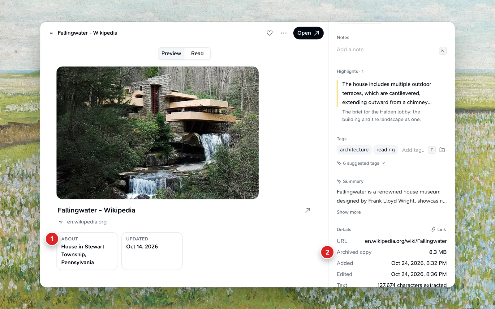

1. Facts the site adds: for Wikipedia, the article's short description and when it was last edited.
2. **Archived copy**: the size of Teak's saved copy of the page.

- **Links:** author and publish date beside the site name, and a product's price as a tag ("$24.99", "Free").
- **Photos:** camera, exposure, aperture, focal length, ISO and when it was taken. Teak never shows a photo's location.
- **Places, apps and games:** address, cuisine, price range and rating; platform, category and rating; or platform, genre, rating and release date.
- **GitHub repositories:** stars, forks and language.
- **Wikipedia:** the short description, last edit date, lead image and whether it's a disambiguation page.
- **arXiv:** authors, publish date, subject and DOI. **Save PDF** saves the paper's PDF as its own document card (it counts toward your card limit); saving it again opens the card you have.
- **YouTube:** channel, length and upload date.
- **Spotify and Apple Music:** name, artist, kind (track, album, playlist or episode) and cover art.
- **Books:** a page with its ISBN in its data (as on Goodreads), or an Amazon book link with a 10-digit ISBN, gets its author, page count, publisher, date and cover from Open Library.
- **Social posts:** posts from X, Instagram, Bluesky, Mastodon, Reddit, TikTok, Threads, LinkedIn and Substack Notes keep their text, author and date. Bluesky, Mastodon and Reddit posts keep up to 10 photos and a video when one is offered as a file. Private, deleted and login-only posts are saved like any page.

## Apps and access

Your library syncs in real time across every [Teak app](/apps). Agents and scripts use the [API](/docs/api), [MCP](/docs/mcp), [SDK](/docs/sdk) and [CLI](/docs/cli).

### Language

The web app, browser extension and the Mac, iPhone, iPad and Android apps are in English, Español, Português (Brasil), Deutsch, Français, 日本語, 한국어 and 简体中文. Choose one in **Settings → Appearance → Language** on the web, or **Settings → Language** in the apps. Your choice is saved to your account, so every browser and device you sign in on follows it. Teak starts in English and never guesses from your browser.

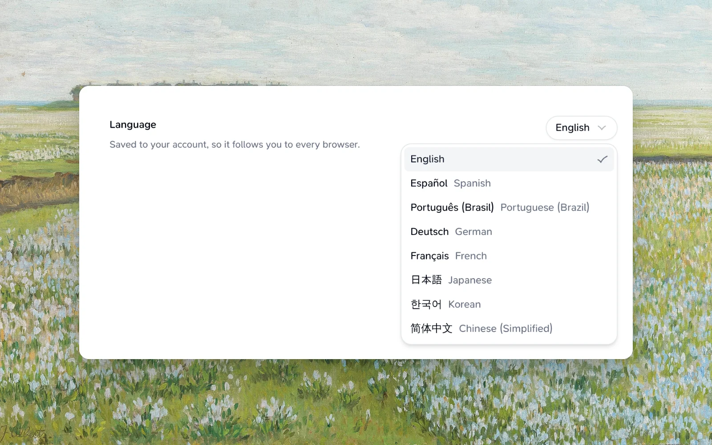

- The apps also follow the language you set for Teak in your device's settings: **Settings → Apps → Teak → Language** on iPhone, iPad and Android 13 or newer, or **System Settings → General → Language & Region → Applications** on a Mac. Changing it there saves it to your account too.
- The extension follows your choice once you sign in. The Safari extension's popup follows Safari's language.
- Search words stay in English: qualifiers such as `is:fav`, `type:image` and `tag:`, `OR`, and dates such as `today`.
- Link facts, price labels, import errors, the API, MCP, CLI, Raycast and these docs are in English.

### Install the web app

In Chrome or Edge, choose **Install Teak** from the address bar or the browser's menu to open Teak in its own window. In Safari on a Mac, choose **File → Add to Dock**; on iPhone and iPad, **Share → Add to Home Screen**. The installed app still needs a connection.

Installed in Chrome on Android or ChromeOS, Teak appears in the system share sheet. Shared links and text open a note ready to save, and shared photos, videos and files upload.
