## Card types

Teak has eight card types, each with automatic processing and a rich preview.

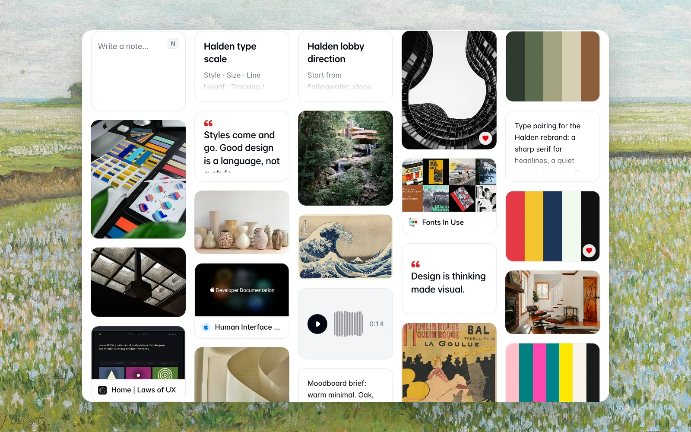

| Type | What you save | What Teak adds |
| --- | --- | --- |
| **Text** | Notes, decisions, feedback | Full-text search |
| **Link** | Articles, Dribbble shots, tools | Details, screenshot, a saved copy of the page |
| **Image** | Screenshots, mockups, photos | Color palette, the words in the image |
| **Video** | Tutorials, animations, clips | Inline player, thumbnail, colors, transcript |
| **Audio** | Voice memos, recordings | Transcript |
| **Document** | PDFs, Office files, source code, Markdown, ZIP and design files | Preview, file facts, searchable text |
| **Palette** | Color swatches | Hex value per color |
| **Quote** | Highlighted passages | Source context |

For text, a quotation with its speaker becomes a quote even without quote marks, a list of colors becomes a palette, and look-alike code or dialogue stays a note.

A palette holds 1 to 12 colors. **Add color** takes one from the picker or a hex code; a swatch's **×** (or right-click **Remove color**) removes it, with **Undo**. Click a swatch to copy its hex.

:::note[Upload limits]
Files (images, video, audio, documents, source files, Markdown, ZIP archives and design files) can be up to 100 MB. `.md` and `.markdown` files become editable notes, up to 512 KiB of UTF-8 text. [Teak archive imports](/docs/import#limits) have their own limits.
:::

## Saving

Save from the web app, the [browser extensions](/docs/extension), the [Mac](/docs/mac), [iPhone and iPad](/docs/mobile) and [Android](/docs/android) apps, [Raycast](/docs/raycast), the [CLI](/docs/cli), [email](#save-by-email), the [API](/docs/api) or [MCP](/docs/mcp).

### Saving links

Paste a link on the home page to save it. Paste up to 100 links, one per line, for one card each.

### Saving something again

Saving a link again, from anywhere, makes no second card: Teak moves the existing card to the top of your library and out of Archive. Addresses that differ only by `http` or `https`, `www.`, a trailing slash, a `#fragment` or tracking parameters (`utm_*`, `fbclid`, `gclid`) are the same link.

- Only a bare link counts; a link with words around it, a note or a file becomes a new card.
- Tags and notes sent with it aren't added to the existing card; add them there.
- Cards in Trash don't count: their link makes a new card.
- **Details** keep **Added**, the first save date, and show **Saved again** with the latest.

### Saving while offline or when a save fails

Teak tells you when you're offline. Notes saved offline appear right away and sync when you reconnect. A voice recording that fails to save stays in the recording window to retry or download.

### Save by email

Turn on **Settings → Integrations → Save by email**, then send or forward anything to `save@in.teakvault.com` from the address you sign in to Teak with.

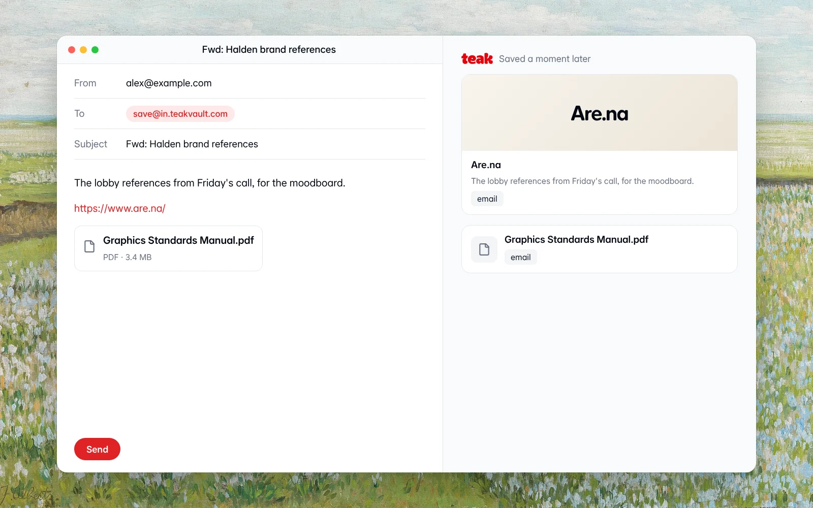

- An email of just a link and at most a sentence or two becomes a link card with the sentence as its note; anything else becomes a note headed with the subject, minus tracking images, redirect wrappers and "Fwd:" headers.
- Attachments become their own cards, in upload formats, up to about 18 MB per email.
- Every card is tagged `email`.
- Mail from other addresses, or failing its domain's sender checks (DMARC), is refused, so a work account forwards only if you sign in with it.
- Mail past 60 an hour, or once a free account has 200 cards, is dropped without a reply.

## Reading

### Saved copies of pages

Teak keeps a private copy of every saved page, so it outlives the site: one file of text, styles, fonts and images, up to 20 MB, without video, audio or scripts. Larger pages are kept as text. If the page disappears, opening it shows Teak's copy.

- The Chrome and Firefox extensions save the page as you saw it, even signed in, minus passwords, payment card numbers and one-time codes.
- **Details** show **Archived copy** with its size, **Text only**, **Saving a copy…**, or **Couldn't save a copy** with the reason.
- [Refresh details](#refresh-details) saves a new copy, unless the link has [highlights](#highlights).

### Read

On the web, a link whose saved copy holds an article shows **Preview · Read** (`R` switches). **Read** lays out the article's text and images cleanly, with site, author and reading time above and **Open original ↗** below.

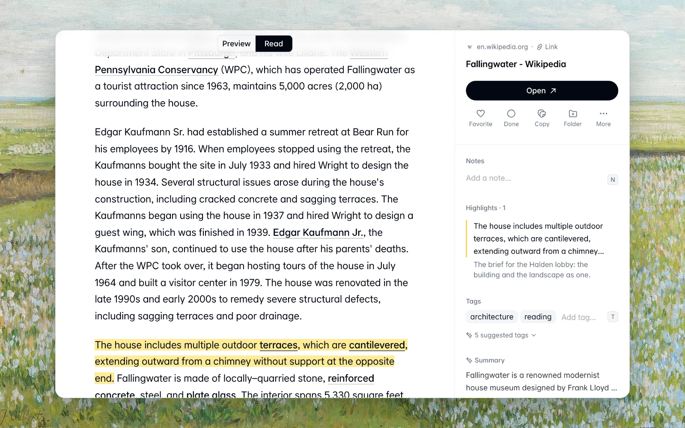

- Articles, news and research open on **Read**; other links on **Preview**.
- An article needs at least 120 words of main text (300 on pages that don't look like articles, such as shops or home pages).
- Wiki articles show the fact box's picture on top and its facts as a short list after the opening paragraphs.
- **Read** says **Preparing the article…** until ready; on failure, **Try again** refreshes the card.
- Search covers the article's words, and a long article's summary is written from it.
- The API, MCP, SDK and CLI return the article as Markdown ([Read a card's text](/docs/api#read-a-cards-text)).

### Highlights

In **Read**, select text and choose **Highlight** or press `H`. On a phone or tablet, **Highlight** is in a bottom bar.

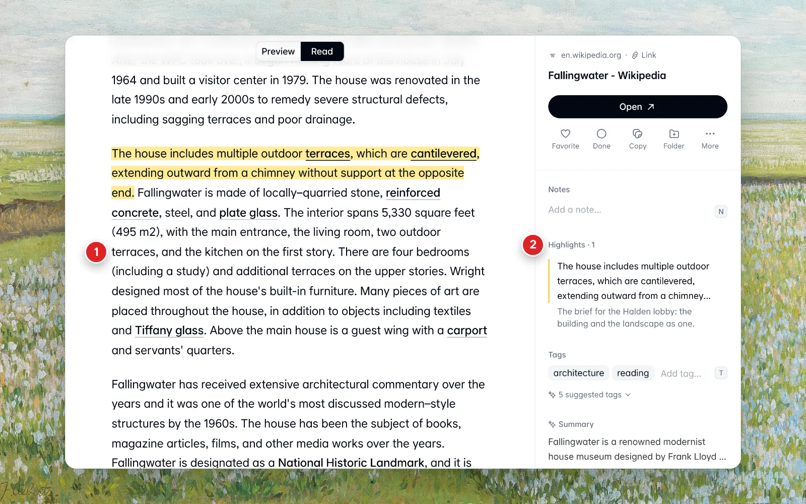

1. The highlighted passage in **Read**.
2. **Highlights · 1** in the card's details, with the highlight's note. Click it to jump to the passage.

- Click a highlight to add a note (up to 2,000 characters) or **Remove highlight**, with **Undo**.
- Overlapping highlights join, keeping the older note. Each holds up to 5,000 characters, 200 per card.
- One missing from the saved article says **Not found in the saved article** and can still be removed.
- A highlighted link keeps its saved copy and article when refreshed or saved again, and its URL is locked until highlights are removed.
- Highlights from [Instapaper, Omnivore and Raindrop.io imports](/docs/import) say **Waiting for the article…** until it's prepared.
- Highlights aren't searched. They're in your [export](/docs/export), and the [API](/docs/api#highlights), MCP, SDK and CLI can list, add, note and remove them.

Read and highlights aren't in the Mac, iPhone, iPad or Android apps yet.

## Your library

### Sidebar

On the web, the sidebar holds:

- **New**, under the Teak logo: a note or link (`N`), file uploads (`U`), or an audio recording.
- **Everything**, **Favorites**, **Tags**, your folders (with color and card count; smart folders show a search icon), **Archive**, **Trash** and **Settings**, each a shareable page. Drop a card on a folder to add it.

Each page's header has its name, the search box, and buttons such as **View**, which filters by card types, changes the order, and saves smart folders. Selecting cards swaps in their actions.

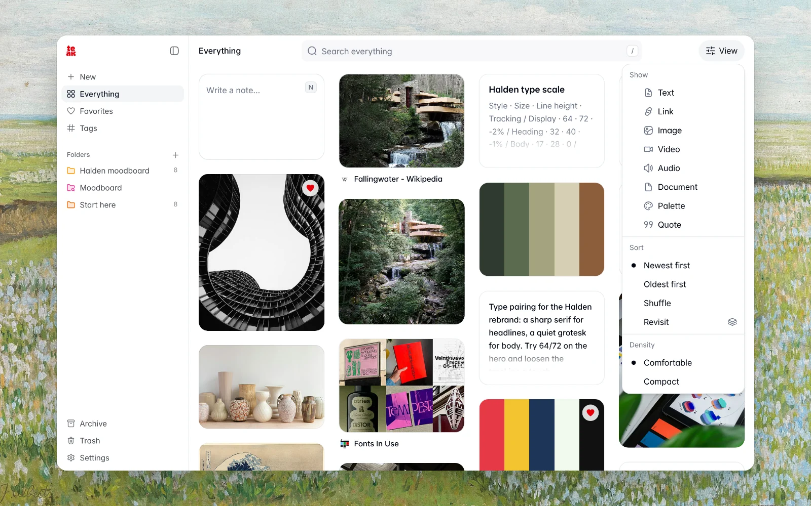

Drag the sidebar's edge to resize it (double-click resets), or collapse it to icons with its top button (`⌘B`, `Ctrl+B` on Windows and Linux); each device remembers both. On a phone it's a drawer, and **+** adds a note or link, uploads files or records audio.

### Grid

The masonry grid has two columns on a phone, up to five on wide screens, and no captions. Notes, quotes, palettes and voice memos are same-size tiles; photos and videos keep their shape. Notes show their first line as a heading, voice memos their length. Links show their picture (or site icon and address) over site icon, title and price; documents, their first page over name and file type. Bottom right, a heart marks favorites and a check [done](#read-watch-and-buy) links. Hover a video for its length, or any card to open its link, favorite it, or open **More** (`⋯`), always shown on touch screens.

Click a card to open its details: source, type (click for all cards of it), title (click a link's to rename it), and **Open** for a link or **Download** for a file. Beside that, pinned while scrolling: **Favorite**, a link's [done button](#read-watch-and-buy), **Copy**, **Folder** and **More** (`⋯`) with Save PDF, More like this, Refresh details, Pin to top, Archive and Move to Trash.

Below, edit notes, folders, tags, summary, colors and **Details** in place. Notes save as you type; `Enter` adds a tag. Teak's tags fold under **suggested tags** to **Keep** or **Remove**. **Details** shows when you added and last saved the card, and its size; the pencil beside a link's **URL** changes it.

Step through cards with the arrows beside the card, or `←` and `→`. On a phone, cards open as a sheet with a bottom action bar. Trashed cards show **Restore** and **Delete forever**.

To select cards, click the circle in a card's corner (or right-click and choose **Select**), then click more. The top bar archives them; **More** favorites, adds to a folder, adds or removes tags, copies links or moves to Trash. Archive's main action is **Unarchive**; Trash's, **Restore**. Archive, Unarchive and Move to Trash offer **Undo**, and failed cards stay selected with **Retry**.

#### Pinned cards

Pin up to 12 cards to the top of **Everything** with **Pin to top** in a card's menu, or `P`, into a **Pinned** row above the grid, newest first. Drag to reorder (hold first on touch screens), or focus one and press `Alt` with `←` or `→`. A 13th pin is refused; unpin one first.

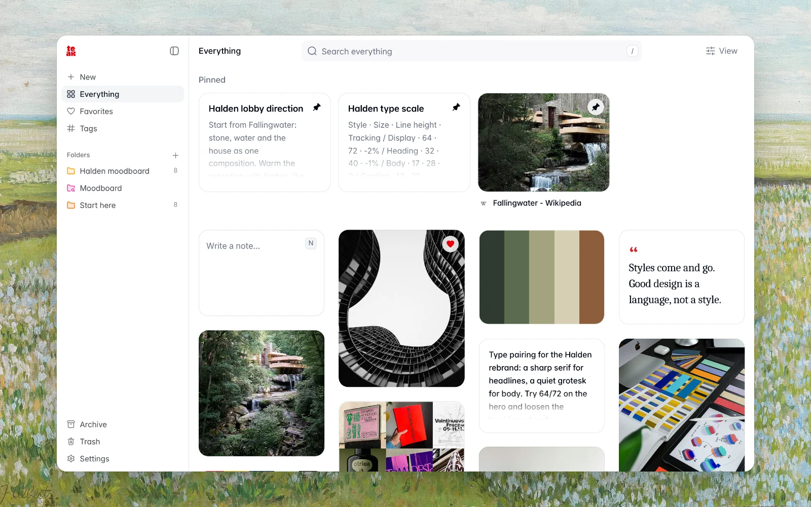

- The row, without captions, shows only on **Everything** in **Newest** order with no search or filter. Elsewhere pinned cards stay where they rank.
- `is:pinned` lists them.
- Archiving or trashing unpins a card; **Undo** on that toast restores its pin and place. Favorites and pins are separate.
- Pin on the web, or with `PATCH /v1/cards/:cardId/pin` and `isPinned: true` in the [API](/docs/api#pinned-cards), MCP, SDK or CLI. The Mac, iPhone, iPad and Android apps can search `is:pinned` but don't pin or show the row.

## Notes

Notes are Markdown. In a checklist, ticked items move below open ones and move back when unticked (on the web, `⌘Z` undoes the move). Every app shows tickable checkboxes.

### Link cards

Type `[[` in a note on the web to pick, with the arrow keys and `Enter` or a click, from up to 8 cards matching what you type next (newest cards until then). Cards tagged `secret` or `hidden` appear only when you type the tag, such as `[[diary #secret`.

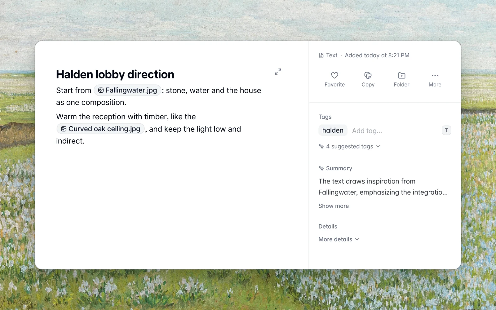

- The link is a pill with the card's type and current title. Click it, or select it and press `Enter`, to open the card.
- Links to trashed, deleted or others' cards show **Missing card**; restoring a trashed card brings its links back. Links inside code stay plain text.
- A linked card's details show **Linked from** with up to 50 notes, most recently updated first, except notes in Trash or tagged `secret` or `hidden`.
- Tiles show a link as its title, and search finds a note by a linked card's title as of linking.
- On Mac, iPhone and iPad, and in exports, the API, MCP and CLI, a link is written `[[Title|teak:<card-id>]]`.

### Tables in notes

In a note on the web, type `/table`. `Tab` moves to the next cell (adding a row from the last), `Shift+Tab` back, `Enter` down. Point at the table, or press `Alt+F10` in a cell, for the **⋯** menu to add or delete rows, columns or the table.

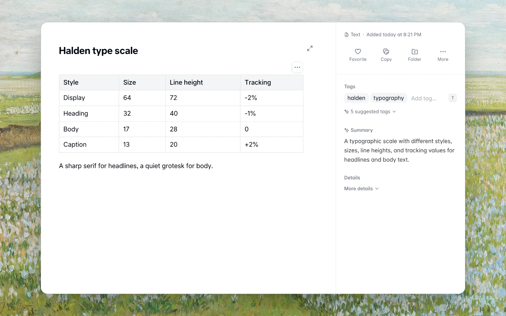

Cells hold one line with bold, italic, code and links (not `[[` card links); tables hold up to 20 columns and 200 rows, saved as Markdown. Pasted Markdown tables convert unless they align columns or sit in a quote or list. Other apps show tables without editing.

### Focus mode

Press `⌘E` (`Ctrl+E` on Windows and Linux), or the expand button at a note's top right, to see only your note. The **Close** and **Save** bar fades as you type; the word count shows when you pause. `Esc` or `⌘E` leaves, keeping edits and focus on the card; `Esc` first closes an open slash menu or link editor.

## Search and organization

### Smart search

Search finds cards by meaning: `cozy reading nook` finds a photo of an armchair by a window with books, a misspelled `typograhpy` finds your type notes, and other languages find English cards. Cards with your words come first, related ones a moment later; with no word match, `flowers` still finds a lily. Teak counts each group; **Hide related** drops the second.

Search covers titles, descriptions, tags, notes, transcripts, file text, and words in images:

- **Documents:** PDFs, Word, PowerPoint, text and code files, searched up to the first 32 KB (roughly 5,000 words). Teak keeps the first 500 pages' text, all returned by the API, MCP and CLI. Scanned PDFs without text are read from their first 3 pages.
- **Audio and video:** transcribed speech, plus, for links, Vimeo captions and podcast episodes whose page links to the audio (up to 100 MB).
- **Images:** words in images and video thumbnails, such as a receipt's invoice number or a code screenshot, used only for search.

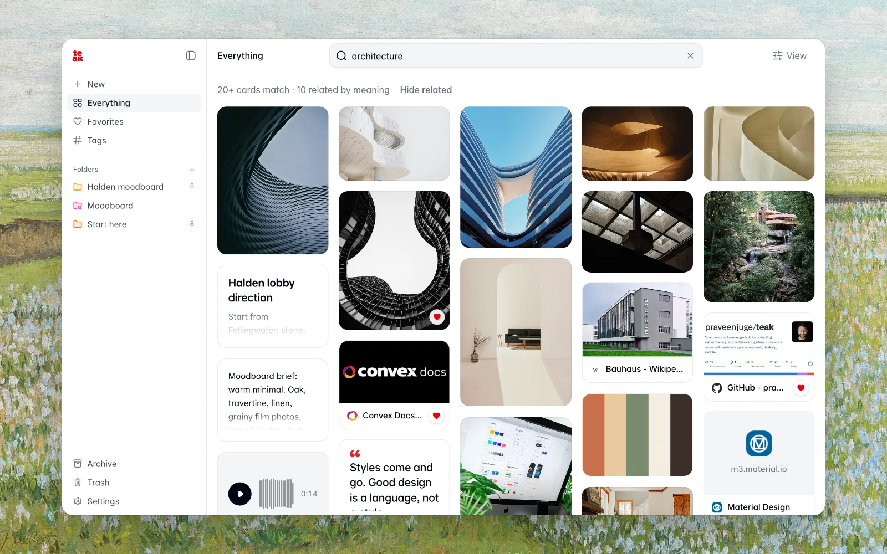

| Token | Examples | Effect |
| --- | --- | --- |
| **Color name** | `red`, `blue`, `teal` | Dominant palette color |
| **Hex color** | `#FF5733`, `#3B82F6` | Exact color. `tag:fff` finds a tag that looks like a color |
| **Visual style** | `minimal`, `dark`, `cinematic`, `typographic`, `3d`, `hand-drawn` | Images and videos with that look |
| **Date** | `today`, `this week`, `january`, `last year` | Date saved (or saved again) |
| **Quick view** | `favorites` / `fav`, `archive`, `trash` / `bin` / `deleted` | Opens that page; type it again for Everything |
| **Tag** | `tag:design`, `#design`, `tag:"web design"` | That tag, any case |
| **Type** | `type:link`, `type:images`, `type:notes`, `type:pdf` | That type. Also `note`, `pdf`, `doc`, `photo`, `picture`, `color`, `voice`, `memo`, `url`, `bookmark`, `movie` |
| **State** | `is:fav`, `is:archived`, `is:pinned` | Favorites, archived or pinned only |
| **Done** | `is:done`, `is:todo` | Links [marked done](#read-watch-and-buy), or not |
| **Site** | `site:github.com` | Links from that site, and text saved from it. Ignores `www.` and case; excludes subdomains |
| **Folder** | `folder:Inbox`, `folder:"Reading list"` | That folder (not smart folders) |
| **Price** | `price:<100`, `price:>=10`, `price:=0` | Product links by price, any currency |
| **Text in image** | `text:4411`, `text:"total due"` | Images, videos, links and scanned PDFs whose own words contain it, ignoring case and line breaks |
| **Phrase** | `"design system"` | Those words in order, including in documents |
| **Similar** | `like:<card id>` | Closest in meaning to that card ([Find similar](#find-similar)) |
| **Mood** | `mood:"moody brutalist"` | Images with that look ([Search images by mood](#search-images-by-mood)) |
| **Exclude** | `-figma`, `-"brand guide"`, `-tag:old`, `-is:archived` | Leaves out matches. Works before anything but `like:` and `mood:` |
| **Either** | `tag:fonts OR tag:type` | Either side. `OR` must be uppercase |
| **Group** | `(site:github.com OR site:gitlab.com) -is:archived` | Parentheses scope `OR` and `-` |
| **Keyword** | anything else | Full-text match |

Several tags, folders, image texts or prices must all match, so `price:>20 price:<100` is a range; several types or sites match any. Spaces join terms that must all match and `OR` joins its sides, so `design -figma OR sketch` means `(design -figma) OR sketch`. A `-` inside a word, as in `to-do`, is part of it. Unknown filters like `type:banana` are searched as text; a missing folder shows **No folder named …**.

```
minimal dark
feedback this week
site:github.com tag:design "design system"
#inspo -type:image
tag:fonts OR tag:type
```

The search box suggests filters, your tags and folders, and your most-saved sites; picks become removable pills, and **Backspace** in an empty box removes the last. **Enter** turns a date at either end into a pill: `kestrel last week` searches "kestrel" in last week's cards. With no results, Teak suggests spellings from your tags, folders and titles, lets you drop filters one at a time, and offers **Save as a note** for a words-only search. In Favorites, Archive, Trash or a folder, **Search everything** widens to your whole library.

The Mac, iPhone, iPad and Android apps use the same syntax and find the same cards.

#### Find similar

**More like this** in a card's **⋯** menu shows the cards of any type closest to it in meaning, as a **Similar to** pill you can filter or save as a smart folder. A just-saved card may take a few seconds.

#### Search images by mood

`mood:"moody brutalist"` lists images whose description, tags, visual style and text match. It reads only images: `mood:` with `type:link` finds nothing.

### Sort and share a search

Cards are ordered newest saved first ([saving a link again](#saving-something-again) moves it up); imported bookmarks keep their original dates. Searches with words start in **Best match**. **View** offers **Newest first**, **Oldest first**, **Shuffle** and **Revisit**.

- **Shuffle** orders cards randomly, stable while you scroll. **Reshuffle** (the dice beside **View**) picks a new order; Back returns to the last. Tags or folders over 2,000 cards shuffle their newest 2,000.
- **Revisit**, outside Archive and Trash, shows 20 random cards from the view, one at a time. `←` or `A` archives, `→` or `K` keeps (or swipe), `Space` opens, `Z` undoes the last archive, `Esc` leaves. **Revisit 20 more** continues; **Start over** reshuffles.

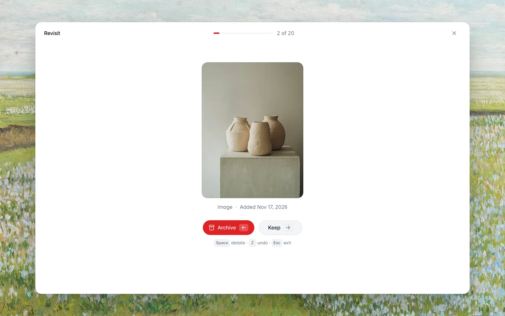

Search, order and card types live in the address bar, so reloads, history and shared links restore the view. Very broad searches sort only their 400 best matches; add a type, date or words to narrow.

### Folders

Folders group cards by project, trip or anything. A card can be in several; removing it never deletes it.

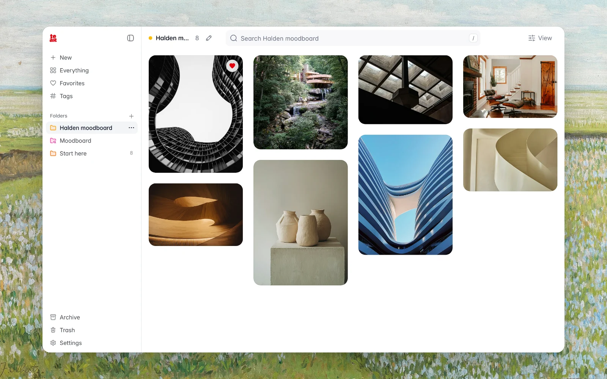

- **Create:** click **+** next to **Folders** in the sidebar, type a name and press `Enter`, or type a new name in **Add to folder…**. Names are unique ignoring case.
- **Add cards:** drag cards onto a folder, or use **Add to folder…** in a card's menu or a selection's **More**. Inside a folder, **Add cards** picks more.
- **Move or remove:** inside a folder, a card's menu has **Remove from this folder**; a selection has **Move to folder…**.
- **Rename, recolor or delete:** right-click a folder in the sidebar or use its **…** menu. Deleting keeps the cards; **Undo** restores the folder for a few seconds.

Archived and trashed cards stay out of folders and counts. You can have up to 500 folders, smart folders included; a card can be in up to 50. Folders are also in the [API](/docs/api#folders), [CLI](/docs/cli) and [MCP](/docs/mcp).

#### Smart folders

A smart folder is a saved search that fills itself with every match, future cards included. Search, then choose **Save as smart folder…** in **View**. It keeps filters, card types and the page (Favorites, Archive or a folder), not colors, styles or dates.

Smart folders show a search icon and their search as faded pills; typing narrows it, and the pencil beside the name edits it. You can't add cards by hand. `folder:"Reading list" is:fav` shows favorites in Reading list, even after a rename.

#### Folder rules

A folder can tag and collect cards for you. Choose **Edit…** from its menu, or the pencil beside its name, then **Add a rule**:

- **Add these tags:** every card put in the folder, however it's added, gets these tags (up to 10).
- **Auto-file cards that match:** a search, such as `tag:typography` or `site:figma.com type:link`. Once processed, matching cards are filed in the folder with its tags. `like:` and `mood:` can't be used.

Saving a rule also applies it to existing cards (archived included, not Trash) and reports how many changed, with **Undo**; **Undo last run** stays in the folder's Edit dialog for a day. Rules only add: a card you take out, or a tag you remove, stays out. Up to 50 folders can have rules; smart folders can't. Rules are also in the [API](/docs/api#folder-rules), [CLI](/docs/cli) and [MCP](/docs/mcp).

### Tags and filters

Teak tags cards automatically; add your own too. Filter by type in **View**, by tag on the **Tags** page, or by anything in the search box. Active filters show as pills; **×** clears them.

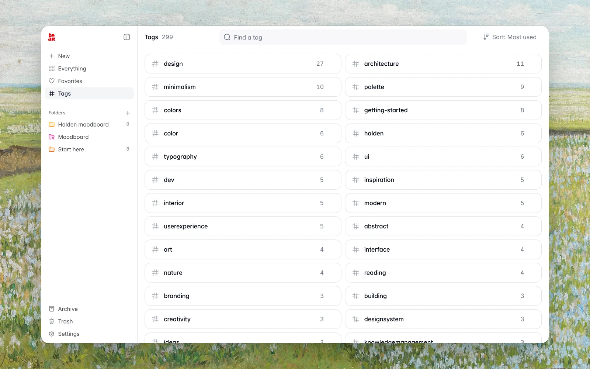

**Tags** lists every tag with its count of cards outside Archive and Trash; click one for its cards. Tags ignore case: `Design` and `design` are one. A tag's **⋯** menu changes it on every card, archived, trashed and Teak-tagged included:

- **Rename…** renames it, or merges it into an existing tag of that name.
- **Merge into…** replaces it with another tag.
- **Delete…** removes it from every card, keeping the cards.

Renames and merges update folders' auto-tags and searches; deletes remove it from auto-tags. Changes run in the background, one at a time. Teak confirms merges and deletes, which can't be undone.

### Archive

Archive a card to hide it without deleting: right-click it, or open it and choose **Archive**. Archived cards stay out of search, Favorites, folders and tag counts, but count toward your card limit. **Unarchive** in **Archive** restores one.

### Trash

Deleted cards go to Trash to restore or delete forever; after 30 days they're deleted. **Empty Trash**, at the top, deletes everything after confirming. A card trashed from Archive returns there when restored.

### Hidden cards

Tag a card `secret` or `hidden` to hide it from your library, Favorites, Archive, Trash, folders, search and Shuffle, in every app and the API. Search `#secret` or `tag:hidden` (not the bare word), or use a smart folder naming the tag, to see them; remove the tag to unhide. Teak's own tags never hide a card, and hidden cards count toward your limit.

### Read, watch and buy

Mark a finished link (only links) done with the button beside **Favorite**, or `D`: **Mark as read** for articles, news, books and papers, **Mark as watched** for films and shows, **Mark as listened** for podcasts and music, **Mark as bought** for products, **Mark as cooked** for recipes, **Mark as played** for games, **Mark as done** otherwise. Its footer then ends with a check, beside any favorite heart.

`is:todo` finds unfinished articles, news, books, films, shows, podcasts, music, products, recipes, courses, events, apps and games; `is:done`, finished links. Both work in smart folders: `is:todo folder:"Reading list"` is what's left to read there.

## Keyboard shortcuts

On the web, Teak works without a mouse. `?` lists every shortcut, and menus, tooltips and the sidebar show them. Shortcuts don't fire while typing. On Windows and Linux, use `Ctrl` for `⌘`.

With a card focused in the grid (one Tab stop):

| Keys | Action |
| --- | --- |
| Arrow keys, `J` / `K` | Move between cards |
| `Enter` | Open |
| `F` | Favorite or unfavorite |
| `P` | Pin or unpin |
| `Alt` `←` / `Alt` `→` | Move a pinned card in the Pinned row |
| `T` | Add tags |
| `E` | Archive or unarchive |
| `Delete` (`⌫` on a Mac) | Move to Trash |
| `X` | Select or deselect |
| `⌘C` | Copy the note's text, link or image |
| `Esc` | Clear the selection |

With cards selected, `F`, `T`, `E` and `Delete` act on all of them.

With a card open:

| Keys | Action |
| --- | --- |
| `←` / `→` (or `K` / `J`) | Previous or next card |
| `F`, `P`, `T`, `E`, `Delete` | As in the grid |
| `N` | Write a note |
| `O` or `⌘Enter` | Open the link, or download the file |
| `C` | Copy the text, link or image |
| `D` | Mark a link done |
| `R` | Switch **Preview** and **Read** |
| `H` | Highlight selected text in **Read** |
| `⌘E` | Focus mode |
| `Esc` | Close |

Anywhere:

| Keys | Action |
| --- | --- |
| `/` | Search |
| `N` | New note |
| `U` | Upload files |
| `G` then `E`, `F`, `A`, `T`, `L` or `S` | Go to Everything, Favorites, Archive, Trash, Tags or Settings |
| `Alt` `T` (`⌥` `T` on a Mac) | Focus notifications, such as to **Undo** |
| `⌘K` | Command palette |
| `?` | Show shortcuts |

### Command palette

Press `⌘K` anywhere, type to filter, then `Enter`:

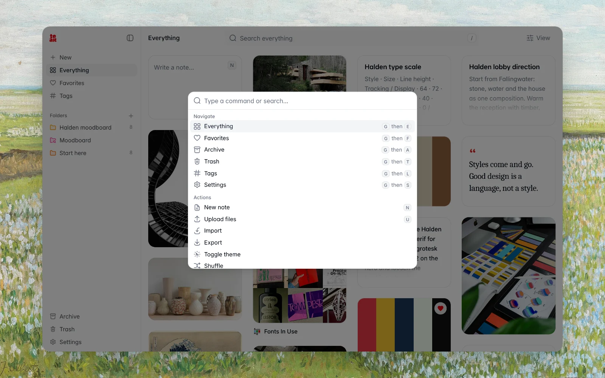

- **Go to** any page, Settings page, folder or smart folder.
- **Find a card:** after two characters, up to 8 matches (filters work); **Search all** shows every match.
- **Run an action:** New note, Upload files, Import, Export, Toggle theme, Shuffle, Keyboard shortcuts, Sign out, and Empty Trash while in Trash.

## AI enrichment

Teak processes every card after you save it:

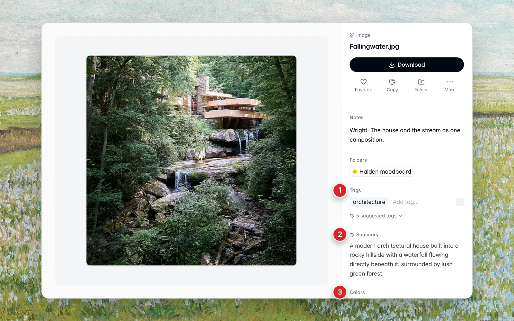

| Feature | What it does |
| --- | --- |
| **Tags** | Tags what it sees, beside yours |
| **Summary** | A short description to scan without opening the card |
| **Category** | Sorts links into article, news, book, movie, TV, podcast, music, product, recipe, course, research, event, software, design, place, typeface, social post, app, game or code repository |
| **Colors** | Dominant image colors, for color search |
| **Transcripts** | Searchable text from speech in audio, video, Vimeo captions and podcast episodes |
| **Text in images** | Words in images, thumbnails, link screenshots and scanned PDFs, for search |
| **Thumbnails** | Previews for video and documents |

Summaries and tags use the language of what you save (its main one if mixed): a Japanese article gets a Japanese summary and tags. Items with no text, such as a photo without words, get English tags. Visual styles such as `minimal` stay English so `mood:` works everywhere. Your own tags are never changed.

### Refresh details

If a summary or tags miss, or a link's preview is stale, choose **Refresh details** from the card's **More** or right-click menu. Teak rereads the link's page (saving a new copy), redoes the transcript, and rewrites the summary and tags. Your tags and notes stay, as do a [highlighted](#highlights) link's saved copy and article, and an unreachable page keeps its preview. Refresh a card at most once a minute, and six cards a minute.

### Replace a link's image

Drop an image on a link's preview, paste one with `⌘V` outside text fields, or click **Replace** beside **Image** in **Details**: JPEG, PNG, WebP, GIF or AVIF under 20 MB. It survives **Refresh details**. **Undo** restores the previous image for two minutes; **Reset** returns to Teak's.

### Edit a link

To change a link's address (`http` or `https`), choose **Edit link…** from its **⋯** menu. Teak reads the new page for preview, summary and tags, and saves a fresh copy; your tags and notes stay. Links with highlights can't be edited until you remove them.

### Card details

Teak shows what a page says about itself:

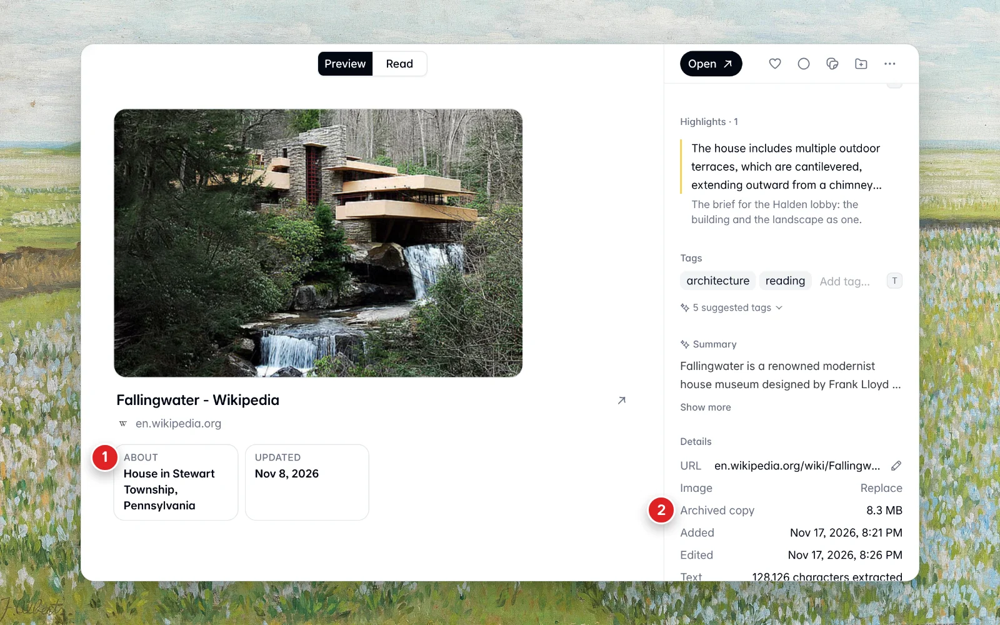

1. Facts the site adds, here Wikipedia's short description and last edit.
2. **Archived copy**: the saved copy's size.

- **Links:** author and publish date beside the site name; a product's price as a tag ("$24.99", "Free").
- **Photos:** camera, exposure, aperture, focal length, ISO and capture time, never location.
- **Places:** address, cuisine, price range and rating. **Apps:** platform, category and rating. **Games:** platform, genre, rating and release date.
- **GitHub repositories:** stars, forks and language.
- **Wikipedia:** short description, last edit date, lead image and whether it's a disambiguation page.
- **arXiv:** authors, publish date, subject and DOI. **Save PDF** saves the paper as its own document card (counting toward your limit), or opens it if saved.
- **YouTube:** channel, length and upload date.
- **Spotify and Apple Music:** name, artist, kind (track, album, playlist or episode) and cover art.
- **Books:** pages with an ISBN in their data (as on Goodreads), or Amazon links with a 10-digit ISBN, get author, page count, publisher, date and cover from Open Library.
- **Social posts:** X, Instagram, Bluesky, Mastodon, Reddit, TikTok, Threads, LinkedIn and Substack Notes keep text, author and date; Bluesky, Mastodon and Reddit also keep up to 10 photos and a video file. Private, deleted and login-only posts save like any page.

## Apps and access

Your library syncs in real time across every [Teak app](/apps). Agents and scripts use the [API](/docs/api), [MCP](/docs/mcp), [SDK](/docs/sdk) and [CLI](/docs/cli).

### Language

Teak's web app, extension and apps are in English, Español, Português (Brasil), Deutsch, Français, 日本語, 한국어 and 简体中文. Choose in **Settings → Appearance → Language** on the web, or **Settings → Language** in the apps; it's saved to your account, so every device follows. Teak starts in English, never guessing from your browser.

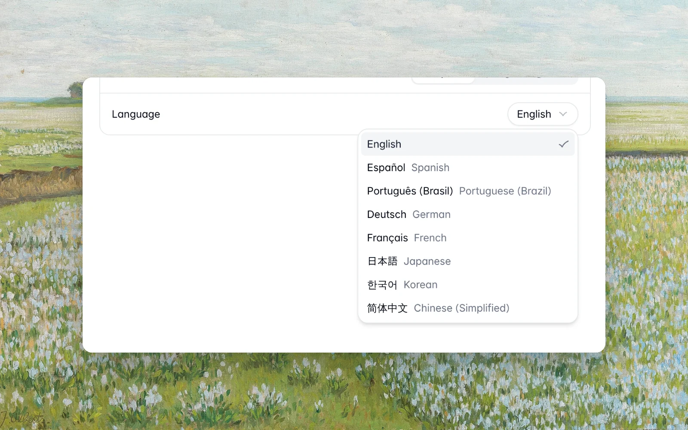

- The apps also follow, and save to your account, Teak's language in **Settings → Apps → Teak → Language** on iPhone, iPad and Android 13 or newer, or **System Settings → General → Language & Region → Applications** on a Mac.
- The extension follows your choice once signed in; the Safari popup follows Safari.
- Search words stay English: qualifiers such as `is:fav`, `type:image` and `tag:`, `OR`, and dates such as `today`.
- Link facts, price labels, import errors, the API, MCP, CLI, Raycast and these docs are English only.

### Install the web app

In Chrome or Edge, choose **Install Teak** from the address bar or browser menu for its own window. In Safari, choose **File → Add to Dock** on a Mac, or **Share → Add to Home Screen** on iPhone and iPad. It still needs a connection.

Installed via Chrome on Android or ChromeOS, Teak joins the share sheet: shared links and text open a note ready to save; shared photos, videos and files upload.
