## Card types

Eight types cover common save workflows. Each gets automatic processing and a rich preview.

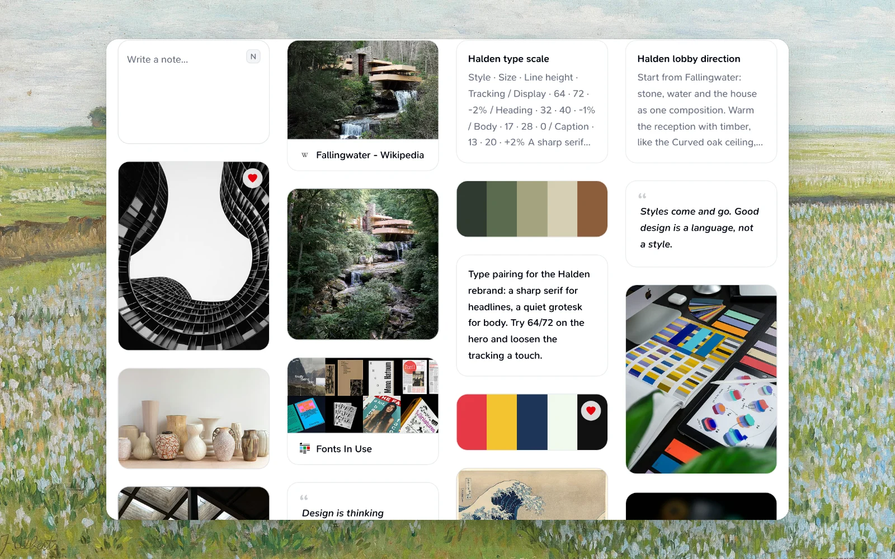

| Type | What you save | Auto-features |
| --- | --- | --- |
| **Text** | Notes, decisions, feedback | Full-text search |
| **Link** | Articles, Dribbble shots, tools | Metadata, screenshot, preview |
| **Image** | Screenshots, mockups, photos | Color palette extraction |
| **Video** | Tutorials, animations, clips | Inline player, thumbnails, colors from frames across it |
| **Audio** | Voice memos, recordings | Transcription |
| **Document** | PDFs, Office files, source, `.mdx`, ZIP, and design files | Adaptive previews and file facts |
| **Palette** | Color swatches from images | Hex values per color |
| **Quote** | Highlighted passages | Source context |

Teak picks the type when you save a note: a quotation with who said it becomes a quote even without quote marks, a list of colors becomes a palette, and code or dialogue that only looks like one stays a note.

:::note[Upload limits]
Ordinary file uploads (images, video, audio, documents, source files, Markdown, ZIP archives, and design files) are supported up to 100 MB. For [Teak archive imports](/docs/import#limits), the archive itself can be up to 5 GiB (exempt from the 100 MB upload limit), while each attached file inside is limited to 20 MiB. `.md` and `.markdown` files become editable text cards limited to 512 KiB of valid UTF-8.
:::

### Saving links

Paste a link on the home page to save it as a link card. Paste a list of links, one per line, and Teak saves each as its own card (up to 100 at a time).

### Saving something again

Saving a link you already have doesn't make a second card. Teak moves that card to the top of your library and brings it back from Archive if it was there. This works wherever you save: the web, the browser extension, Raycast, the Mac, iPhone, iPad and Android apps, email, the API, MCP and the CLI. Teak treats two addresses as the same link when they differ only by `http` or `https`, `www.`, a trailing slash, a `#fragment` or tracking parameters (`utm_*`, `fbclid`, `gclid`).

- Only a link saved on its own counts. A link with words around it, a note or a file is saved as a new card, and so is an emailed link with a sentence or two around it.
- Tags and notes sent with it aren't added to the card you already have. Add them to that card instead.
- A card in Trash doesn't count: saving its link again makes a new card.
- The card's **Details** keep **Added**, the date you first saved it, and show **Saved again** with the last time you saved it.

### Saved copies of pages

Teak keeps a private copy of every link you save, on every plan, so the page outlives the site. The copy is made automatically after you save: one file with the page's text, styles, fonts and images, up to 20 MB. Video, audio and scripts aren't kept, and a page too large to keep whole is kept as text only. Links you saved before get a copy too.

- Saving a page from the Chrome or Firefox extension (the popup, ⌥⇧S, or **Save Page** in the right-click menu) keeps the page as you saw it, including pages you're signed in to. Passwords, payment card numbers and one-time codes are left out.
- The card's **Details** show **Archived copy** with its size, **Text only**, **Saving a copy…** while it's made, or **Couldn't save a copy** with the reason.
- **Refresh details** saves a new copy of the page, unless the link has [highlights](#highlights): highlighted articles keep their saved copy.
- If a saved page disappears, opening it shows Teak's copy instead.

### Read

A saved article reads cleanly in Teak. On the web, a link card's dialog has **Preview · Read** above it when Teak found an article in the page's saved copy: **Read** shows the article's text and images in one calm layout that follows light and dark, with the site, author and reading time above it and **Open original ↗** below. Press `R` to switch between them.

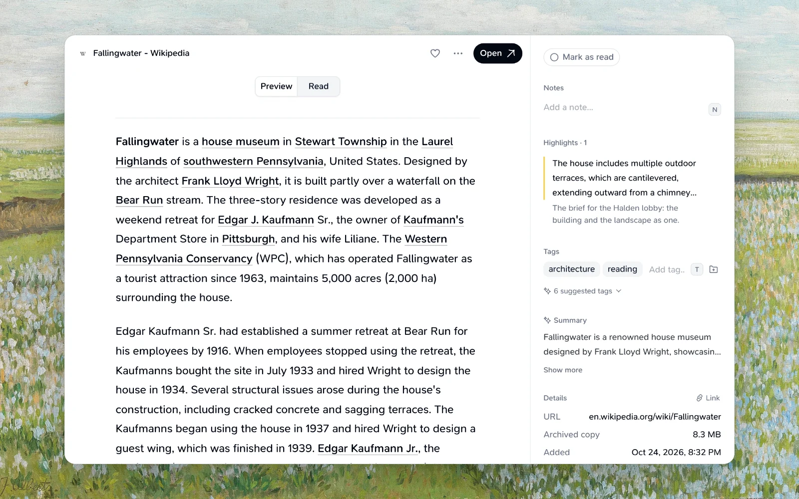

- Articles, news and research open on **Read**; other links open on **Preview**. Your pick lasts for that card while the dialog is open.
- A page counts as an article when its main text has at least 120 words (300 when the page doesn't look like an article, such as a shop or a home page). Pages with less show only **Preview**.
- While the article is prepared after saving, **Read** says **Preparing the article…**. If it couldn't be prepared, **Try again** refreshes the card's details.
- Search finds links by words in their article, and the AI summary of a long article is written from the article itself.
- **Refresh details** prepares the article again from a new copy of the page, unless it has highlights.
- Agents and scripts can read it too: the API, MCP, SDK and CLI return a link's article as Markdown (`teak cards content <id> --kind article`). See [Read a card's text](/docs/api#read-a-cards-text).
- The iPhone, iPad, Mac and Android apps don't show the reader yet.

### Highlights

Mark the passages worth keeping while you read. In **Read**, select some text and choose **Highlight** above it, or press `H`. On a phone or tablet, **Highlight** appears in a bar at the bottom. The passage is painted in one calm color.

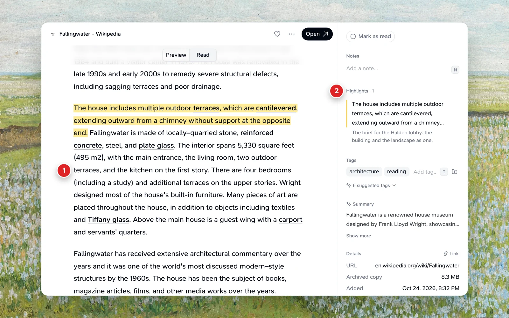

1. The highlighted passage, painted in **Read**.
2. **Highlights · 1** in the card's details, with the highlight's note. Click it to jump to the passage.

- Click a highlight to add a note to it (up to 2,000 characters; it saves when you click away, or with `⌘Enter`), or to **Remove highlight**. Removing it offers **Undo**.
- A new highlight that overlaps one you have joins it: they become one highlight covering both, with the older note. A highlight can be up to 5,000 characters, and a card can have up to 200.
- The card's details list **Highlights · N** after Notes, in the order they appear in the article. Click one to jump to it in **Read**. A highlight Teak can't find in the saved article says **Not found in the saved article**, and you can still remove it.
- Highlighted articles keep their saved copy: **Refresh details** still refreshes the preview, summary and tags, but no longer replaces the copy or the article, and saving the link again from the extension doesn't either. A highlighted link's URL can't be changed until its highlights are removed.
- Highlights from [Instapaper, Omnivore and Raindrop.io imports](/docs/import) arrive as highlights. Until Teak has prepared the article they say **Waiting for the article…**, then appear in the text.
- Highlights aren't searched. They're kept in your [export](/docs/export), and agents and scripts can list, add, note and remove them through the [API](/docs/api#highlights), MCP, SDK and CLI.
- Highlights are made in Teak's reader only, not on live pages, PDFs or notes. The iPhone, iPad, Mac and Android apps don't show them yet.

## Search and organization

### Sidebar

On the web, the sidebar holds everything around your cards:

- **Everything**, **Favorites**, **Tags**, **Archive**, **Trash**, and **Settings**, each its own page you can bookmark or share. See [Tags and filters](#tags-and-filters) for the Tags page.
- **Folders** lists your folders with their color and how many cards each holds; smart folders show a search icon instead of a count. Drag a card onto a folder to add it. See [Folders](#folders).
- **+** beside the Teak logo starts a note or link (**N**), uploads files (**U**), or records audio.

Every page has the same slim header: the page's name on the left (a folder shows its color and card count), the search box, and a **View** menu. Use **View** to narrow the open page to text, links, images, video, audio, documents, palettes, or quotes (pick more than one to combine them), to change the order, or to save the search as a smart folder. The header stays at the top as you scroll, and selecting cards swaps it for the selection's actions.

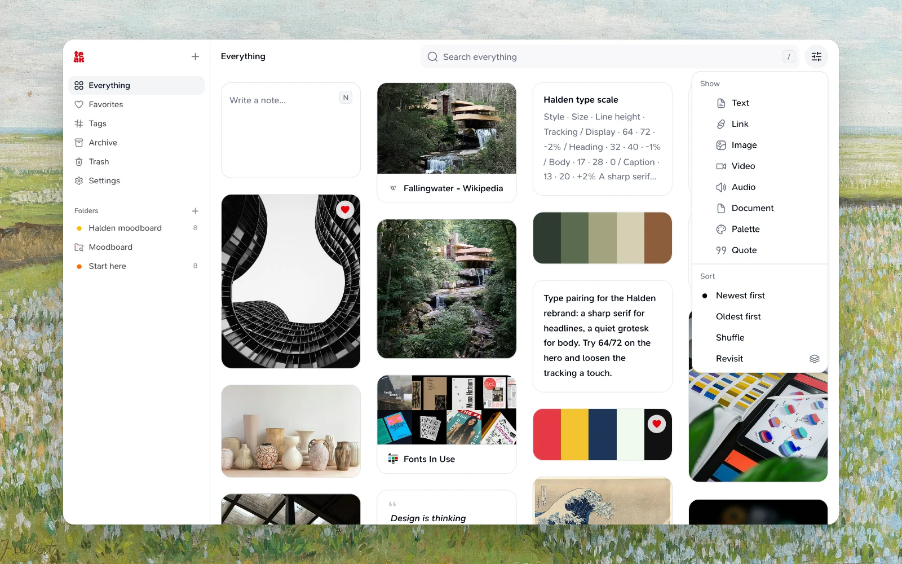

Drag the sidebar's edge to make it wider or narrower, and double-click the edge to reset it. Collapse it to icons with the button that appears at its top when you point at it (or ⌘B, Ctrl+B on Windows and Linux), and bring it back with the button at the start of the header; rest the pointer on the icons to see the full sidebar for a moment. Teak remembers the width and your choice on each device. On a phone, the button at the start of the header opens it as a drawer, and the search icon opens the search box.

### Smart search

Search titles, descriptions, tags, transcripts, the text inside your files, and the words in your images.

Search finds cards by meaning, not just exact words. `cozy reading nook` also finds a photo of an armchair by a window with books, a misspelled `typograhpy` still finds your type notes, and a search in another language finds cards saved in English. Cards that match your words always appear; cards related by meaning join them a moment later. Tokens and filters below apply to both, and the order you pick in **View** decides how they are sorted.

Teak reads the text of PDFs, Word and PowerPoint files, and text and code files when you save them, and transcribes the speech in audio and video. Search then finds a card by a sentence in a PDF or a line someone said in a video. Links count too: a Vimeo video's captions, and what's said in a podcast episode whose page links to its audio (up to 100 MB of audio), become the card's transcript, so search finds the episode by a phrase in it, and its summary and tags describe what's said. For a long document, search covers its first 32 KB of text (roughly 5,000 words); Teak keeps the text of the first 500 pages, and the API, MCP and CLI return all of it. When the words appear in the text of very many of your documents, search shows the 128 closest matches among them. A scanned PDF without a text layer is read instead: Teak reads the words on its first 3 pages, for search, its summary and its tags.

Teak also reads the words in images and in a video's thumbnail when you save them: a receipt, a screenshot of code, a sign, a slide. Search then finds the receipt by its invoice number. Teak uses these words only to find your cards; it doesn't show them.

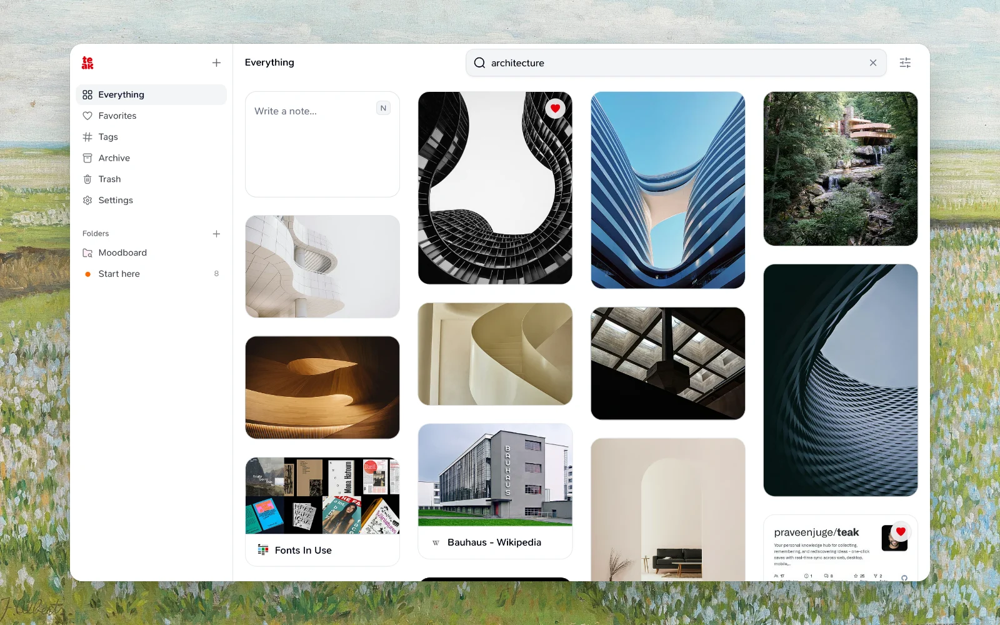

Special tokens work automatically:

| Token | Examples | Effect |
| --- | --- | --- |
| **Color name** | `red`, `blue`, `teal` | Dominant palette color |
| **Visual style** | `minimal`, `dark`, `cinematic`, `typographic`, `3d`, `hand-drawn` | Images and videos with that look |
| **Hex color** | `#FF5733`, `#3B82F6` | Exact color match |
| **Date** | `today`, `this week`, `january`, `last year` | Date saved (or saved again) |
| **Quick view** | `favorites` / `fav`, `archive`, `trash` / `bin` / `deleted` | Opens that page; type it again to go back to Everything |
| **Tag** | `tag:design`, `#design`, `tag:"web design"` | Cards with that tag, ignoring case |
| **Type** | `type:link`, `type:images` | Cards of that type |
| **Favorites or archived** | `is:fav`, `is:archived` | Only favorites, or only archived cards |
| **Done** | `is:done` | Links you marked read, watched, listened to, bought, cooked, played or done |
| **To do** | `is:todo` | Articles, news, books, films, shows, podcasts, music, products, recipes, courses, events, apps and games you haven't marked done |
| **Site** | `site:github.com` | Links from that website, and text saved from its pages |
| **Folder** | `folder:Inbox`, `folder:"Reading list"` | Cards in that folder (not a smart folder) |
| **Price** | `price:<100`, `price:>20`, `price:<=50`, `price:>=10`, `price:=0` | Product links whose price is under, over or exactly that amount |
| **Text in image** | `text:4411`, `text:"total due"` | Images, videos, links and scanned PDFs whose own words contain that text, and not the notes that mention it |
| **Phrase** | `"design system"` | Those words together, in that order |
| **Similar** | `like:<card id>` | Cards closest in meaning to that card (use **More like this**) |
| **Mood** | `mood:"moody brutalist"` | Images whose look and description match the mood |
| **Exclude** | `-figma`, `-"brand guide"`, `-tag:old`, `-type:image`, `-is:archived` | Leaves out cards that match. Works before a word, a phrase or any filter except `like:` and `mood:` |
| **Either** | `tag:fonts OR tag:type` | Cards that match either side. `OR` must be uppercase; a lowercase `or` is just a word |
| **Group** | `(site:github.com OR site:gitlab.com) -is:archived` | Parentheses decide what `OR` and `-` apply to |
| **Keyword** | anything else | Full-text match |

Mix tokens in one query — all recognized filters apply together. Tags, folders, image text and prices must all match, so `price:>20 price:<100` is a range; several types or sites match any of them.

A `-` applies to the word or filter right after it, a space joins what must all match, and `OR` joins the sides around it, so `design -figma OR sketch` means `(design -figma) OR sketch`. A `-` inside a word, as in `to-do`, is part of the word. `-design` also leaves out `designer`. Cards tagged `secret` or `hidden` stay out unless the search asks for that tag: `-tag:hidden` never shows them, and `tag:hidden OR tag:recipes` shows them only through the `tag:hidden` side.

```
blue button hover state
minimal dark
#3B82F6
feedback this week
site:github.com tag:design "design system"
#inspo -type:image
tag:fonts OR tag:type
```

As you type, the search box suggests filters, your tags and folders, and the sites you save most. Pick one with the arrow keys and **Enter**, or click it, and it becomes a removable pill inside the search box. **Esc** closes the suggestions, and **Backspace** in an empty search box removes the last pill. The address bar keeps the whole search, so you can bookmark or share it.

A few details:

- `site:` matches the website exactly. `www.` and capital letters don't matter, so `site:www.GitHub.com` is the same as `site:github.com`, but `site:example.com` doesn't include `blog.example.com`.
- Text saved from a page with the browser extension's **Save Text to Teak** keeps that page as its source. Its details show **From** and the site, `site:` finds it, and the site shows under the text in your library.
- `text:` looks only at the words Teak read in images, video thumbnails, a link's preview image and screenshot, and the first 3 pages of a scanned PDF, ignoring capitals and line breaks, so `text:"total due"` finds a receipt with **Total** and **Due** on two lines. Cards saved before Teak read their words get them once Teak catches up on them, or right away with **Refresh details**.
- `price:` compares the amount only, whatever the currency, so `price:<100` includes both $90 and ¥90. Links without a price never match.
- `#` followed by a color code, like `#fff` or `#3B82F6`, is a color. Use `tag:fff` for a tag that looks like one.
- Quoted phrases also match the text inside your documents.

#### Find similar

Open a card and choose **More like this** from its **⋯** menu to see the cards closest to it in meaning, of any type: notes, links and images about the same thing. The search box shows the pill **Similar to** and the card's title. Add filters to narrow the list, such as `type:link` or a tag, and pick the order in **View**. Save it as a smart folder to keep it; the folder follows the card if you rename it. A card saved a moment ago may need a few seconds before its similar cards show up.

#### Search images by mood

`mood:"moody brutalist"` lists images whose look matches the words: their description, tags, visual style and any text in them. It reads only images, so `mood:` with `type:link` finds nothing.
- Files you saved before Teak kept their text become searchable once Teak catches up on them. For a video saved earlier, use **Refresh details** on the card to get its transcript.
- A filter Teak doesn't recognize, like `type:banana`, is searched as text. A folder name you don't have shows as **No folder named …** and matches nothing.

### Folders

Folders group cards by project, trip, or anything else. A card can be in several folders at once, and removing it from a folder never deletes it.

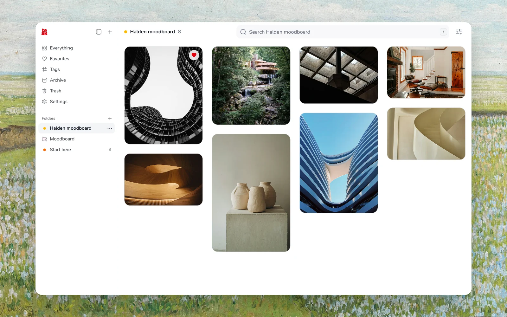

- **Create a folder:** click **+** next to **Folders** in the sidebar, type its name, and press Enter (Escape cancels). Pick a color later from its **…** menu. Names are unique ignoring case, so "Ideas" and "ideas" are the same folder.
- **Add cards:** select cards and choose **More › Add to folder…**, or right-click a card (or open it) and choose **Folders…** to tick the folders it belongs in. Typing a name that doesn't exist yet creates the folder.
- **Open a folder:** click it in the sidebar. Search, card types, and sort work inside it, and **Add cards** picks more cards for it. Archived cards and cards in Trash stay out of the folder and its count until you bring them back.
- **Move or remove:** inside a folder, select cards and use **More › Move to folder…** or **Remove from** the folder.
- **Rename, recolor, or delete:** right-click a folder in the sidebar or use its **…** menu. Deleting a folder keeps its cards in your library, and **Undo** brings it back for a few seconds.

#### Smart folders

A smart folder saves a search. It shows every card that matches, including cards you save later, so it fills itself.

- **Save a search:** search for what you want, such as `tag:design type:link`, open the **View** menu at the end of the search box, and choose **Save as smart folder…**. The search keeps its filters, the card types and tag you picked, and the view you're in (Favorites, Archive, or the folder you have open). Colors, styles, and dates aren't saved.
- **Open it:** smart folders sit with your folders and have a search icon. Its search shows as faded pills at the start of the search box, and anything you type narrows it further.
- **Edit search:** use the pencil beside the folder's name, or its **…** menu in the sidebar. A smart folder can use `folder:` to look inside one of your regular folders, and follows that folder if you rename it.
- Cards aren't added to a smart folder by hand: **Add to folder…** and **Folders…** list only regular folders.

For example, `folder:"Reading list" is:fav` is a smart folder of your favorite cards in Reading list, and `site:github.com "design system"` collects every GitHub link that mentions a design system.

You can have up to 500 folders, smart folders included, and a card can be in up to 50. Folders are also available in the [API](/docs/api#folders), [CLI](/docs/cli), and [MCP](/docs/mcp).

### Tags and filters

AI applies tags automatically; you can add your own. Filter by type from the **View** menu, by tag from the **Tags** page, or by style, color, or date in the search bar. Active filters show as removable pills inside the search bar (the first three, with the rest behind **+N**), and **×** at its end clears them all.

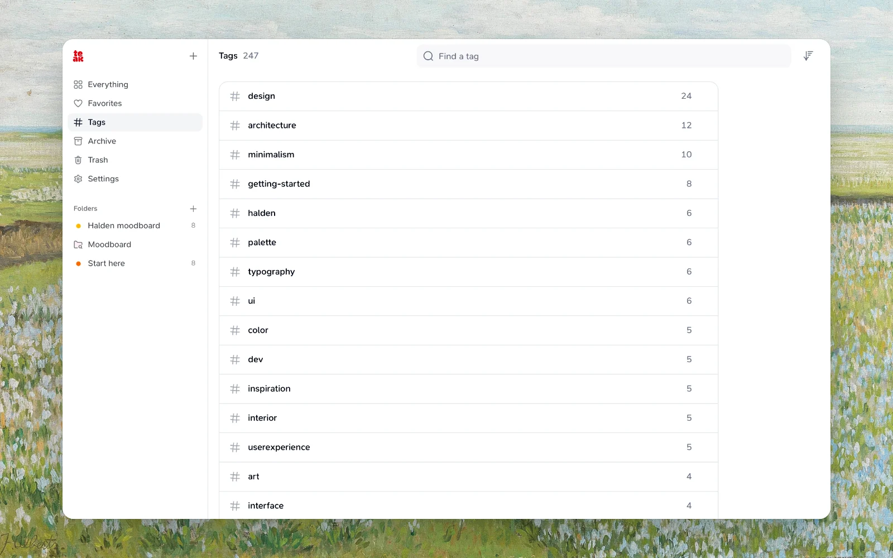

Open **Tags** in the sidebar, right below Favorites, to see every tag with how many cards outside Archive and Trash carry each, most used first. Find one by typing in the box at the top, or sort them by name. Tags match ignoring case, so `Design` and `design` are one tag. Click a tag to see only its cards in your library; remove its pill to clear it. The list catches up a few seconds after tags change.

Use a tag's **⋯** menu on the Tags page to change it on every card at once, including cards in Archive and Trash and tags AI added:

- **Rename…** gives it a new name, written exactly as you type it. A tag that already has the new name can be merged into instead.
- **Merge into…** replaces it with another tag. A card that has both keeps one.
- **Delete…** removes it from every card. The cards are kept.

A change runs in the background, with its progress in a message at the bottom of the page, and one runs at a time. Merges and deletes can't be undone, so Teak asks first.

### Trash

Deleted cards go to trash first. Restore them, or delete permanently (including files). Cards left in trash are permanently deleted after 30 days. Open **Trash** from the sidebar, or type `trash`, `bin`, or `deleted` in the search bar.

### Archive

Archive a card to keep it out of your library without deleting it. Right-click it in the grid, or open it and choose **Archive**. Open **Archive** from the sidebar (or type `archive` and press Enter) to see archived cards, and **Unarchive** to bring one back. Archived cards stay out of search, favorites, filters, and tags until you return them, and they still count toward your card limit. Moving an archived card to Trash and restoring it puts it back in Archive.

### Read, watch and buy

Mark a link done when you've finished with it. Open the link and click the pill at the top of its details (or press `D`, or choose it from **More**): it says **Mark as read** for an article, news story, book or research paper, **Mark as watched** for a film or show, **Mark as listened** for a podcast or music, **Mark as bought** for a product, **Mark as cooked** for a recipe, **Mark as played** for a game, and **Mark as done** for anything else. A toast lets you undo it, and the link's tile shows a check.

Search `is:todo` to see what's left: the articles, news, books, films, shows, podcasts, music, products, recipes, courses, events, apps and games you haven't marked done. When there's nothing left, Teak says **Nothing left to do.** Search `is:done` to see what you've finished. Both work in smart folders too, so `is:todo folder:"Reading list"` is a folder of what's left to read there. Only links can be marked done.

### Hidden cards

Tag a card `secret` or `hidden` to hide it. A hidden card leaves your library, Favorites, Archive, Trash, folders, smart folders, search, and Shuffle, on every app and in the API. Adding one of these tags to an open card shows **Hidden** with the search that shows it, such as **Search #secret to see it.**, and **Undo**. The card's tags show **Hidden** while it is.

To see hidden cards, search for one of those tags: `#secret`, `tag:hidden`, or a tag from the **Tags** page. A smart folder whose search names one of them shows them too. Searching for the word `secret` doesn't. Remove the tag and the card comes back. Tags Teak adds never hide a card, and hidden cards still count toward your card limit and in tag counts. A view whose only cards are hidden says so.

### Link cards

Link one card from another inside a note. Type `[[` in a note on the web, in the card view, in Focus, or in the note you're writing on the home page, and Teak offers up to 8 of your cards that match what you type next; with nothing typed yet, it offers your newest cards. Use the arrow keys and Enter, or click, to pick one, and Esc to close the list. The card you're editing isn't offered, and a card tagged `secret` or `hidden` is offered only when what you type includes that tag, such as `[[diary #secret`.

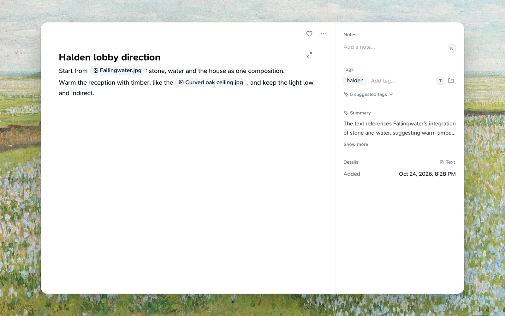

The link shows as a pill with the card's type and its current title, so renaming the card updates every pill that links to it. Click a pill, or select it and press Enter, to open that card. A link to a card in Trash, a deleted card, or a card that isn't yours shows as **Missing card** and does nothing; restoring the card from Trash brings its link back. Links inside code stay plain text.

When you open a card that other notes link to, its details show **Linked from**, with up to 50 of those notes, most recently updated first, and **and more** when there are others. Click one to open it, after any edits to the open card save. Notes in Trash, and notes tagged `secret` or `hidden`, aren't listed. For a card more than 500 notes link to, the list draws on the 500 links made most recently.

On card tiles in your library, on the web and on Mac, iPhone and iPad, a link reads as its title, and search finds a note by a linked card's title. Tiles and search use the title the card had when you linked it; pills always show the current one. Opening the note on Mac, iPhone or iPad shows the link as written: `[[Title|teak:<card-id>]]`, the same form exports, the API, MCP and the CLI use. A note can link to any number of cards, but only its first 500 linked cards list it under **Linked from**.

### Grid

Cards show in a masonry grid that adapts to different sizes and aspect ratios. Links show their site's icon beside the title, notes show their first line as a heading, and audio shows how long it runs.

Rest the pointer on a card to open its link, favorite it, or open **More** (`⋯`) for everything else in its right-click menu.

Click a card to open it. The top holds only its title, favorite, **More** (`⋯`), and one main action: **Open** for a link, **Download** for a file. A note or quote has no title bar, so its content leads. Beside the card are its notes, tags and folders, summary, colors, and details, all editable in place: a note saves on its own as you type (the top shows **Saved** for a moment), and a tag is added when you press `Enter`. Tags Teak added fold under **suggested tags**; open it to keep one as your own tag or remove it. **Details** shows when you added the card, when you saved it again if you did, and its size, with **More details** for the rest. For a link, click its title to rename it.

**More** holds everything else: favorite, mark as done, add to a folder, archive, copy, download, Save PDF, replace the image, More like this, Refresh details, hide or show the details panel, and Delete. Deleting a card shows **Undo**. A card in Trash says so above it, with **Restore** and **Delete Forever**.

The arrows beside the card, or `←` and `→`, step through the cards in the grid's order. They stay in one place whatever the card's size, so you can click quickly and every click moves one card. Photos and videos fill the card, with the title bar showing when you point at them. To read a note or photo full width, hide the details with `I` or **More**; the card remembers that. On a phone the card opens as a sheet from the bottom, with the arrows, favorite, **More**, and **Open** in a bar along the bottom.

In a note on the web, ticked checklist items move to the bottom of their list, below the open ones, and unticking one moves it back up; `⌘Z` puts it back where it was.

To act on many cards at once, click the circle in a card's corner (or right-click it and choose **Select**), then click more cards. The bar across the top of the page archives them in one click, and **More** adds them to favorites or a folder, adds or removes tags, copies their links, or moves them to Trash. In Archive the main action is **Unarchive**, and in Trash it's **Restore**. Archive, Unarchive, and Move to Trash show **Undo** when they finish; if some cards couldn't be changed, they stay selected and **Retry** tries them again.

#### Tables in notes

In a note on the web, type `/table` to add a table with a header row. `Tab` moves to the next cell (and adds a row from the last one), `Shift+Tab` moves back, and `Enter` moves down a column. Point at the table, or press `Alt+F10` in a cell, for the **⋯** menu that adds or deletes rows and columns, or deletes the table. A cell holds one line of text with bold, italic, code and links (but not `[[` card links), and a table can have up to 20 columns and 200 rows. Tables are saved as Markdown, so exports, the API and the apps get the same text; tiles show a table's cells separated by `·`. A pasted Markdown table becomes a table too, unless it aligns its columns or sits in a quote or list, which keeps it as text you can edit.

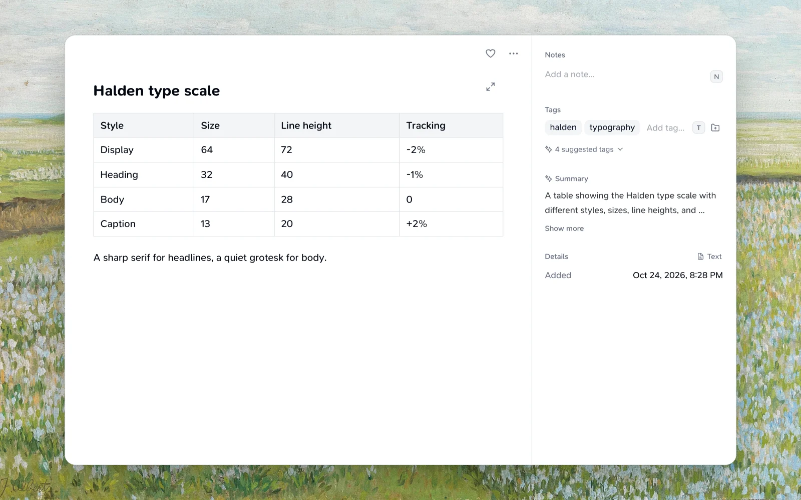

#### Focus mode

To write without distraction, open **Focus**: press `⌘E` (`Ctrl+E` on Windows and Linux) or click the expand button at the top right of a note, or of a new note you're writing. Focus shows only your note in one centered column. The **Close** and **Save** bar fades out while you type and comes back when you move the pointer, and the word count appears when you pause. Press `Esc` or `⌘E` again to leave (with the slash menu or link editor open, `Esc` closes that first); your edits stay, and an existing note saves on its own as it does in the card.

### Keyboard shortcuts

On the web, you can use your library without a mouse. Press `?` anywhere to see every shortcut. Shortcuts never fire while you type in the search box, a note, or any other field. With a card open, its own keys (listed below) and `?` work; any other dialog or menu turns shortcuts off while it's open.

The grid is a single stop when you Tab through the page. Once a card has focus:

| Keys | Action |
| --- | --- |
| Arrow keys | Move to the nearest card in that direction |
| `J` / `K` | Next or previous card, in the grid's order |
| `Enter` | Open the card (`Esc` closes it and returns to the card) |
| `F` | Add to or remove from favorites |
| `T` | Add tags |
| `E` | Archive or unarchive |
| `Delete` (`⌫` on a Mac) | Move to Trash (in Trash, delete forever after you confirm) |
| `X` | Select or deselect the card |
| `⌘C` (`Ctrl+C` on Windows and Linux) | Copy the note's text, the link, or the image |
| `Esc` | Clear the selection |

With a card open:

| Keys | Action |
| --- | --- |
| `←` / `→` (or `K` / `J`) | Previous or next card |
| `F` | Add to or remove from favorites |
| `T` | Add a tag |
| `N` | Write a note |
| `O`, or `⌘Enter` (`Ctrl+Enter` on Windows and Linux) | Open the link, or download the file |
| `C` | Copy the link, or a note's or quote's text |
| `D` | Mark a link as read, watched, bought, and so on |
| `I` | Hide or show the details beside the card |
| `R` | Switch a link between **Preview** and **Read** |
| `H` | Highlight the text selected in **Read** |
| `⌘E` (`Ctrl+E` on Windows and Linux) | Focus on the note: write with nothing else on screen |
| `E` | Archive or unarchive |
| `Delete` (`⌫` on a Mac) | Move to Trash |
| `Esc` | Close the card |

Anywhere in your library:

| Keys | Action |
| --- | --- |
| `/` | Search |
| `N` | Write a new note (opens **Everything** first if needed) |
| `U` | Upload files |
| `G` then `E`, `F`, `A`, or `T` | Go to **Everything**, **Favorites**, **Archive**, or **Trash** |
| `G` then `S` | Go to **Settings** |
| `Alt` `T` (`⌥` `T` on a Mac) | Go to notifications, for example to **Undo** |
| `⌘K` (`Ctrl+K` on Windows and Linux) | Open the command palette |
| `?` | Show the keyboard shortcuts |

Outside Trash, with cards selected, `F`, `T`, `E`, and `Delete` act on all of them, like the bar across the top. Menus, button tooltips, and the sidebar show the key beside each action that has one. Moving past the last card loads more. With nothing focused, `J` or `K` returns to the grid.

#### Command palette

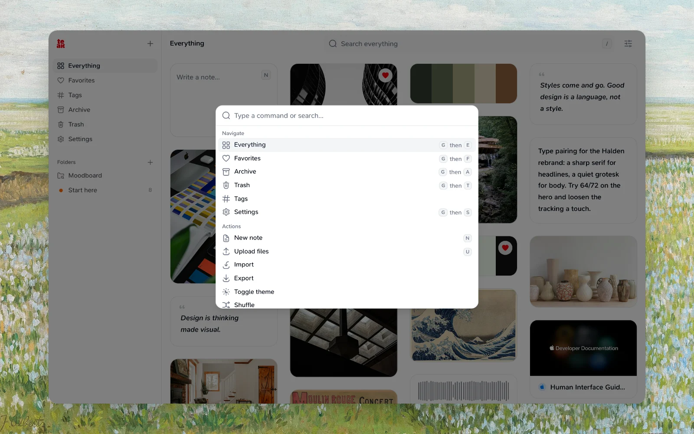

Press `⌘K` (`Ctrl+K` on Windows and Linux) on any page to jump anywhere without the mouse. Type to filter, use the arrow keys to move, and press `Enter` to choose:

- **Go to** Everything, Favorites, Archive, Trash, Tags, Settings, any Settings page (Plan, Appearance, Integrations, Security, Import & export), or any folder or smart folder by name.
- **Find a card:** after two characters, the palette lists up to 8 cards from your search, qualifiers included (`#design`, `type:link`, `site:github.com`). Choose one to open it, or choose **Search all** to see every match. From Archive it searches your archive, and **Search all** stays there; it never shows cards in Trash.
- **Run an action:** New note, Upload files, Import, Export, Toggle theme, Shuffle, Keyboard shortcuts, and Sign out.

Press `⌘K` again or `Esc` to close it, and focus goes back where it was. While you write a note, `⌘K` still adds a link, and while another dialog or menu is open it does nothing.

### Sort and share a search

Cards are ordered by the date you saved them, newest first; [saving a link again](#saving-something-again) moves it to the top. Choose **Oldest first** from the **View** menu beside the search bar to start from the beginning.

A search with words starts in **Best match**: the cards that best match what you typed come first. Teak scores your search's top results the moment you search; if that takes more than a moment, the results stay in their usual order instead of moving while you look at them. Choose **Newest first** from the **View** menu to see your matches by date instead. Imported bookmarks keep their original dates, so they land where they were first saved.

To rediscover what you saved long ago, choose **Shuffle** from the **View** menu. Your cards appear in a random order that stays put while you scroll, so nothing repeats or goes missing. Click **Reshuffle** (the dice beside the **View** menu) for a new order; Back returns to the previous one. Shuffle works in search, tags, folders, Favorites, Archive, and Trash too; a tag or folder with more than 2,000 cards shuffles its newest 2,000.

To tidy up as you go, choose **Revisit** from the **View** menu. Revisit shows 20 random cards from what's on screen (your library, Favorites, a folder, a smart folder, a tag, or a search), one at a time. Press `←` or `A` to archive a card, with **Undo**, and `→` or `K` to keep it; on a touch screen, swipe left or right. `Space` opens the card's details, `Z` takes back the last archive, and `Esc` leaves. When you reach the end, **Revisit 20 more** brings the next cards of the same shuffle, so none repeat; once you've seen them all, **Start over** shuffles again. Revisit isn't offered in Archive or Trash.

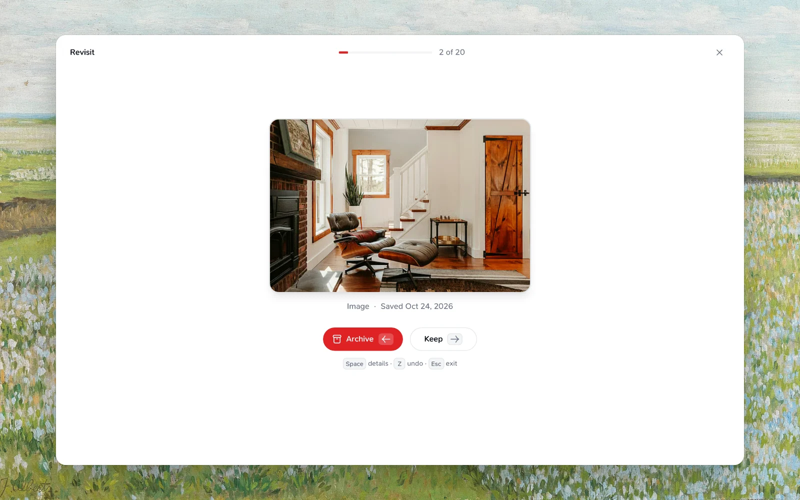

Your search, sort (including the shuffled order and Revisit), and card types stay in the address bar, so reloading the page, the browser's Back and Forward buttons, and links you copy all bring back the same view. A very broad search is sorted within its 400 best matches; add a type, date, or more words to narrow it.

## AI enrichment

Each card is processed automatically:

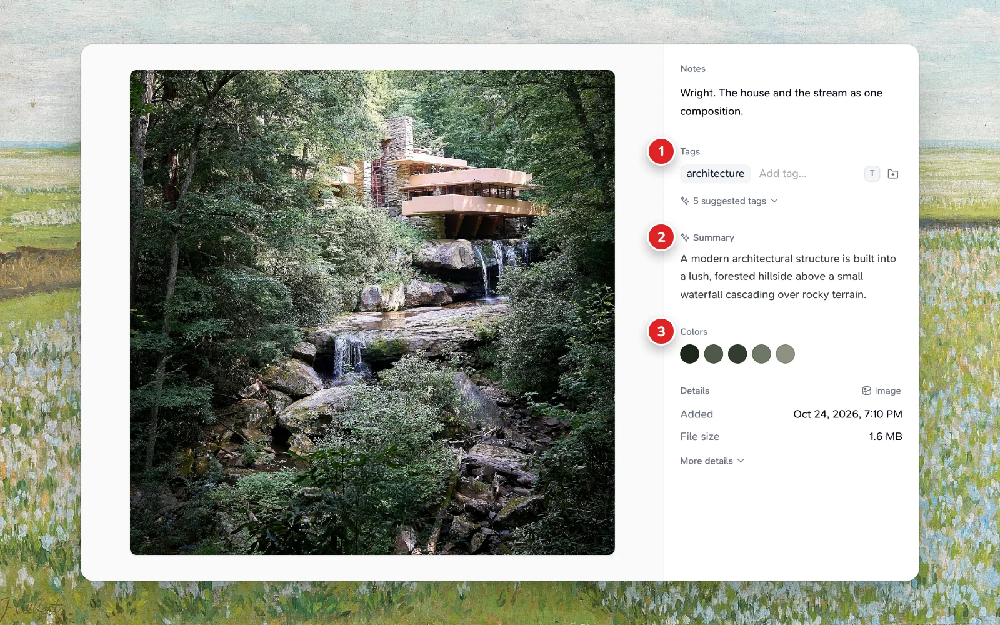

1. **Tags** you added, plus the ones Teak suggests from what it sees.
2. **Summary**: a short description Teak writes, so you can scan without opening the card.
3. **Colors** pulled from the image, which color search uses.

| Feature | Description |
| --- | --- |
| **Auto-tagging** | Keywords and concepts |
| **Summaries** | Short descriptions for scanning |
| **Categorization** | Link type (article, news, book, movie, TV, podcast, music, product, recipe, course, research, event, software, design, place, typeface, social post, app, game, or code repository), read from the page when no site rule fits |
| **Color extraction** | Dominant colors in images |
| **Transcription** | Audio, video, Vimeo captions and podcast episodes → searchable text |
| **Text in images** | Words in images, video thumbnails, link previews and screenshots, and the first 3 pages of scanned PDFs, for search |
| **Thumbnails** | Previews for video and documents |

Summaries and AI tags are written in the language of what you save: a Japanese article gets a Japanese summary and Japanese tags, a Spanish note gets Spanish ones. When something mixes languages, its main language wins. Items with no text to read, such as a photo without words, get English tags. Your own tags are never changed, and visual styles such as `minimal` or `cinematic` stay in English so `mood:` works the same everywhere. Cards saved before this change keep their English AI output until you use **Refresh details**.

### Refresh details

If a summary or tags miss the mark, or a link's preview looks out of date, open the card and choose **Refresh details** from its **More** menu, or right-click it in the grid. Teak clears the card's summary, tags, and transcript and processes it again, reading the link's page again for its preview, and a Vimeo video's captions or a podcast episode's audio again for its transcript. If the page can't be reached, the card keeps the preview it has. Your own tags and notes stay, and so does a highlighted link's saved copy and article. You can refresh a card once a minute, and up to six cards a minute.

### Replace a link's image

If a link's preview image is wrong, missing, or not the one you want, open the card and choose your own: drop an image on the preview, paste one with `⌘V` (`Ctrl+V` on Windows) while no text field has focus, or choose **Replace image** from the card's **⋯** menu. Use a JPEG, PNG, WebP, GIF, or AVIF image under 20 MB; SVG and HEIC images aren't supported yet. A link without an image shows **Add an image** where you can drop one.

Your image shows in the grid and in the card on the web, and in the grids of the iPhone, iPad, and Mac apps. It stays through **Refresh details**. **Undo** in the message that follows puts back the previous image for two minutes. **Reset to original image** goes back to the image Teak found, or its screenshot of the page, and deletes yours.

### Card details

Link cards show who wrote the page and when it was published, next to the site name, when the page says so. Product links show their price as a tag on the card, such as "$24.99", "€1,299.00" or "Free", when the page states one. **Refresh details** on the card reads the price from the page again. **Details**, beside an open card, lists the author, publisher, and publish date, and for photos the camera, exposure, aperture, focal length, ISO, and when the photo was taken. Teak never shows a photo's location.

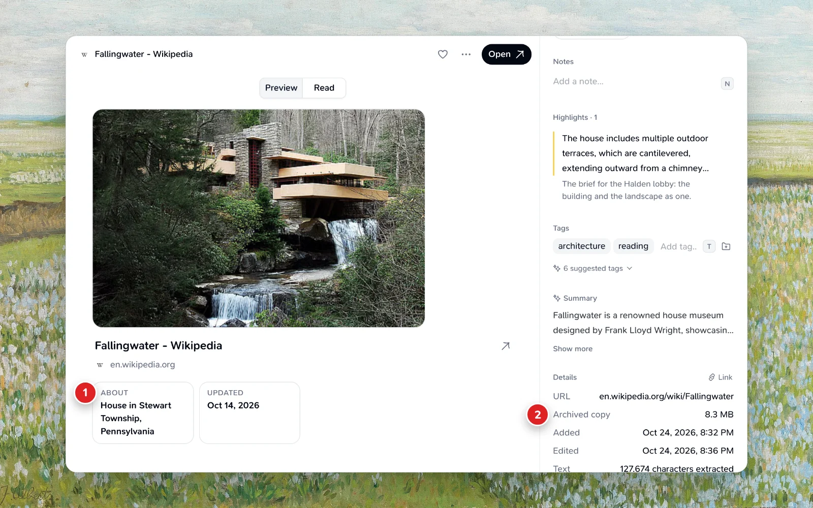

1. Facts the site adds: for Wikipedia, the article's short description and when it was last edited.
2. **Archived copy**: the size of Teak's saved copy of the page.

Places, apps, and games get their own facts when the page publishes them: a restaurant or home's address, cuisine, price range, and rating; an app's platform, category, and rating; and a game's platform, genre, rating, and release date. Code repositories on GitHub show their stars, forks, and language.

Some sites tell Teak more about a link than the page does:

- **Wikipedia:** the article's short description and when it was last edited, and its lead image when the page has none. A disambiguation page says so. The article's opening paragraph also shapes Teak's summary.
- **arXiv:** the paper's authors (the first three, then "et al."), publish date, subject and DOI. The abstract shapes the summary.
- **YouTube:** the channel, the video's length and when it was uploaded.
- **Spotify and Apple Music:** the artist and whether it's a track, album, playlist or episode, with the cover art.
- **Books:** a book page that states its ISBN in its page data (as Goodreads does), or an Amazon book link with its 10-digit ISBN in the address, gets its author, page count, publisher, publish date and ISBN from Open Library, and its cover when the page has none. What the page says itself always wins.

If a site is down or slow, the card keeps the details it had. Links you saved before get these details when you use **Refresh details**.

**Save PDF:** an arXiv paper's card has **Save PDF** under its details. It saves the paper's PDF as its own document card, so you can read it in Teak and search its text; **Open** in the message that follows shows it. Saving the same paper again opens the card you already have. A withdrawn paper has no PDF to save. The PDF counts as a card toward your plan's limit.

**Social posts:** a saved post from X, Instagram, Bluesky, Mastodon, Reddit, TikTok, Threads, LinkedIn, or Substack Notes keeps its text and author, and its date when the site shares it. Bluesky, Mastodon, and Reddit posts keep up to 10 photos, and a video when the site offers it as a file (otherwise its cover image). A TikTok keeps its caption and cover image, and Threads, LinkedIn, and Substack Notes keep the text and image their page shares. A private, deleted, or login-only post is saved like any other page.

## Apps and access

Everything syncs in real time — pick your apps on the [Apps page](/apps).

Sign in with your browser, or create a long-lived key under **Settings → Integrations → API keys**.

### Language

Teak's web app and browser extension are available in English, Español, Português (Brasil), Deutsch, Français, 日本語, 한국어 and 简体中文. Choose one in **Settings → Appearance → Language**. The app switches right away, without reloading, and your choice is saved to your account, so it follows you to every browser you sign in on. Teak starts in English for every account and never guesses from your browser's language.

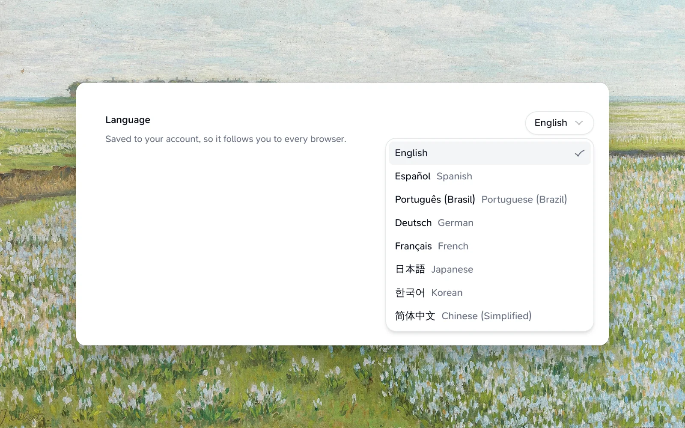

- The browser extension's popup, right-click menu, address bar suggestions and save buttons follow the language once you sign in. Its name in your browser's extensions list follows your browser's language.
- Search words stay in English in every language: qualifiers such as `is:fav`, `type:image` and `tag:`, `OR`, and date words such as `today`.
- Some details Teak adds to cards stay in English: link facts, bylines, price labels and import errors. So do the API, MCP, CLI and these docs.
- The Mac, iPhone, iPad, Android and Raycast apps are in English for now.

### Save by email

Turn on **Settings → Integrations → Save by email**, then send or forward anything to `save@in.teakvault.com` from the email address you sign in to Teak with.

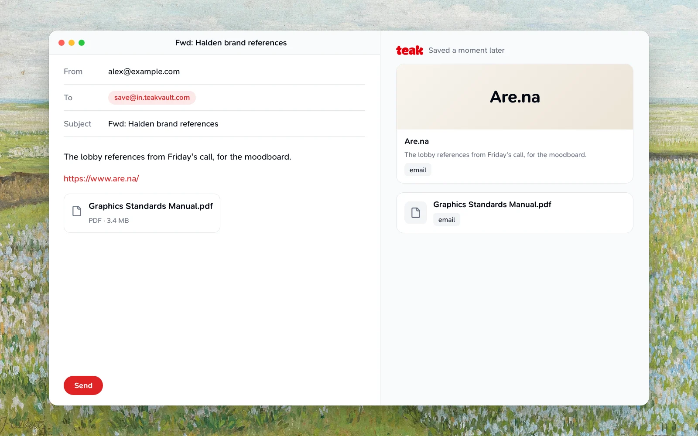

- An email that's just a link, with at most a sentence or two, becomes a link card, and the sentence becomes its note. A link you already have, emailed on its own, moves that card to the top instead; with a sentence around it, it makes a new card. Anything else becomes a note, headed with the subject. Tracking images and redirect wrappers are removed, and a forwarded email's "Fwd:" and forwarding header are dropped.
- Attachments become their own cards, with the same formats as uploads. An email can carry about 18 MB of attachments in total.
- Every card is tagged `email`.
- Mail from any other address isn't saved, and neither is mail that fails its domain's sender checks (DMARC); your mail app shows it was refused. Forwarding from a work account only works if that's the email you sign in with.
- Mail past 60 emails an hour, or once a free account has 200 cards, is dropped without a reply.

