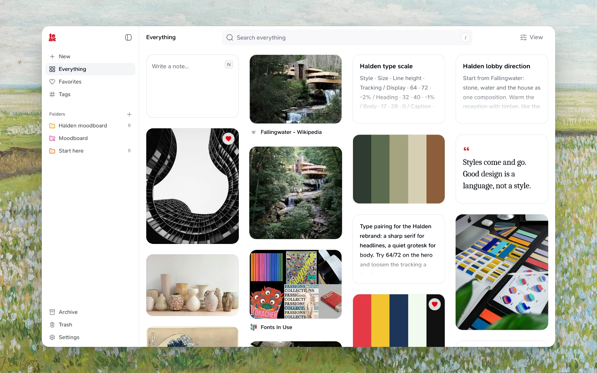

Teak is a personal library for links, notes, images, files and more. Save from any device, and Teak tags and describes everything so a short search finds it again.

## Get started

<CardGroup cols={2}>
  <Card title="Features" href="/docs/features" icon="sparkles">
    Card types, search, folders, and AI enrichment.
  </Card>
  <Card title="Apps" href="/apps" icon="layout-grid">
    Web, Mac, iPhone, iPad, Android, browser extensions, Raycast, and CLI.
  </Card>
  <Card title="Browser extensions" href="/docs/extension" icon="puzzle">
    Save pages, images, and selected text in one click.
  </Card>
  <Card title="Import" href="/docs/import" icon="download">
    Bookmarks, Raindrop, or a Teak archive.
  </Card>
  <Card title="Export" href="/docs/export" icon="upload">
    Download a portable ZIP of your library.
  </Card>
  <Card title="API & agents" href="/docs/ai-agents" icon="code">
    REST API, MCP, SDK, and agent skills.
  </Card>
</CardGroup>

## Help

<CardGroup cols={3}>
  <Card title="Support" href="/docs/support" icon="life-buoy">
    Troubleshooting, contact, and bug reports.
  </Card>
  <Card title="Privacy Policy" href="/docs/privacy-policy" icon="shield">
    How we handle your data.
  </Card>
  <Card title="Terms of Service" href="/docs/terms-of-service" icon="file-text">
    Rules for using Teak.
  </Card>
</CardGroup>
