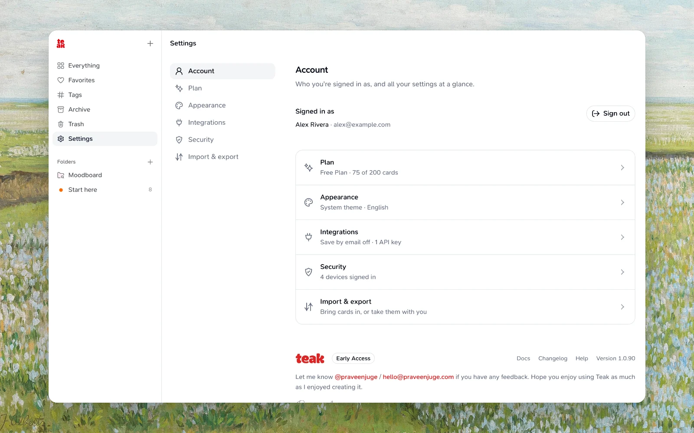

## Troubleshooting

Refresh or relaunch the app, check that you're signed in and online, and update to the latest version. Each app's page has its own troubleshooting: [Mac](/docs/mac), [iPhone and iPad](/docs/mobile), [Android](/docs/android), [browser extension](/docs/extension), [Raycast](/docs/raycast) and [CLI](/docs/cli). For the [API](/docs/api) and [MCP](/docs/mcp), check that your API key is still active in **Settings → Integrations**.

**Settings → Account** shows who you're signed in as, with a summary of your plan, appearance, integrations, security and imports.

## Contact

Email hello@praveenjuge.com; we usually reply within 24–48 hours. For billing, use **Settings → Plan** (**Continue to checkout**, or **Manage subscription** on Pro).

## Bug reports and feature requests

Open a [GitHub issue](https://github.com/praveenjuge/teak/issues) with the steps to reproduce, what you expected and what happened, and your app, browser or OS version. Label feature requests **enhancement**.

Follow updates on [X](https://x.com/praveenjuge).

<GithubInfo />
